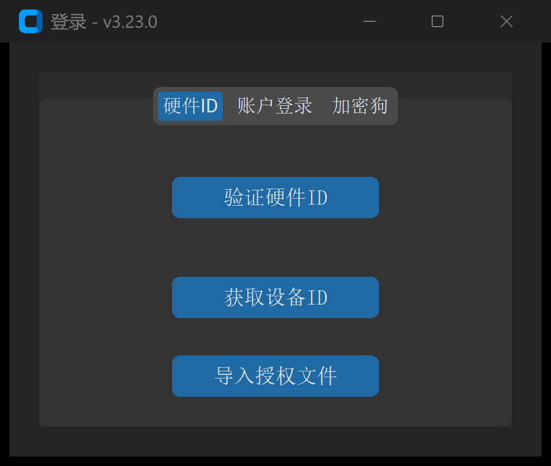

# 1.1 安装与授权激活

本节介绍 **干涉磨削砂轮修整软件（IGD v3.23.0）** 的运行环境、配置文件目录、后台进程池加速特性及 4 种授权激活方式。

---

## 系统环境要求

为确保高密度螺旋面点云（`最终曲线点密度` ≥ 600）与多直径并行包络求解流畅运行，建议配置如下：

| 配置项 | 最低要求 | 推荐工程配置 |
| :--- | :--- | :--- |
| **操作系统** | Windows 10 (64-bit) / macOS 12+ | Windows 10 / 11 专业版 (64-bit) |
| **处理器 (CPU)** | Intel Core i5 / AMD Ryzen 5（4 核及以上） | Intel Core i7 / Ryzen 7（8 核及以上，高主频） |
| **内存 (RAM)** | 8 GB | 16 GB 及以上 |
| **显示器分辨率** | 1366 × 768（100% 缩放） | 1920 × 1080 或 2560 × 1440 |
| **外设与浏览器** | USB 2.0/3.0 接口（使用加密狗时） | Chrome / Edge（用于查看 3D HTML 报告） |

* **Windows 专属加密组件**：`高级参数 -> 初始化配置` 中的 **`Siemens程序加密`** 依赖 Windows 专用外部编译组件，仅在 Windows 系统下生效。
* **macOS 触控板支持**：macOS 版支持原生双指捏合缩放与双指滚动缩放交互画布。

---

## 安装与配置目录

1. **软件部署与后台预热**：
   * 解压发行包至本地非系统保护目录（如 `D:\IGD_Software\`），双击启动主程序；
   * 授权校验通过后，软件会在后台自动**预热常驻多核计算进程池与 Numba 磁盘缓存**，并将子进程生命周期绑定至主窗口，大幅缩短首次多直径计算耗时（多档包络仅约 8 秒）且退出时无残留进程。
2. **用户配置目录（`~/.igd`）**：
   软件首次运行会在系统用户主目录（如 `C:\Users\<用户名>\.igd\` 或 `~/.igd/`）下初始化配置文件，升级版本时不覆盖历史数据：
   * `igd_config_main.json`：保存 `基本参数`、`高级参数`、`language_code` 与 `ui_scaling`；
   * `igd_config_draw.json`：保存 `绘图工具` 全部子模块参数；
   * `igd_config_tool.json`：保存 `工具箱` 全部子模块参数；
   * `igd_license.lic`：导入离线数字签名授权后生成的本地许可凭证；
   * `PartsLibrary/`：保存用户在 `工具 -> 零件库` 中归档的三文件独立配置包。

---

## 四种授权激活方式

启动软件时按优先级自动检测授权；未自动通过时弹出登录窗口，支持以下 4 种方式：

### 方式 1：USB 硬件加密狗（推荐）

* 将配发的 USB 加密狗插入计算机，启动软件即可直接跳过登录界面；
* 进入主界面后，左下角状态栏显示 **`🟢 加密狗授权已激活`**；
* 若启动后才插入加密狗，可切换至 **`加密狗`** 标签页点击 **`验证加密狗`**；
* **热插拔保护**：后台守护线程每 **3 秒**自动巡检一次硬件；运行期间拔出加密狗将自动安全退出，计算途中掉线将拦截并提示 `加密狗已断开或会话已失效，无法执行核心计算！`。

### 方式 2：导入授权文件（`.lic`）

* 点击登录窗口中的 **`导入授权文件`** 按钮，选中官方签发的 `*.lic` 授权文件；
* 验证签名与有效期通过后自动写入 `~/.igd/igd_license.lic` 并进入主界面。

### 方式 3：硬件 ID 离线激活

* 切换至 **`硬件ID`** 标签页，点击 **`获取设备ID`** 获取本机硬件特征码；
* 将特征码提交技术支持换取授权配置后，点击 **`验证硬件ID`** 完成绑定。

### 方式 4：账户登录与注册

* 在 **`账户登录`** 标签页输入 **`用户名`** 与 **`密码`**，点击 **`登录`**；
* 首次使用可点击 **`注册`**，填写 `用户名`、`密码`、`确认密码`、官方发放的 `注册码` 与本机 `硬件ID` 完成激活。

---

## 定制版模块权限

IGD 根据当前加密狗或 `.lic` 许可中的 UI 策略动态适配功能可见性：

* **标准全功能版**：开放 4 大主标签页、全部 14 种数控 `程序模式` 及全部工具箱模块；
* **专机定制版**：仅显示对应机床适用的 `程序模式` 与必需参数栏，防止现场操作工误触无关变量；如需增开模块请联系技术支持更新授权。
