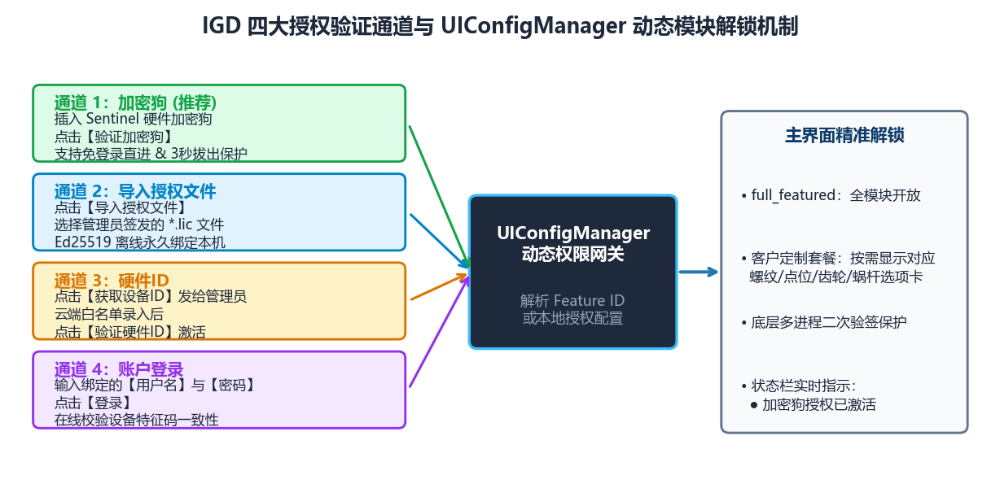

# 1.1 系统要求、安装与授权激活

本节介绍 **IGD 磨削修整计算软件** 的软硬件运行环境、安装启动流程，以及 **4 种授权验证机制** 的具体操作方法。

---

## 一、系统环境要求

为保证三维螺旋面高密度点云（`最终曲线点密度` $\ge 600$）空间啮合包络求解与交互式 3D 视图渲染流畅，建议运行环境满足以下配置：

| 配置项 | 最低要求 | 推荐工程配置 |
| :--- | :--- | :--- |
| **操作系统** | Windows 10 (64-bit) / macOS 12+ | Windows 10 / 11 专业版 (64-bit) |
| **处理器 (CPU)** | Intel Core i5 / AMD Ryzen 5（4 核及以上） | Intel Core i7 / Ryzen 7（8 核及以上，高主频有利于包络迭代） |
| **内存 (RAM)** | 8 GB | 16 GB 及以上 |
| **显示器分辨率** | $1366 \times 768$（缩放比例 100%） | $1920 \times 1080$ 或 $2560 \times 1440$（推荐 100%~125% 缩放） |
| **外设与浏览器** | USB 2.0/3.0 接口（使用硬件加密狗时） | Chrome / Edge 现代浏览器（用于查看交互式 3D HTML 报告） |

> **平台特性说明**：`高级参数 -> 初始化配置` 中的 **`Siemens程序加密`**（将明文 `.SPF` 自动编译加密为 `.CPF`）依赖 Windows 平台专用加密组件，仅在 Windows 系统下可勾选生效。

---

## 二、软件安装与用户数据目录

1. **安装或解压**：运行官方安装包或将绿色发行版解压至本地非系统保护目录（例如 `D:\IGD_Software\`），双击主程序 `IGD.exe` 启动。
2. **本地配置与零件库目录（`~/.igd`）**：
   软件首次启动时，会在当前操作系统用户主目录下自动初始化隐藏工作区文件夹 `C:\Users\<用户名>\.igd\`，用于持久化保存所有个性化设置与工程数据，软件升级时不会覆盖此目录：
   * `config.json`：记录界面语言（`中文` / `English`）与全局系统参数；
   * `last_settings.json`：自动记忆上一次成功执行 `生成代码` 时的全部界面参数，下次启动软件时自动恢复；
   * `PartsLibrary/`：存放用户在 `工具 -> 零件库` 中归档的所有典型工件配置包。

---

## 三、软件授权与激活流程

软件内置多重授权校验机制。启动 `IGD.exe` 时，系统会按以下优先级自动检测授权状态：

### 方式 1：USB 硬件加密狗（推荐现场离线工控机使用）

1. 将官方配发的 **USB 硬件加密狗** 插入计算机 USB 接口；
2. 启动软件，系统若检测到有效加密狗且在授权有效期内，将**直接跳过登录弹窗**进入主界面，并在软件左下角状态栏显示：
   * `🟢 加密狗授权已激活`
3. 若软件已处于登录窗口，再插入加密狗，可切换至 **`加密狗`** 标签页并点击 **`验证加密狗`** 按钮立即激活。
4. **运行期热插拔保护**：加密狗激活状态下，后台守护线程每 30 秒自动巡检一次硬件连接。若运行途中拔出加密狗，软件将弹出 **`加密狗连接断开，程序即将关闭！`** 警告并安全退出。

### 方式 2：导入离线授权文件（`.lic`）

适用于无外网环境且已绑定工控机硬件指纹或加密狗序列号的场景：

1. 在登录窗口底部点击 **`导入授权文件`** 按钮；
2. 在文件选择对话框中选中官方签发的授权文件（`*.lic`）；
3. 系统验证签名与有效期通过后，自动将其保存至本地配置目录并弹出 **`授权文件导入成功！`**，随后直接进入主界面。

### 方式 3：硬件 ID 离线激活

1. 在登录窗口切换至 **`硬件ID`** 标签页；
2. 点击 **`获取设备ID`**，系统自动采集当前计算机主板与硬件特征码并填入文本框；
3. 将该硬件 ID 发送给技术支持人员获取对应的离线授权或验证配置后，点击 **`验证硬件ID`** 完成本机绑定激活。

### 方式 4：账户密码登录与注册

1. 若采用账号授权模式，在 **`账户登录`** 标签页输入 **`用户名`** 与 **`密码`**，点击 **`登录`**；
2. 首次使用账户模式的设备，可点击窗口右上角 **`注册`** 按钮切换至注册面板，在 **`账户注册`** 标签页填写 `用户名`、`密码`、`确认密码`、官方发放的 `注册码` 与本机 `硬件ID`，点击 **`注册`** 完成激活。

---

## 四、定制版模块权限说明（动态界面适配）

IGD 支持按客户机型与工艺包（通过许可证中的配置策略）动态裁剪或开放界面模块：

* **标准全功能版**：开放全部 4 大主标签页（`基本参数`、`高级参数`、`绘图工具`、`工具箱`）、全部 13 种数控 `程序模式` 及所有子模块；
* **专机定制版**：若您看到的界面仅显示部分 `程序模式`（例如仅保留适配本厂机床的 `模式-0` 或 `模式-5`）或隐藏了部分非标建模标签页，属于当前授权许可证对应的**专机精简视图**，旨在防止现场操作工误触无关机床宏变量。如需开通额外模块，请联系技术支持更新 `.lic` 授权文件。
