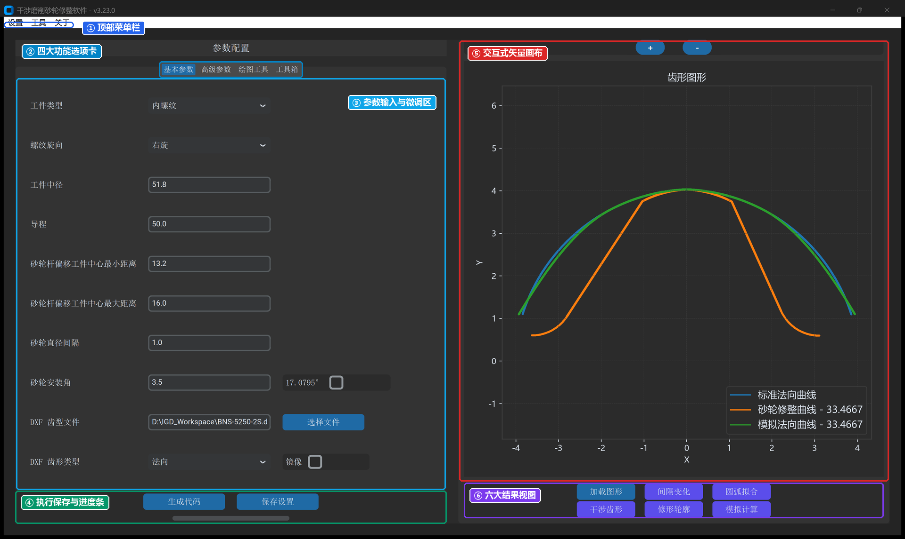
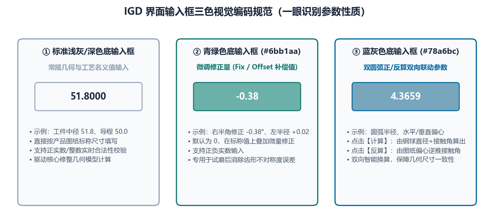

# 1.2 界面布局与交互

主窗口采用**左侧参数控制面板 + 右侧交互式绘图画布**的双栏分屏结构，全局划分为 **6 大核心功能区域**。

---

## 主界面六大区域

* **① 顶部菜单栏（`设置` / `工具` / `关于`）**：
  * **`设置`**：`中文` / `English` 实时切换（无需重启）、`检查更新`、`更新日志`；
  * **`工具`**：打开 `零件库` 独立管理窗口；
  * **`关于`**：访问官方网站、在线手册与版本信息。
* **② 四大功能选项卡**：
  * **`基本参数`**：工件螺旋参数、DXF 导入、砂轮范围与安装角；
  * **`高级参数`**：分为 `初始化配置`（滚轮补偿/侧边修正/圆弧拟合）与 `程序信息`（14 种程序模板/轴名称）；
  * **`绘图工具`**：参数化生成 `螺纹`、`XY 点位文件`、`齿轮`、`蜗杆` DXF；
  * **`工具箱`**：集成 6 大分析检验、DXF 批处理与成形车刀设计工具。
* **③ 参数输入与微调区**：承载当前选项卡下的几何输入、补偿微调框与选项开关。
* **④ 执行保存与进度条**：
  * **`生成代码`**（主执行按钮，随当前标签页动态切换功能名称）；
  * **`保存设置`** + 多核计算进度条（插入 USB 加密狗启动时左下角同步显示 **`🟢 加密狗授权已激活`**）。
* **⑤ 交互式矢量画布**：高精度矢量绘图区，右上/光标实时追踪坐标 `(X, Y)` 与切线夹角。
* **⑥ 六大结果视图**：计算后依次激活 **`加载图形`**、**`间隔变化`**、**`圆弧拟合`**、**`干涉齿形`**、**`修形轮廓`**、**`模拟计算`**（在工具箱分析页面自动切换为 **`误差曲线`** / **`刷新`** 等专属按钮）。

---

## 输入框三色视觉编码

* **标准灰白/深色底框**：直接按产品图纸与砂轮实物填写的公称基准值；
* **青绿色底框（`#6bb1aa`）**：现场试磨增量微调框（默认 `0`），按 `实际值 = 左框公称值 + 右框微调值` 生效，无需改动图纸名义值；
* **蓝灰色底框（`#78a6bc`）**：专用于 `绘图工具 -> 螺纹 -> 双圆弧` 半径与偏心联动，点击 `计算` 自动填入、点击 `反算` 支持输入反推接触角。

---

## 右侧画布交互操作

* **缩放操作**：
  * 鼠标滚轮围绕光标位置缩放；
  * 画布顶部 **`[+]` / `[-]`** 按钮步进缩放；
  * **macOS 触控板**支持双指捏合缩放与双指滚动缩放。
* **平移与视角**：2D 曲线按住鼠标左键拖拽平移；3D 视图（`最大偏移`）按住左键 360° 旋转、右键上下拖动缩放；
* **双击复位**：画布任意位置双击左键立即居中还原最佳比例；
* **悬停拾取**：移动光标至曲线附近自动显示精确坐标 `(X, Y)` 与夹角。
