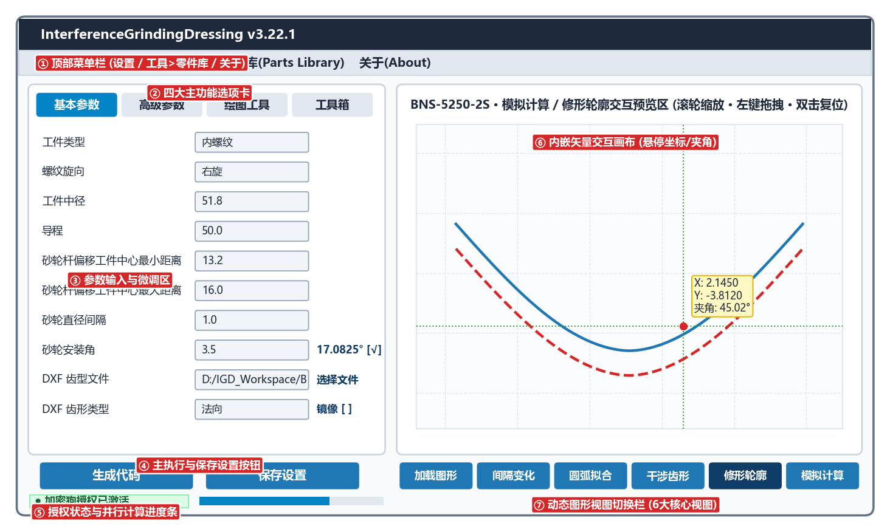
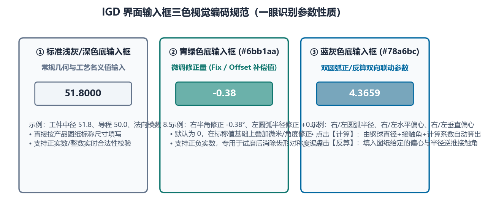

# 1.2 主界面布局、三色输入框与画布操作

成功进入 **IGD** 主窗口后，软件采用工业 CAE 软件经典的**“左参数控制面板 + 右交互式绘图画布”**双栏分屏架构。理解界面分区与**输入框三色视觉编码规范**是高效操作本软件的基础。

---

## 一、主界面五大功能分区

如上图所示，主窗口由五大核心区域构成：

1. **① 顶部系统菜单栏**
   * **`设置`**：支持实时切换界面 **`语言`**（`中文` / `English`，无需重启）、执行 **`检查更新`** 以及查看版本 **`更新日志`**；
   * **`工具`**：打开 **`零件库`** 管理窗口，支持将常用工件的完整参数与 DXF 齿形一键归档或回填；
   * **`关于`**：提供 **`官方网站`**、**`用户手册`** 与 **`关于我们`** 入口。
2. **② 左侧四大核心工作台标签页**
   * **`基本参数`**：日常磨削修整计算最核心的输入面板，定义工件螺旋参数、导入 `DXF 齿型文件` 并设置砂轮直径/杆偏移范围与安装角；
   * **`高级参数`**：分为 **`初始化配置`**（滚轮半径、点密度、延长高度、圆弧拟合、特殊工艺开关）与 **`程序信息`**（13 种数控系统 `程序模式` 与修整轴定义）；
   * **`绘图工具`**：内置参数化标准齿形生成器，涵盖 **`螺纹`**（`三角` / `梯形` / `双圆弧`）、**`XY 点位文件`**、**`齿轮`**（`渐开线`）与 **`蜗杆`**（7 种包络蜗杆），底部操作按钮为 **`生成齿形文件`**；
   * **`工具箱`**：集成 6 大工程辅助与仿真校验工具（`最大偏移`、`滚道曲线计算`、`DXF 处理`、`曲线转换`、`曲线误差对比`、`车刀计算`）。
3. **③ 左下角主操作与授权状态区**
   * 当处于 `基本参数` 或 `高级参数` 标签页时，底部主按钮显示为 **`生成代码`**（快捷键或鼠标点击触发空间包络修整计算）；
   * 当切换至 `绘图工具` 或 `工具箱` 各子标签页时，底部主按钮会**自动切换**为对应模块的专属执行按钮（如 `生成齿形文件`、`生成工件截面曲线`、`生成车刀数据` 等）；
   * 最下方状态栏实时显示当前加密狗或授权激活状态（如 `🟢 加密狗授权已激活`）。
4. **④ 右侧交互式绘图画布（Matplotlib 工具栏 + 主绘图区）**
   * 顶部集成标准图形交互工具栏（复位视图、回退/前进、平移拖曳、框选局部放大、保存高清图片），鼠标在画布内移动时右上角实时显示当前十字光标的精确物理坐标 $(X, Y)$（单位：$\text{mm}$ 或 $\mu\text{m}$）。
5. **⑤ 右下角多视图切换栏**
   * 在执行 `生成代码` 后，右下角提供 6 个核心计算结果视图按钮：**`加载图形`**、**`间隔变化`**、**`圆弧拟合`**、**`干涉齿形`**、**`修形轮廓`**、**`模拟计算`**；
   * 当在 `工具箱` 中执行 `滚道曲线计算` 或 `曲线误差对比` 时，该区域还会动态浮现紫色的 **`误差曲线`** 专属分析按钮。

---

## 二、输入框三色视觉编码规范（核心交互约定）

在 `基本参数`、`绘图工具` 与 `工具箱` 的眾多参数行中，您会看到三种不同背景颜色的输入框。这是 IGD 专为**“理论标准值 + 现场工艺微调补偿”**设计的视觉编码体系：

| 输入框背景色 | 色值标识 | 属性定位 | 工程含义与操作规范 |
| :--- | :--- | :--- | :--- |
| **标准白色底框** | `#FFFFFF`（深色模式下为标准底色） | **基础设计输入项** | 根据产品加工图纸或机床刀具规格**必填**的公称几何参数（如 `工件中径`、`导程`、`最大砂轮直径`、`滚轮圆弧半径` 等）。 |
| **青绿色底框** | `#6bb1aa` | **公差微调 / 偏置补偿项** | 紧跟在基础参数右侧的**增量修正框**（默认值为 `0`）。用于在**不破坏图纸公称参数**的前提下，输入现场试磨后的角度微调量、直径磨损补偿量或变位修正量。 **叠加法则**：$\text{实际生效值} = \text{左侧白底标准值} + \text{右侧青绿框微调值}$。 |
| **蓝灰色底框** | `#78a6bc` | **正向自动计算结果 / 逆向反算输入项** | 专用于 `绘图工具 -> 螺纹 -> 双圆弧` 面板中的圆弧半径与水平/垂直偏心参数： • 点击 **`计算`** 时：系统由 `计算系数`、`钢球直径`、`接触角` 自动推算这 6 个参数并填入蓝灰色框； • 点击 **`反算`** 时：允许工程师直接在蓝灰色框内填入图纸给定的圆弧半径与偏心值，逆向解算接触角与圆弧过渡。 |

> **现场调机最佳实践**：例如在 `绘图工具 -> 螺纹 -> 梯形` 中，图纸要求半角为 $15^\circ$，但三坐标实测磨出的螺纹牙型半角偏小 $0.05^\circ$。此时**切勿修改**左侧白底框中的 `15`，而应在右侧 **`#6bb1aa` 青绿色修正框**中输入 `0.05`（或 `-0.05`）。这样既保留了图纸原始基准 `15`，又清晰记录了本次修整的工艺补偿量。

---

## 三、右侧绘图画布快捷操作指南

右侧画布支持亚微米级局部细节放大审阅（例如放大到 $0.001\text{ mm}$ 级别检查齿根倒圆过渡或双圆弧交点 $X=0$ 处的台阶差）：

* **框选放大（Zoom）**：点击画布顶部工具栏的 **放大镜图标**，在画布上按住鼠标左键拖拽拉出矩形框，即可将齿顶、齿根或圆弧拟合段放大至微米级视野；
* **自由平移（Pan）**：点击 **十字箭头图标**，按住鼠标左键拖动可平移视图；按住鼠标右键拖动可按比例缩放坐标轴；
* **一键复位（Home）**：点击最左侧 **房屋图标**，立即恢复全景自适应比例视图；
* **高分辨率截图保存（Save）**：点击 **软盘图标**，可将当前画布视图导出为高分辨率 `.png`、`.svg` 或 `.pdf` 矢量图，用于编制车间工艺卡。

