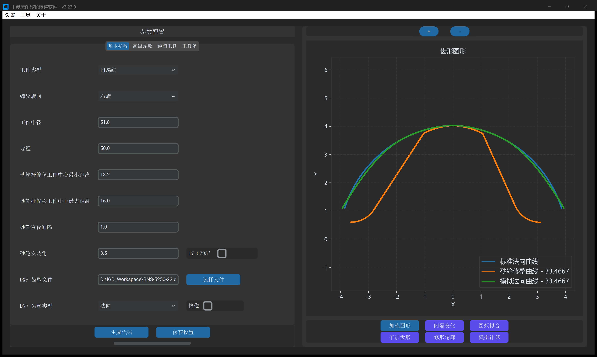

# 2. 基本参数

**`基本参数`** 是空间螺旋面包络干涉计算的入口面板，用于设置工件螺旋几何、导入 DXF 截面齿型，并配置砂轮直径范围与安装角度。

---

## 本章内容

* **[2.1 工件与螺旋参数](workpiece_params.md)**
  * `工件类型`（`内螺纹` / `外螺纹`）与 `螺纹旋向`（`右旋` / `左旋`）的空间啮合差异；
  * `工件中径`、`导程` 设定及理论螺旋升角自动同步规则。
* **[2.2 DXF 导入与截面类型](dxf_import.md)**
  * DXF 局部坐标系规范（Y = 0 对齐工件中径）与图元连续性要求；
  * 伴随文件 `*-info.txt` 自动识别回填机制；
  * 三种 `DXF 齿形类型`（`法向` / `轴向` / `端面(左)`）与 `镜像` 翻转。
* **[2.3 砂轮范围与安装角](grinding_params.md)**
  * `砂轮杆偏移` 与 `砂轮直径` 双输入模式及其换算关系；
  * `砂轮直径间隔` 分档机制及 `模式-10` / `模式-99` 单直径锁定；
  * `砂轮安装角` 受限工况下的空间干涉影响与调优准则。
