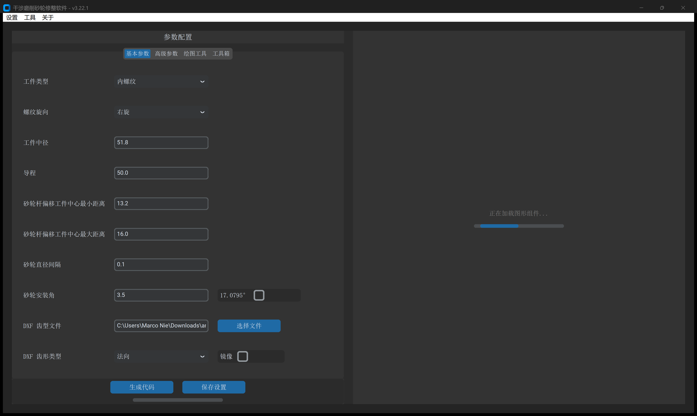

# 第 2 章 基本参数：工件、齿形与砂轮定义

**`基本参数`** 是执行空间包络干涉计算的第一入口。在本面板中定义目标工件的螺旋面参数、导入 DXF 齿型文件，并给定砂轮工作范围与安装角度。

---

## 本章导航

- **[2.1 工件几何与螺旋方向](workpiece_params.md)**：
  - `工件类型`（`内螺纹` / `外螺纹`）空间拓扑差异。
  - `螺纹旋向`（`右旋` / `左旋`）对称与非对称型面规律。
  - `工件中径` 与 `导程` 设定及中径理论螺旋升角 $\lambda$ 实时联动计算。
- **[2.2 DXF 齿型文件导入、齿形类型与镜像](dxf_import.md)**：
  - DXF 齿槽曲线局部坐标系规范（$Y=0$ 必须位于中径）。
  - `*-info.txt` 伴随文件参数自动识别与回填。
  - 三种 `DXF 齿形类型`（`法向`、`轴向`、`端面(左)`）与 `镜像` 翻转时机。
- **[2.3 砂轮直径/杆偏移范围、间隔与安装角](grinding_params.md)**：
  - `砂轮杆偏移` 与 `砂轮直径` 双输入模式的几何转换。
  - `砂轮直径间隔` 阶梯步进与宏程序条件分支（`IF...GOTO...`）。
  - `砂轮安装角` 倾斜受限时的接触线二次干涉机理与调优准则。
