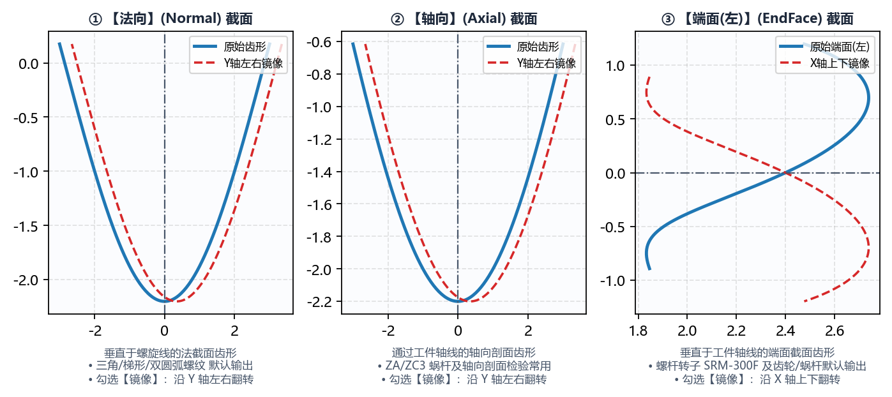

# 2.2 DXF 导入与截面类型

在配置完成工件螺旋参数后，导入目标齿槽 DXF 文件，并准确选择截面定义类型（`法向` / `轴向` / `端面(左)`）。

---

## DXF 坐标系与伴随文件

点击 **`DXF 齿型文件`** 右侧 **`选择文件`** 导入 `.dxf`（支持 `LINE`、`ARC`、`SPLINE`、`LWPOLYLINE`），右侧画布 `加载图形` 视图会立即绘制原始轮廓。

### 局部坐标系规范

* **X 轴（水平）**：沿齿槽宽度方向，推荐以齿槽中心对称线为 `X = 0`；
* **Y 轴（垂直）**：沿工件径向，**必须以 `工件中径` 所在直径作为 `Y = 0` 基准线**：
  * **`内螺纹`**：滚道底部（大径方向）位于 `Y > 0`；
  * **`外螺纹`**：中径为 `Y = 0`，齿顶位于 `Y > 0`，齿根位于 `Y < 0`；
* **单轮廓纯净性**：DXF 内应仅含**一条连续完整的单齿/单槽有效轮廓**，清除图框、中心线、标注文字等辅助图元。

### `*-info.txt` 自动识别回填

使用 **`绘图工具`** 生成 `xxx.dxf` 时，同目录下会自动创建元数据文件 **`xxx-info.txt`**：

* **自动回填基本参数**：通过 `选择文件` 加载 `xxx.dxf` 时，自动读取 `工件中径` 与 `导程` 写入 `基本参数` 并重算螺旋升角；
* **写入 G 代码注释**：当 `高级参数 -> 程序信息 -> 程序头加载齿形信息` 设为 `是` 时，自动将详细参数写入宏程序头部注释以便机台核对。

---

## 三种截面类型与镜像

| `DXF 齿形类型` | 空间几何定义 | 典型来源与适用工件 |
| :--- | :--- | :--- |
| **`法向`**（默认） | 垂直于中径螺旋线切线的法向截面（N-N） | • `绘图工具 -> 螺纹`（三角/梯形/双圆弧）输出 • 法向直廓蜗杆（`ZN1`）、法向基准齿形图纸 |
| **`轴向`** | 包含工件回转轴线的轴向纵截面（A-A） | • 轴向剖视图纸、阿基米德蜗杆（`ZA`）、轴向圆弧蜗杆（`ZC3`） • 轴向扫描实测齿形 |
| **`端面(左)`** | 垂直于工件回转轴线的端面横截面（T-T） | • 双螺杆压缩机阴阳转子（如 `SRM-300F`、`SRM-301M`） • `绘图工具 -> 齿轮` 与 `蜗杆` 输出端面 DXF |

* **类型严禁选错**：大螺旋角工件的 `法向` 与 `轴向` 齿宽约差 `1 / cos(λ)`，与 `端面` 约差 `1 / sin(λ)`，误选会导致计算截面严重失真。

### `镜像` 复选框

* **几何行为**：导入第一步沿 `X = 0`（Y 轴）水平镜像翻转 `(x, y) → (-x, y)` 并同步反转点序；
* **常见用途**：
  * 适配非对称型面（如转子、锯齿螺纹）因视图方向或机床左右装夹差异引起的迎背刃对调；
  * 勾选后在 `加载图形` 视图直观确认左右齿侧与砂轮修整方向一致。

