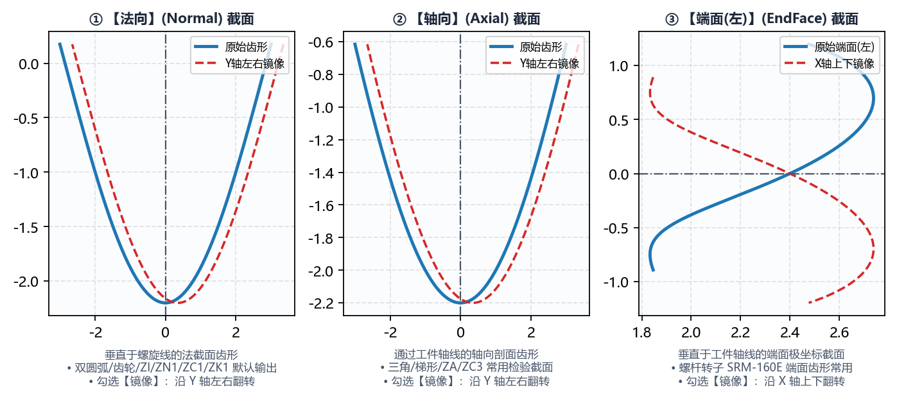

# 2.2 DXF 齿型文件导入、齿形类型与镜像

在定义好工件螺旋参数后，下一步是通过 **`DXF 齿型文件`** 导入目标工件的标准齿槽（或齿体）截面曲线，并正确声明该曲线所属的空间截面类型（**`DXF 齿形类型`**）。

---

## 一、`DXF 齿型文件` 导入规范与坐标系约定

点击 **`DXF 齿型文件`** 右侧的 **`选择文件`** 按钮，选择目标 `.dxf` 文件后，软件会自动解析其中的几何图元（支持 `LINE` 直线、`ARC` 圆弧、`SPLINE` 样条曲线、`LWPOLYLINE` 多段线），并在右侧画布的 **`加载图形`** 视图中绘出原始齿形曲线。

### 1. 标准 DXF 齿形局部坐标系约定

为使空间螺旋面包络计算准确对应到工件直径方向与轴向，导入的 DXF 齿形须遵循以下坐标系标准（由软件内置 **`绘图工具`** 生成的所有 DXF 文件均已自动严格遵循此标准）：

* **水平轴（$X$ 轴）**：代表齿槽宽度方向，推荐以齿槽中心对称线为 $X = 0$；
* **垂直轴（$Y$ 轴）**：代表工件径向高度方向，**必须以 `工件中径` ($d_2$) 所在位置作为 $Y = 0$ 基准线**！
  * 对于 **`内螺纹`**：齿底（大径处）位于 $Y > 0$（或按法向修整反转后位于底部），软件内部会根据 `工件类型` 自动对齐径向朝向；
  * 对于 **`外螺纹`**：分度圆/中径位于 $Y = 0$，齿顶位于 $Y > 0$，齿根位于 $Y < 0$。
* **曲线连续性要求**：DXF 中应仅包含**单条连续的完整齿槽（或单齿）有效轮廓线**，切勿保留图框、中心点画线、尺寸标注文字或多余的封闭辅助框，否则会导致离散化排序异常。

### 2. 伴随文件 `*-info.txt` 的智能识别与参数自动回填

当您使用软件内置的 **`绘图工具`**（无论是 `螺纹`、`齿轮` 还是 `蜗杆`）点击 `生成齿形文件` 保存 `xxx.dxf` 时，软件会在同一文件夹下自动生成同名的 **`xxx-info.txt`** 伴随说明文件。

* 当您在 **`基本参数`** 中点击 `选择文件` 加载 `xxx.dxf` 时，若系统检测到同目录下存在 `xxx-info.txt`，将**自动读取其中的几何元数据并回填至主界面**：
  1. 自动将 `工件中径` 与 `导程` 回填至 `基本参数` 对应输入框，并触发螺旋升角实时重算；
  2. 若在 `高级参数 -> 程序信息` 中将 **`程序头加载齿形信息`** 设为 **`是`**，软件还会自动将 `xxx-info.txt` 中的完整参数明细（如模数、压力角、变位系数、钢球直径、接触角等）格式化为 G 代码注释写入最终输出的宏程序头部！

---

## 二、`DXF 齿形类型`（`法向` / `轴向` / `端面(左)`）与 `镜像`

不同的产品图纸或上游设计软件给出的 DXF 齿形截面定义方式不同。请务必根据 DXF 文件的真实几何来源正确选择 **`DXF 齿形类型`**：

| `DXF 齿形类型` 选项 | 空间截面几何定义 | 典型应用场景与软件来源 |
| :--- | :--- | :--- |
| **`法向`**（默认） | 垂直于工件中径处螺旋线切线方向的**法向截面（Normal Section, N-N）** | 1. 由本软件 `绘图工具 -> 螺纹`（`三角` / `梯形` / `双圆弧`）生成的全部标准齿形； 2. 法向直廓蜗杆（`ZN1`）、渐开线螺旋齿轮的法向基准齿形。 |
| **`轴向`** | 包含工件回转轴线 $(X_w, Z_w)$ 的**轴向纵截面（Axial Section, A-A）** | 1. 机械制图中直接在轴向剖视图上标注的梯形丝杠、阿基米德蜗杆（`ZA`）或轴向圆弧蜗杆（`ZC3`）图纸； 2. 轮廓仪沿工件轴向直接扫描测得的截面 DXF。 |
| **`端面(左)`** | 垂直于工件回转轴线的**端面横截面（Transverse Section, T-T）** | 1. **双螺杆压缩机阴阳转子**（如 `SRM-300F`、`SRM-301M`、`SRM-160E`），行业通用以端面型线（端面离散点或端面 DXF）作为设计基准； 2. 由本软件 `绘图工具 -> 齿轮` 和 `绘图工具 -> 蜗杆` 输出的端面标准齿形 DXF。 |

> **切勿选错齿形类型**：在大导程或大螺旋角工况下，`法向`、`轴向` 与 `端面(左)` 截面的齿槽宽度和曲率相差极大（轴向齿宽约为法向齿宽的 $1/\cos\lambda$，端面齿宽约为法向齿宽的 $1/\sin\lambda$）。若将端面转子 DXF 误选为 `法向`，计算出的砂轮廓形将严重失真！

### `镜像` 复选框的使用时机

在 **`DXF 齿形类型`** 下拉框右侧配有一个 **`镜像`** 复选框：

* **几何作用**：勾选 **`镜像`** 后，软件在导入 DXF 齿形的第一步即以 $X = 0$（Y 轴）为对称轴，对原始齿形执行水平翻转 $(x, y) \mapsto (-x, y)$，并同步反转曲线点集顺序。
* **何时需要勾选 `镜像`**：
  1. **不对称齿形的旋向或装夹方向适配**：在双螺杆压缩机阴阳转子（如 `SRM-300F` 阴转子与 `SRM-301M` 阳转子）或单向受载非对称锯齿螺纹磨削中，当设计端面图定义为左视图而机床装夹方向或螺旋旋向与之相反时，通过勾选 **`镜像`** 即可将迎刃面与背刃面对调；
  2. **快速检验**：勾选或取消勾选 `镜像` 后，点击 `生成代码` 并查看右下角 **`加载图形`** 视图，即可直观确认翻转后的左右齿侧是否与机床砂轮修整方向一致。

