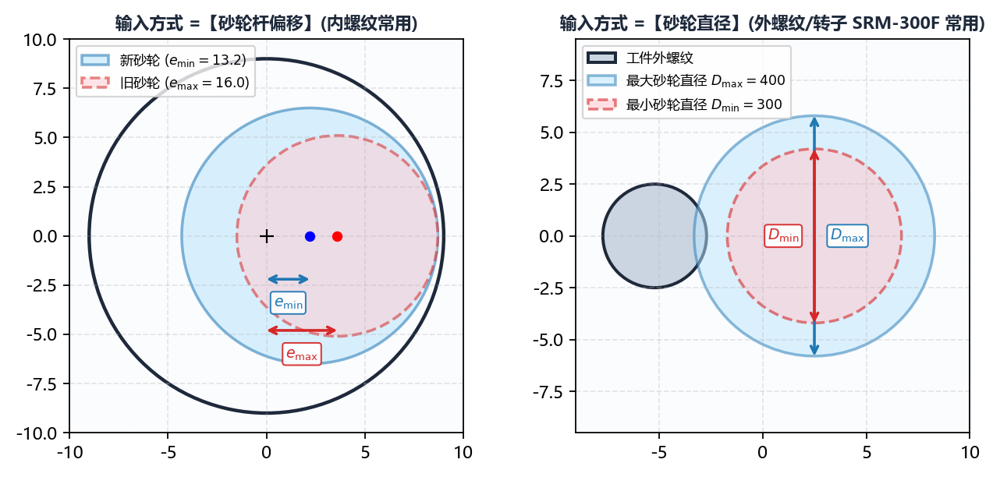
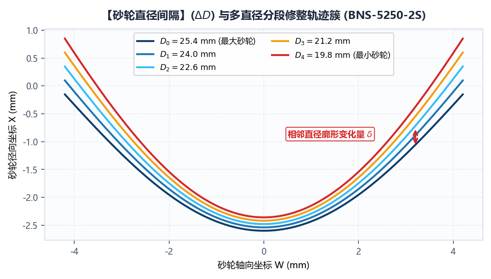
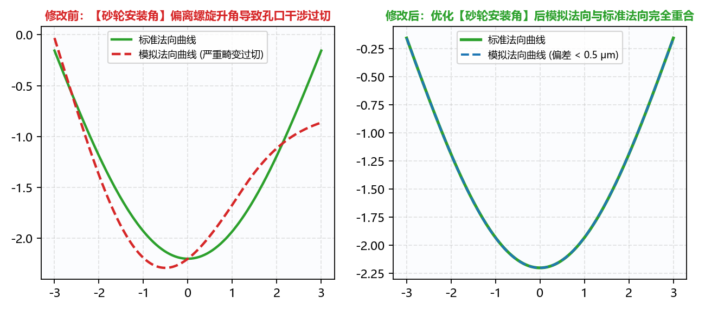

# 2.3 砂轮直径/杆偏移范围、间隔与安装角

本节详解 **`基本参数`** 下半部分关于砂轮工作尺寸范围、直径修整阶梯间隔以及 **`砂轮安装角`** 的工程设定逻辑。

---

## 一、砂轮范围的两种输入模式（`砂轮杆偏移` vs `砂轮直径`）

根据用户在 `高级参数 -> 初始化配置 -> 输入方式` 中的选择，`基本参数` 面板中的第 5、6 行参数标签会自动在以下两种模式之间切换：

### 模式 A：`输入方式` = `砂轮杆偏移`（内螺纹磨削推荐）

在内螺纹螺母磨削中，工艺员通常更关心砂轮修整变小后，**砂轮主轴中心相对于螺母回转中心还能往径向偏移多少距离而不撞杆**。此时界面显示：

* **`砂轮杆偏移工件中心最小距离`** ($e_{\min}$)：新砂轮（直径最大时）对应的中心偏移距离；
* **`砂轮杆偏移工件中心最大距离`** ($e_{\max}$)：旧砂轮（磨损至最小时）对应的最大中心偏移距离（必须满足 $e_{\max} > e_{\min} \ge 0$，且不得超过 `工具箱 -> 最大偏移` 算出的防撞极限）。
* **内部自动换算砂轮直径公式**：
  软件根据导入齿形的最大径向深度 $R_{\text{profile,max}}$ 自动将偏移距离换算为实际参与包络计算的砂轮直径：
  $$D_{\text{wheel,max}} = 2 \times \left(R_{\text{profile,max}} - e_{\min}\right), \qquad D_{\text{wheel,min}} = 2 \times \left(R_{\text{profile,max}} - e_{\max}\right)$$

### 模式 B：`输入方式` = `砂轮直径`（外螺纹/蜗杆/转子及已知砂轮规格的内螺纹推荐）

当直接按砂轮外径上下限管理修整程序时，界面显示：

* **`最大砂轮直径`** ($D_{\max}$)：新砂轮上机时的最大工作外径（例如外圆磨大砂轮 `400 mm`，或内圆磨新砂轮 `43 mm`）；
* **`最小砂轮直径`** ($D_{\min}$)：砂轮允许磨损到的报废下限直径（例如外圆磨 `300 mm`，或内圆磨 `35 mm`，必须满足 $D_{\max} > D_{\min} > 0$）。

> **特殊提示**：当 `高级参数 -> 程序信息 -> 程序模式` 选择为 **`模式-99`**（单砂轮直径仅输出 DXF 模式）时，**`砂轮杆偏移工件中心最小距离`**（或 **`最小砂轮直径`**）输入框会自动置灰锁定，系统仅针对单一目标砂轮尺寸计算并导出 1 份精确 DXF 廓形。

---

## 二、`砂轮直径间隔` 与多阶梯数控宏程序生成机制

在空间螺旋面包络磨削中，**随着砂轮直径磨损变小，砂轮与工件螺旋面的空间接触线形态会发生改变，从而导致所需的无干涉砂轮修整截形也随之动态变化**。

* **`砂轮直径间隔`** ($\Delta D$)：定义从最大砂轮直径 $D_{\max}$ 到最小砂轮直径 $D_{\min}$ 之间，每隔多少毫米重新计算一档精确的砂轮修整截面。
* **计算档数公式**：
  $$N_{\text{steps}} = \left\lfloor \frac{D_{\max} - D_{\min}}{\Delta D} \right\rfloor + 1$$
* **数控宏程序（`.SPF` / `O2010`）动态匹配原理**：
  如上图右侧所示，IGD 生成的数控修整程序并非只针对某一个固定直径，而是将全部 $N_{\text{steps}}$ 档砂轮直径对应的 G 代码段打包进同一个宏程序中，并通过机床实时砂轮直径宏变量（如西门子 `DRESSER[24]` / `_OVR[167]` 或发那科 `#550`）自动执行条件跳转（`IF ... GOTOF ...`）：
  * 机床每次修整砂轮时，系统自动读取当前砂轮直径并跳入最匹配的那一档 `STEP_n` 子程序段执行修整，**实现砂轮从新到旧全寿命周期内的全自动动态干涉补偿**！
* **工程取值建议**：
  * **小直径内螺纹砂轮**（$D \in [10, 50]\text{ mm}$）：直径变化对曲率影响极敏感，建议 `砂轮直径间隔` 设为 **`0.1` ~ `0.5 mm`**；
  * **大直径外螺纹/蜗杆/转子砂轮**（$D \in [250, 500]\text{ mm}$）：曲率随直径变化平缓，建议 `砂轮直径间隔` 设为 **`2.0` ~ `10.0 mm`**（既保证微米级包络精度，又避免生成的 `.SPF` 文件体积过大）。

---

## 三、`砂轮安装角` 调优与防过切准则

**`砂轮安装角`** ($\Sigma$) 是指砂轮主轴回转轴线与工件横截面（或轴向基准面）之间的空间夹角（单位：度 `$^\circ$`）。

1. **理想状态（$\Sigma = \lambda$）**：
   在外螺纹、蜗杆及转子磨削中，机床 B 轴（或 A 轴）通常无空间干涉限制，应保持 `砂轮安装角` 右侧复选框为勾选状态，使砂轮安装角严格等于中径螺旋升角 $\lambda$。此时空间接触线最短、包络修正量最小。
2. **内螺纹受限状态（$\Sigma < \lambda$）**：
   在大导程内螺纹螺母磨削中（如 `BNS-2020-R` 理论螺旋升角为 $17.6568^\circ$，或 `BNS-5250-2S` 理论升角高达 $17.0054^\circ$），若砂轮杆直接倾斜 $17^\circ$ 伸入深孔，砂轮杆尾部必然与螺母孔口发生碰撞。因此现场往往只能将机床砂轮杆倾角设定为较小值（如 $12^\circ$ 或 $15^\circ$）：
   * **严禁隐瞒真实安装角**：机床实际倾角设为多少度，软件中的 **`砂轮安装角`** 就必须如实输入多少度！如上图左半部分所示，若机床实际倾斜 $13.5^\circ$ 而软件按 $17.0^\circ$ 计算，磨出的滚道侧面会产生高达数十微米的严重欠切/过切并破坏接触角；
   * **倾角过小极限报警**：当存在极大相差（$\Delta\theta = |\lambda - \Sigma|$ 过大）且砂轮直径较大时，砂轮侧面可能发生二次包络自交（即无论怎样修薄砂轮都无法避免侧面擦伤工件）。建议先用 `工具箱 -> 最大偏移` 求出在安全防撞前提下机床所能允许的**最大砂轮安装角**，使 $\Sigma$ 尽可能贴近 $\lambda$。

