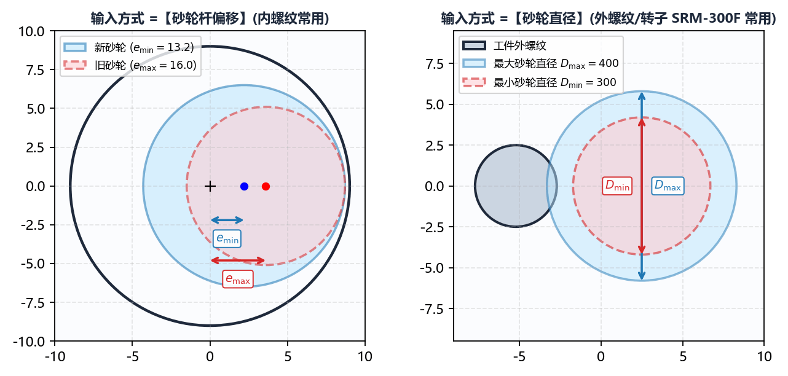
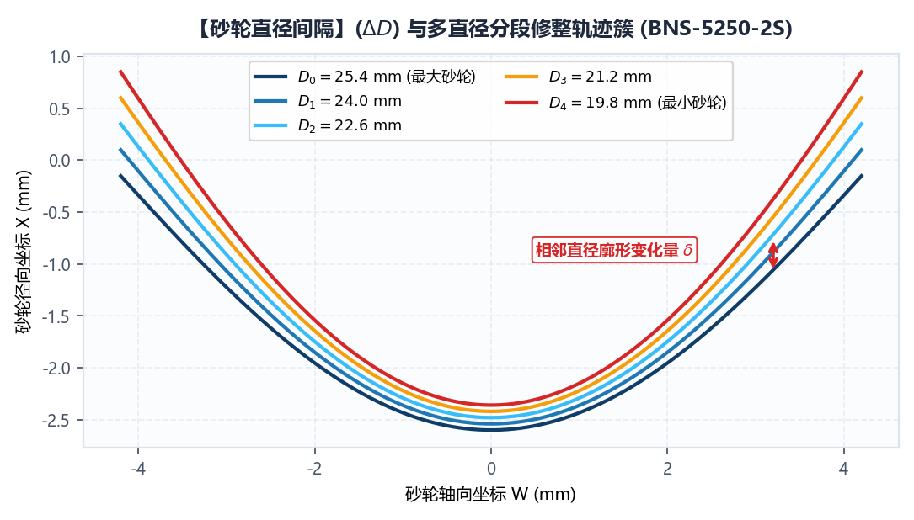
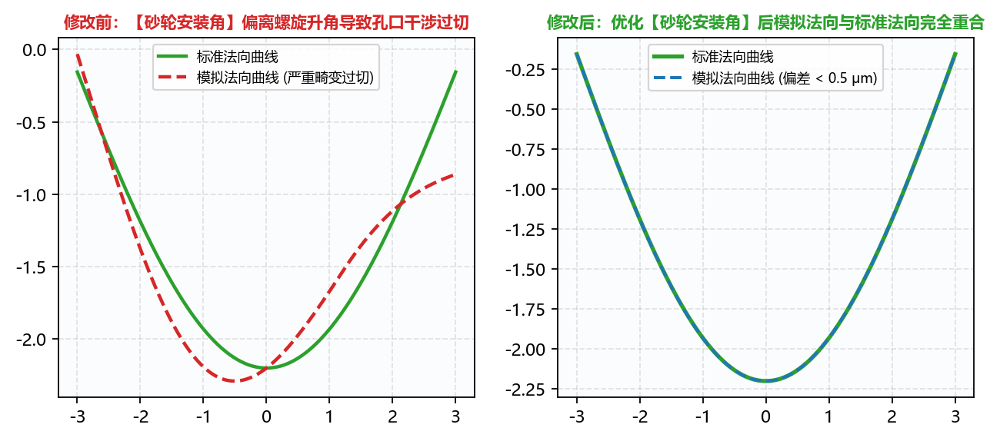

# 2.3 砂轮范围与安装角

本节说明砂轮工作范围双输入模式、`砂轮直径间隔` 分档机制及 `砂轮安装角` 对包络精度的影响。

---

## 双输入模式与自动换算

在 `高级参数 -> 初始化配置 -> 输入方式` 中切换后，`基本参数` 第 5、6 行标签会在两种模式间自动联动变化：

### 模式 A：`砂轮杆偏移`（推荐用于内螺纹）

从内孔中心距防撞角度控制砂轮工作尺寸区间：

* **`砂轮杆偏移工件中心最小距离`**（`e_min`）：新砂轮（最大外径）对应的中心偏移；
* **`砂轮杆偏移工件中心最大距离`**（`e_max`）：旧砂轮（最小外径）对应的中心偏移，须满足 `e_max > e_min ≥ 0` 且不超过 `工具箱 -> 最大偏移` 算出的碰撞极限；
* **内部换算关系**（基于导入齿形最大径向深度 `R_profile,max`）：

$$D_{\text{wheel,max}} = 2 \times \left(R_{\text{profile,max}} - e_{\min}\right), \qquad D_{\text{wheel,min}} = 2 \times \left(R_{\text{profile,max}} - e_{\max}\right)$$

### 模式 B：`砂轮直径`（外螺纹/蜗杆/转子）

直接按砂轮外径管理新旧修整区间：

* **`最大砂轮直径`**（`D_max`）：新砂轮工作外径（如 `400 mm` 或内圆砂轮 `43 mm`）；
* **`最小砂轮直径`**（`D_min`）：磨损报废下限外径（如 `300 mm` 或 `35 mm`，须满足 `D_max > D_min > 0`）。

### 单砂轮纯 DXF 模式锁定规则

* 当 `高级参数 -> 程序信息 -> 程序模式` 选择 **`模式-10`** 或 **`模式-99`**（单直径仅输出 DXF，不生成宏程序）时：
  * **`最小砂轮直径` / `砂轮杆偏移工件中心最大(小)偏移下限`** 与 **`砂轮直径间隔`** 均自动锁定；
  * 系统仅按单一砂轮尺寸计算并导出 1 套 DXF 验证文件。

---

## `砂轮直径间隔` 与多档宏程序

随砂轮磨损外径减小，空间啮合接触线形态会改变，需分段重算无干涉修整轮廓：

* **分档总数计算**：

$$N_{\text{steps}} = \left\lfloor \frac{D_{\max} - D_{\min}}{\Delta D} \right\rfloor + 1$$

* **数控宏程序自动跳转**：所有直径档位 `STEP_n` 合并至同一宏程序中，运行时按机床当前砂轮直径变量（如 Siemens `DRESSER[24]` / `_OVR[167]`、Fanuc `#550`/`#603`）执行 `IF ... GOTO/GOTOF` 自动选档。
* **推荐间隔取值**：
  * 小直径内螺纹砂轮（10 ~ 50 mm）：设为 **`0.1 ~ 0.5 mm`**；
  * 大直径外螺纹/蜗杆/转子砂轮（250 ~ 500 mm）：设为 **`2.0 ~ 10.0 mm`**，兼顾精度与程序体积。

---

## `砂轮安装角` 调优准则

**`砂轮安装角`** 须严格等于机床砂轮主轴实际偏转角（单位：`°`）：

* **外螺纹/蜗杆/转子（`Σ = λ`）**：无孔壁碰撞风险，建议保持勾选右侧同步框使安装角等于中径螺旋升角 `λ`，此时接触线最短、修正量最小；
* **内螺纹受限状态（`Σ < λ`）**：
  * 如 `BNS-5250-2S` 理论升角 `17.0795°`、`BNS-2020-R` 理论升角 `17.6568°`，因深孔避让只能倾转 `3.5° ~ 15°`；
  * **严禁虚填角度**：取消同步框后如实填写真实倾角，否则偏差角将带来数十微米过切/欠切并破坏接触角；
  * **倾角过小预警**：若 `|λ - Σ|` 过大可能触发二次包络自交，应先用 `工具箱 -> 最大偏移` 校核孔口安全间隙后尽量增大安装角。

