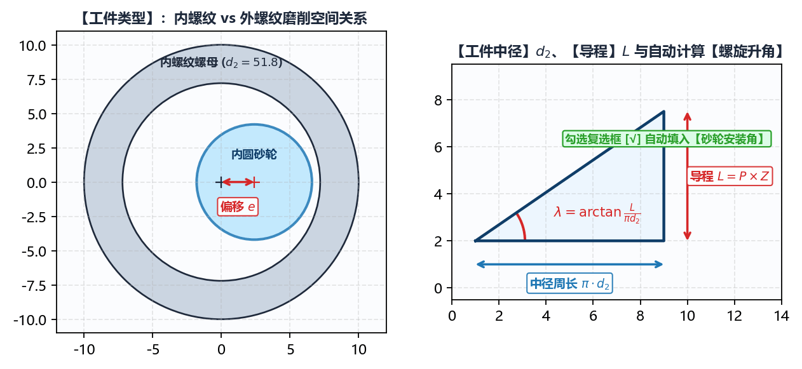

# 2.1 工件与螺旋参数

`基本参数` 面板前 4 项共同决定工件三维螺旋面的空间方程，任一项方向设定错误均会导致啮合包络曲率反转。

---

## 工件类型与螺纹旋向

### `工件类型`（`内螺纹` / `外螺纹`）

* **`内螺纹`**（如 `BNS-2020-R`、`BNS-5250-2S` 丝杠螺母、`PRS-2065-3S` 行星内齿圈）：
  * **啮合特点**：砂轮伸入内孔磨削，外径受内孔限制且与工件螺旋面同向弯曲；
  * **干涉特征**：空间接触线极长，通常无法以完整理论升角安装砂轮，曲率干涉显著大于外螺纹；
  * **界面联动**：自动隐藏 `外螺纹模式`；`双圆弧` 绘图模块中的直径标签切换为 `工件大径`。
* **`外螺纹`**（如外丝杠、蜗杆 `ZC1-9808`、转子 `SRM-300F/301M`、渐开线花键 `SPL-60T`）：
  * **啮合特点**：在工件外部磨削，或在 `内旋风铣` 模式下由内切刀盘包络外螺纹；
  * **界面联动**：显示 `高级参数 -> 外螺纹模式`；`双圆弧` 绘图模块中的直径标签切换为 `工件小径`。

### `螺纹旋向`（`右旋` / `左旋`）

* **`右旋`**：大多数标准滚珠丝杠、蜗杆及阳转子（顺时针旋入）；
* **`左旋`**：反向丝杠或配对阴转子（如左旋 `SRM-300F`）；
* **非对称型面核查**：当左右齿侧半角或曲率不等时，修改旋向会互换迎刃侧与背刃侧；需结合 `镜像` 开关与 `加载图形` / `干涉齿形` 视图二次核对。

---

## 工件中径、导程与螺旋升角

| 参数名称 | 单位 | 工程定义与输入要求 |
| :--- | :--- | :--- |
| **`工件中径`**（`d₂`） | mm | 螺旋面计算基准直径，须与 DXF 齿形中 `Y = 0` 基准线一致（> 0） |
| **`导程`**（`Ph`） | mm | 旋转一周轴向推进距离；多头工件按 `轴向螺距 × 头数` 输入 |

### 理论螺旋升角自动同步

输入正值 `工件中径` 与 `导程` 后，系统自动按空间螺旋公式解算中径螺旋升角 `λ`，显示于 `砂轮安装角` 右侧数值框：

$$\lambda = \arctan\left(\frac{P_h}{\pi \cdot d_2}\right) \times \frac{180^\circ}{\pi}$$

* **勾选右侧复选框（默认）**：自动将 `λ` 填入 `砂轮安装角`，适用于空间无干涉的外螺纹、蜗杆与转子磨削；
* **取消勾选（手动输入）**：当内螺纹砂轮杆受孔径限制必须减小倾角，或机床转台按固定刻度分度时，取消勾选并如实输入实际角度。

