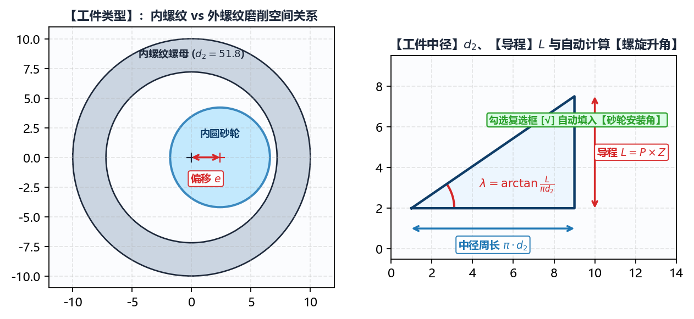

# 2.1 工件几何与螺旋方向

在 **`基本参数`** 面板顶部，前四项参数共同决定了目标工件的三维螺旋面空间方程。任何一项设置失误都会导致包络接触线空间曲率计算方向反转。

---

## 一、`工件类型` 与 `螺纹旋向` 的空间几何图解

### 1. `工件类型`（`内螺纹` / `外螺纹`）

* **`内螺纹`**：
  * **典型零件**：滚珠丝杠螺母（如 `BNS-2020-R`、`BNS-5250-2S`）、行星滚柱丝杠内齿圈（如 `PRS-2065-3S`）。
  * **啮合特征**：砂轮伸入工件内孔进行内啮合磨削，砂轮外径必须小于工件内孔小径。由于砂轮外圆柱面与螺母内螺旋面同向弯曲，**空间接触线极长，曲率干涉比外螺纹严重得多**；同时砂轮安装角往往受内孔长度限制无法达到理论螺旋升角，必须依赖 IGD 的空间包络算法精确修正砂轮截形。
  * **联动影响**：切换为 `内螺纹` 时，`绘图工具 -> 螺纹 -> 双圆弧` 中的直径标签会自动切换为 **`工件大径`**（滚道谷底最大直径），且 `高级参数 -> 初始化配置` 中的 **`外螺纹模式`** 会自动隐藏。
* **`外螺纹`**：
  * **典型零件**：外滚珠丝杠轴、行星滚柱丝杠主丝杠、双螺杆压缩机阴阳转子（如 `SRM-300F`、`SRM-301M`）、各类精密蜗杆（如 `ZC1-9808`）及渐开线齿轮/花键（如 `SPL-60T`）。
  * **啮合特征**：砂轮在工件外部进行外啮合磨削（或在 `外螺纹模式` = `内旋风铣` 时由内切刀盘包络外螺纹）。
  * **联动影响**：切换为 `外螺纹` 时，`绘图工具 -> 螺纹 -> 双圆弧` 中的直径标签自动显示为 **`工件小径`**，且 `高级参数 -> 初始化配置` 中会显示 **`外螺纹模式`**（可选 `普通砂轮` 或 `内旋风铣`）。

### 2. `螺纹旋向`（`右旋` / `左旋`）

* **`右旋`**：顺时针旋转时沿轴向远离观察者推进（绝大多数标准滚珠丝杠、蜗杆及压缩机阳转子）；
* **`左旋`**：逆时针旋转时沿轴向推进（如反向丝杠螺母、双螺杆压缩机中与右旋阳转子配对的左旋阴转子 `SRM-300F`）。
* **工程注意事项**：当左/右齿面不对称（例如左、右半角不等的锯齿形螺纹，或压缩机阴阳转子型线）时，改变 `螺纹旋向` 会直接交换空间螺旋面的迎刃侧与背刃侧。此时请结合 **`DXF 齿形类型`** 右侧的 **`镜像`** 开关以及右下角 **`加载图形`** / **`干涉齿形`** 视图核对左右齿侧对应关系。

---

## 二、`工件中径`、`导程` 与自动螺旋升角

| 参数名称 | 单位 | 工程定义与输入要求 |
| :--- | :--- | :--- |
| **`工件中径`** ($d_2$) | $\text{mm}$ | 螺旋面计算基准圆柱直径（对应 DXF 齿形局部坐标系中 $Y=0$ 基准线所在的工件直径）。必须满足 $d_2 > 0$。 |
| **`导程`** ($P_h$) | $\text{mm}$ | 工件旋转一整周（$360^\circ$）时螺旋线沿轴向移动的距离。对于多头螺纹、多头蜗杆或多齿转子，$\text{导程 } P_h = \text{轴向螺距 } P \times \text{头数 } z$。 |

### 中径螺旋升角 $\lambda$ 的实时联动解算

只要在 **`工件中径`** ($d_2$) 与 **`导程`** ($P_h$) 中输入有效正数，软件会立即根据空间螺旋线公式实时计算出中径处的理论螺旋升角 $\lambda$，并显示在下方 **`砂轮安装角`** 右侧的蓝色数值标签中（保留 4 位小数）：

$$\lambda = \arctan\left(\frac{P_h}{\pi \cdot d_2}\right) \times \frac{180^\circ}{\pi}$$

* **自动同步复选框（默认勾选）**：
  * 当 **`砂轮安装角`** 右侧的复选框处于**勾选状态**时，只要修改 `工件中径` 或 `导程`，系统会自动将计算出的理论螺旋升角 $\lambda$ 填入 `砂轮安装角` 输入框（这是外螺纹磨削与蜗杆磨削的标准设定，此时砂轮轴线与工件螺旋槽在中径处严格相切）；
  * 当加工大导程**内螺纹**（受砂轮杆与内孔干涉限制，实际安装角必须小于理论螺旋升角）或现场磨床A轴分度只能设定整数/半度角时，请**取消勾选**该复选框，随后即可在 `砂轮安装角` 输入框中手动键入机床实际设定的安装角度。

