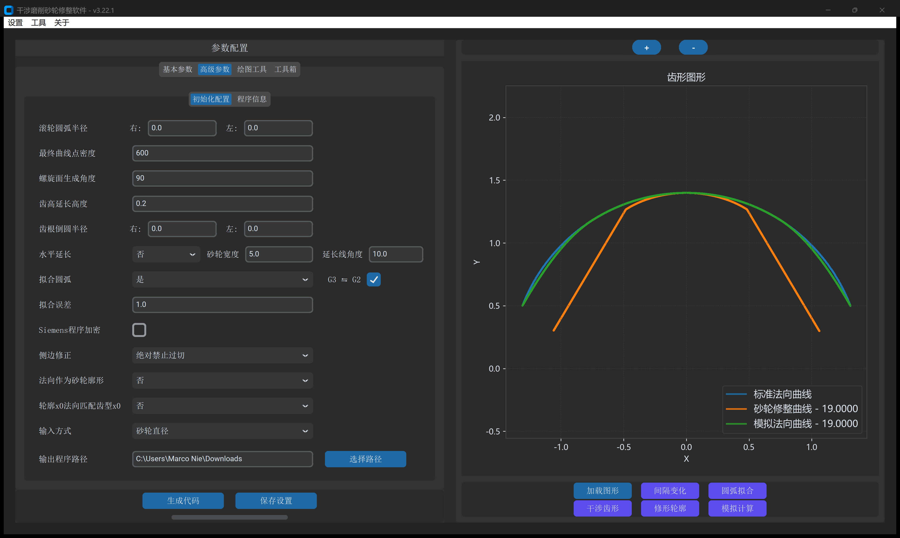
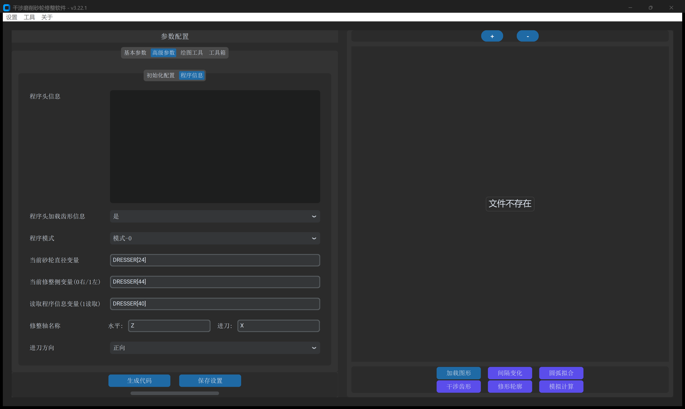

# 第 3 章 高级参数：初始化配置与数控程序信息

**`高级参数`** 标签页用于控制空间包络数值求解精度、金刚石修整滚轮刀尖圆弧补偿、齿顶/齿根/水平延伸结构、圆弧插补拟合公差，以及适配不同机床数控系统的宏程序输出格式。下设 **`初始化配置`** 与 **`程序信息`** 两个子标签页。

---

## 一、`初始化配置` 模块

控制三维螺旋面包络算法的核心迭代精度、滚轮半径补偿与几何修整细节：

- **左右 `滚轮圆弧半径`**：支持非对称或双修整轮独立偏置。
- **`最终曲线点密度` & `螺旋面生成角度`**：控制离散点云采样密度与圆周啮合求解范围。
- **`齿高延长高度` & `侧边修正`**：确保滚轮完全修穿砂轮齿顶，并提供 3 种模式（`保持现状` / `均衡过切和残留` / `绝对禁止过切`）通过二分搜索智能消除滚道孔口干涉过切。
- **`齿根倒圆半径` 防过切法则**：自动钳制保证 $R_{\text{root}} \ge R_{\text{dress}}$，杜绝啃刀事故。
- **`水平延长`**：一键修整砂轮两侧水平端面或斜坡端面（`延长线角度`）。
- **`拟合圆弧` & `拟合误差`**：自适应双切圆弧拟合，输出 `G2`/`G3` 插补指令。
- **特殊工艺开关**：涵盖 `外螺纹模式`（`普通砂轮` vs `内旋风铣`）、`轮廓x0法向匹配齿型x0` 及 `Siemens程序加密`。

---

## 二、`程序信息` 模块

配置输出数控宏程序的文件格式、控制系统类型与轴名称：

- **`程序头信息`**：多行自定义工艺注释，自动添加数控系统对应注释符。
- **`程序头加载齿形信息`**：将当前计算的完整参数清单写入 G 代码头部，便于现场校对。
- **13 种 `程序模式`**：覆盖 Siemens 840D sl/ONE（`模式-0` ~ `模式-4`, `模式-8`, `模式-100`）、Fanuc 0i/31i（`模式-5`, `模式-7`, `模式-9`, `模式-98`）、新代 Syntec（`模式-6`）及纯 DXF 模式（`模式-99`）。
- **`修整轴名称` 与 `进刀方向`**：支持自由定义水平轴/进刀轴（如 W/U、Z/X、Y/X）及正向/负向切入极性。
