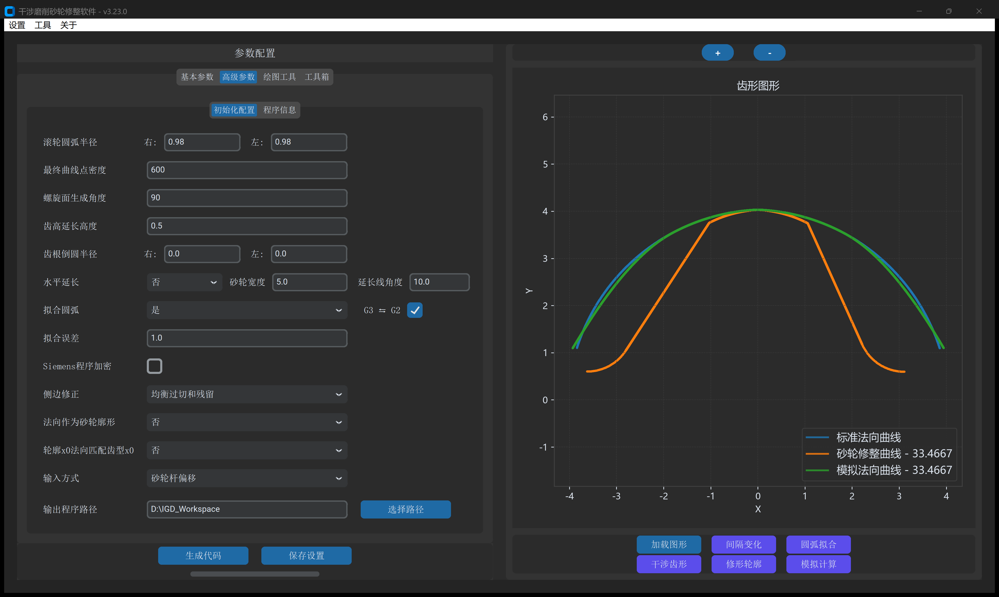
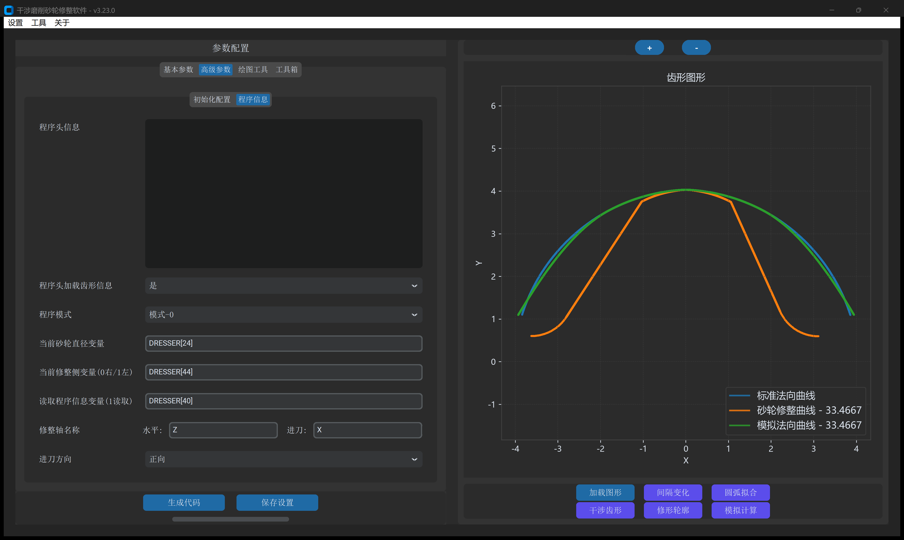

# 3. 高级参数

**`高级参数`** 控制空间包络求解精度、滚轮刀尖半径偏置、侧边过切修正、圆弧拟合容差及数控宏程序模板，包含 **`初始化配置`** 与 **`程序信息`** 两个子页。

---

## 一、`初始化配置`

* **滚轮与齿根**：左右 `滚轮圆弧半径` 独立偏置、`齿根倒圆半径` 安全下限钳制；
* **点云采样**：`最终曲线点密度` 与 `螺旋面生成角度`；
* **修整延长与侧边修正**：`齿高延长高度`、`侧边修正`（`保持现状` / `均衡过切和残留` / `绝对禁止过切`）、`水平延长`（`砂轮宽度` / `延长线角度`）；
* **圆弧拟合**：`拟合圆弧`、`G3 ⇆ G2` 与 `拟合误差`（单位 `0.1 μm`，单段扫角 ≤ 150°）；
* **工艺开关**：`输入方式`、`外螺纹模式`、`轮廓x0法向匹配齿型x0`、`法向作为砂轮廓形`、`Siemens程序加密`。

---

## 二、`程序信息`

* **程序头部**：`程序头信息` 多行工艺备注、`程序头加载齿形信息` 参数归档；
* **14 种 `程序模式`**：覆盖 Siemens（`.SPF`/`.CPF`）、Fanuc（`O2010`）、Syntec（`O2010.txt`）与纯 DXF（`模式-10`、`模式-99`）；
* **坐标映射**：`修整轴名称`（`水平:` / `进刀:`）、`进刀方向`（`负向` / `正向`）及机床直径变量配置。

---

## 本章内容

* **[3.1 初始化配置](init_config.md)**：滚轮补偿、点云精度、侧边修正、延长段与双切圆弧拟合；
* **[3.2 特殊工艺开关](special_modes.md)**：内旋风铣、非对称转子基准锁定、法向直出与加密导出；
* **[3.3 程序模式与修整轴](program_modes.md)**：14 种数控模板（含 `模式-10`）参数对照与轴极性规则。
