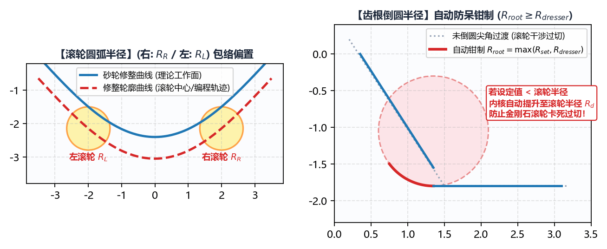
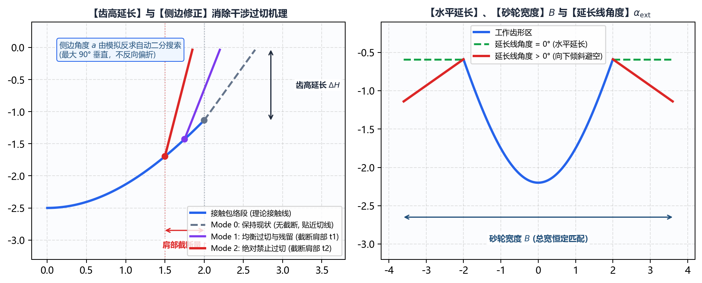
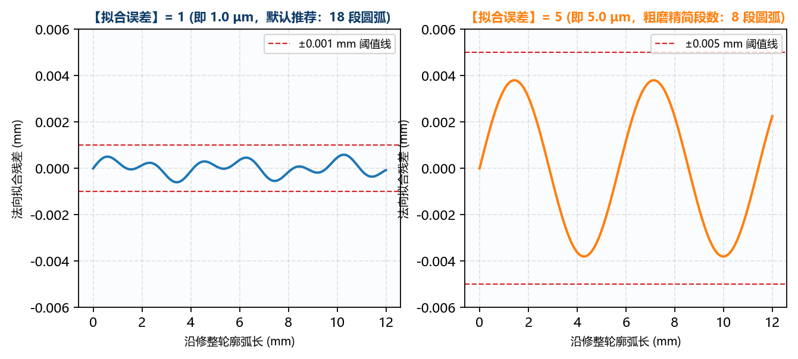

# 3.1 初始化配置：滚轮补偿、齿根延长与圆弧拟合

本节逐项详解 **`高级参数 -> 初始化配置`** 子标签页中的几何修整补偿参数、侧边过切修正及离散圆弧拟合控制项。

---

## 一、`滚轮圆弧半径` 与 `齿根倒圆半径`（防过切钳制法则）

### 1. `滚轮圆弧半径`（`右:` / `左:`，单位：$\text{mm}$）

* **工程定义**：用于修整砂轮的金刚石滚轮（或金刚石笔）左右工作圆弧的实测刀尖半径（$R_{\text{dress,R}}, R_{\text{dress,L}}$）。
* **法向等距补偿机理**：
  数控磨床的修整程序驱动的是金刚石滚轮圆弧的**刀心参考点**。如上图左侧所示，软件在算出无干涉理论砂轮廓形（蓝色实线）后，会分别沿曲线法向向外作距离为 `右:`（$R_{\text{dress,R}}$）和 `左:`（$R_{\text{dress,L}}$）的等距包络偏置，生成左侧修整走刀轨迹与右侧修整走刀轨迹。
* **特别功能**：
  * 支持左右采用不同半径的修整轮（双滚轮独立修整或非对称金刚石滚轮）；
  * 若机床数控系统自身已开启硬件刀具半径补偿（G41/G42）且要求程序输出砂轮表面净尺寸坐标，可将左右 **`滚轮圆弧半径`** 均设为 **`0`**。

### 2. `齿根倒圆半径`（`右:` / `左:`，单位：$\text{mm}$）

* **工程定义**：砂轮廓形底部两侧与延长段（或水平段）交接处的过渡圆角半径（$R_{\text{root,R}}, R_{\text{root,L}}$）。
* **核心防过切安全法则（系统自动钳制）**：
  如上图右侧所示，金刚石滚轮具有物理半径 $R_{\text{dress}}$。如果砂轮齿根内凹过渡圆弧半径 $R_{\text{root}}$ 小于金刚石滚轮半径 $R_{\text{dress}}$，滚轮在走刀经过齿根拐角时其外缘将无法触底，反而会**啃伤（过切）已修整好的砂轮工作齿侧**！
  * **软件内置保护逻辑**：只要开启了 **`水平延长` = `是`**，或者用户输入的 **`齿根倒圆半径` > 0**，软件内部会自动执行安全下限钳制：
    $$R_{\text{root,实际生效}} = \max\left(R_{\text{root,输入}}, \ R_{\text{dress}}\right)$$
  * **推荐设定**：一般直接将左右 `齿根倒圆半径` 设为**大于或等于**对应的左右 `滚轮圆弧半径`（例如滚轮半径为 `0.2 mm` 时，齿根倒圆设为 `0.2` ~ `0.3 mm`）。

---

## 二、`最终曲线点密度` 与 `螺旋面生成角度`

这两项参数共同决定三维空间螺旋面网格的离散分辨率：

| 参数名称 | 默认值 | 推荐范围 | 工程作用与调优指南 |
| :--- | :--- | :--- | :--- |
| **`最终曲线点密度`** | `600` | `500` ~ `2000` | 定义输出砂轮廓形与拟合圆弧前，沿齿形全长均匀重采样的离散点数量。 • 常规丝杠螺母（如 `BNS-2020-R`）：`500` ~ `600` 即可在 2 秒内达到亚微米精度； • 复杂型线（如双螺杆转子 `SRM-300F`、渐开线花键 `SPL-60T`）：建议提升至 **`1000` ~ `2000`**，以捕捉微小曲率转折。 |
| **`螺旋面生成角度`** | `90` | `30` ~ `180`（单位：`$^\circ$`） | 定义计算空间接触线时，工件螺旋面在啮合区前后展开的圆周包络角度范围（$\pm \theta^\circ$）。 • 绝大多数外螺纹与小螺旋角内螺纹：默认 `90`（或 `30` ~ `60`）已完全覆盖全部空间接触区域； • 超大导程深孔内螺纹或小直径内旋风铣：保持 **`90` ~ `120`** 以确保接触线首尾不被截断。 |

---

## 三、`齿高延长`、`侧边修正`（消除滚道干涉过切）与 `水平延长`

在内螺纹大导程干涉磨削中，为了确保砂轮有效修穿工件全齿深，同时彻底消除滚道孔口两侧因干涉运动扫出的过切缺陷，软件提供了智能化的侧边自适应修正体系：

### 1. `齿高延长高度`（单位：$\text{mm}$）

* **工程定义**：在理论齿形工作高度以外沿齿高方向继续延伸修整的高度余量 $\Delta H$。
* **参数设定**：
  * 设置为 **`0`**：砂轮修整齿高与输入齿型的标准法向齿形高度严格一致；
  * 设置为 **`0.1` ~ `0.5 mm`**（推荐）：在齿高方向继续向上延伸一段，确保金刚石滚轮彻底修穿砂轮外缘，避免砂轮齿顶在磨削时因未修整而形成未切削台阶。砂轮端点高度由设定的齿高延长高度确定。

### 2. `侧边修正`（Flank Correction - 消除干涉导致滚道两侧过切）

* **工程痛点与产生机理**：
  在干涉磨削时（尤其是内螺纹工件导程较大、砂轮安装角与螺旋升角存在夹角差，或砂轮直径相对螺母孔径较大时），三维空间微分包络接触线往往仅覆盖砂轮近齿顶附近的一段区域。接触段两侧“肩部”在砂轮高速回转并沿工件螺旋线作相对运动时，会扫入工件螺旋槽孔口两侧，造成**滚道两侧孔口过度过切（Overcut）**，破坏密封槽或减小承载接触面。
* **自适应优化内核（`calc_flank.py`）**：
  软件内置了先进的**“截断肩部 + 虚拟磨削仿真反求 + 二分搜索”**闭环修正算法：
  1. **肩部智能截断**：从理论接触段两端向内截断指定量 $t$（按 $X$ 轴距离计算）；
  2. **自适应延伸角度**：在截断点处以角度 $a$（与水平方向夹角，最大 $90^\circ$ 垂直，绝不反向偏折）引出直线延伸到原有深度；
  3. **二分闭环搜索**：在多轮迭代中，系统自动调用虚拟磨削求解器反算成形滚道截面，并与标准法向曲线进行高精度误差比对，自动搜索出最优截断量 $t$ 与最佳侧边角度 $a$。
* **三大修正模式选用指南**：
  * **`保持现状`（默认）**：
    不截断原始包络计算曲线，侧边延长线角度自动选择在过切最少时最贴近切线的值。适用于小导程或干涉不明显的标准工件。
  * **`均衡过切和残留`（推荐平衡模式）**：
    智能截断砂轮肩部，使滚道每侧的最大过切量与最大残留量大致相当（即使 $\max(\text{过切}, \text{残留})$ 达到极小值）。适用于绝大多数大导程滚珠丝杠螺母与汽车转向套筒，在保证滚道接触面积的同时压制孔口过切。
  * **`绝对禁止过切`（严苛高精模式）**：
    以能够将过切完全消除至容差范围内（$\le 0.5\ \mu\text{m}$）的最小截断量截断砂轮肩部，滚道孔口侧边保留微量安全残留。适用于图纸严格要求“零过切/欠切允许”的军工航天精密传动件。
* **注意事项**：
  * 由于截断量与角度通过高精度虚拟磨削仿真进行多轮二分搜索，启用修正模式 1 或 2 时计算耗时会微幅增加（通常约 1~3 秒）；
  * 转子齿型不适用侧边修正（转子型线直接沿切线延长）。

### 3. `水平延长`（`否` / `是`）、`砂轮宽度` 与 `延长线角度`

当需要金刚石滚轮顺便修整砂轮左右两侧端面（或齿根圆柱外缘）时，将 **`水平延长`** 设为 **`是`**：

* **`砂轮宽度`** ($B_{\text{wheel}}$，单位：$\text{mm}$)：指定修整后整个砂轮廓形的总水平跨度（必须大于当前齿槽开口宽度，例如齿槽宽 `6 mm` 时，`砂轮宽度` 可设为 `8` ~ `10 mm`）；
* **`延长线角度`** ($\beta_{\text{ext}}$，单位：`$^\circ$`，默认 `0`）：
  * 当设为 **`0`** 时，两侧延长段为严格的水平直线（平行于砂轮回转轴线）；
  * 当设为正角度（如 `5` ~ `65`，常见于压缩机转子砂轮两侧斜坡修整）时，两侧延伸段将按指定斜率向外展开。

---

## 四、`拟合圆弧`、`G3 ⇆ G2` 与 `拟合误差`

空间啮合包络计算出的理论砂轮廓形是一条曲率连续变化的非圆空间曲线（由高密度离散点组成）。

* **`拟合圆弧`（`否` / `是`）**：
  * 选择 **`是`**（强烈推荐）：软件采用自适应双切圆弧（Bi-arc）逼近算法，将数百个离散点拟合成十余段至数十段相切圆弧，并在宏程序中输出平滑的 **`G2` / `G3` 圆弧插补指令**。这能大幅减少数控程序段数，消除机床微小直线段加减速引起的砂轮表面振纹；
  * 选择 **`否`**：不进行圆弧拟合，宏程序直接按离散点输出高密度 **`G1` 直线插补指令**。
* **`G3 ⇆ G2` 复选框**：
  * 由于不同数控磨床的修整轴左手/右手坐标系定义或前后刀架朝向不同，机床实际执行的顺/逆时针圆弧方向可能与标准平面相反。勾选 **`G3 ⇆ G2`** 后，系统会将生成的所有 `G2` 与 `G3` 指令**全局互换**（例如 `模式-1` 机床模板默认即勾选此项）。
* **`拟合误差`**（单位：$\mu\text{m}$，即 $0.001\text{ mm}$，默认值 `1`）：
  * 控制拟合出的 `G2`/`G3` 圆弧与理论高密度包络点云之间的**最大法向残差上限**。
  * **工程建议**：精密丝杠、转子与蜗杆磨削请保持在 **`0.5` ~ `1.5` ($\mu\text{m}$)** 之间（如 `SRM-300F` 转子设为 `0.5`，常规丝杠螺母设为 `1`）。切勿将其设得过大（如 $> 5\ \mu\text{m}$），否则会导致圆弧段过于粗糙并产生分段折痕。
