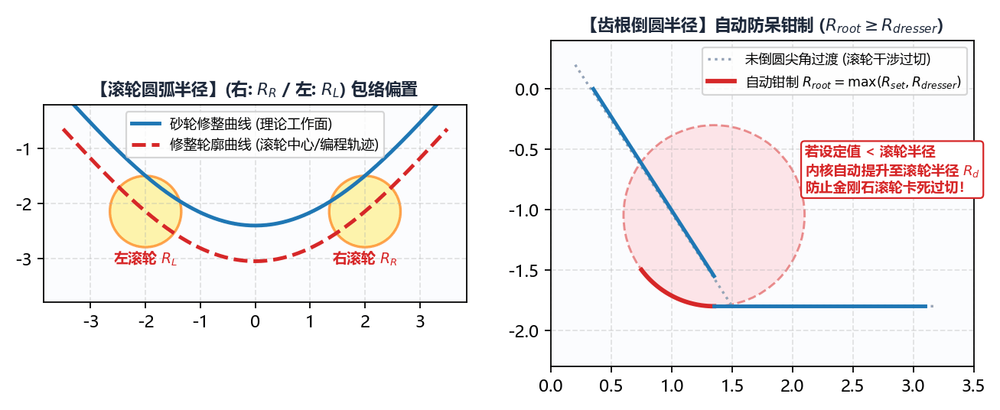
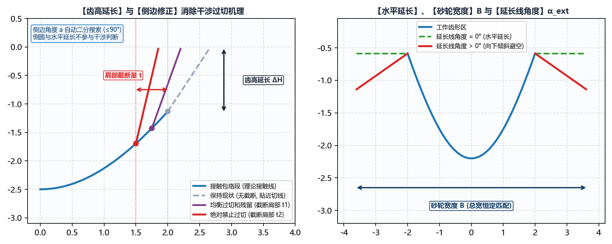
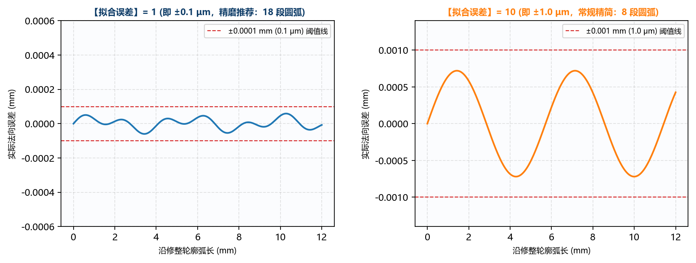

# 3.1 初始化配置

本节详解 **`高级参数 -> 初始化配置`** 中的滚轮补偿、采样密度、侧边修正、延长结构与圆弧拟合参数。

---

## 滚轮补偿与齿根倒圆

### 滚轮圆弧半径（mm）

* **工程定义**：金刚石滚轮左右工作圆弧的实测刀尖半径（`R_dress,R`、`R_dress,L`）；
* **等距刀心偏置**：在无干涉砂轮理论截形外侧分别按左右半径法向等距偏置，输出左右刀心修整轨迹；
* **特殊工况**：
  * 支持左右配置不同半径以适配非对称轮或双修整轮；
  * 若机床自身启用硬件 `G41/G42` 半径补偿，可将该值设为 `0`。

### 齿根倒圆半径（mm）

* **工程定义**：砂轮廓形底部与延长段之间的过渡圆角半径；
* **自动防过切钳制**：开启 `水平延长 = 是` 或输入 `齿根倒圆半径 > 0` 时，系统自动保证过渡圆弧不小于滚轮半径，防止滚轮啃伤工作齿侧：

$$R_{\text{root,实际生效}} = \max\left(R_{\text{root,输入}}, \ R_{\text{dress}}\right)$$

---

## 点云密度与螺旋面角度

| 参数名称 | 默认值 | 推荐范围 | 工程说明 |
| :--- | :--- | :--- | :--- |
| **`最终曲线点密度`** | `600` | `500 ~ 2000` | • 输出轨迹及拟合前的重采样点数 • 常规丝杠 `500 ~ 600`；复杂转子/花键推荐 `1000 ~ 2000` |
| **`螺旋面生成角度`** | `90` | `30 ~ 180`（`°`） | • 求解接触线时工件螺旋面展角（±θ°） • 常规工况 `60 ~ 90`；超大导程或内旋风铣建议 `90 ~ 120` |

---

## 齿高延长、侧边修正与水平延长

### `齿高延长高度`（mm）

* **`0`**：保持修整高度与理论法向齿高完全一致；
* **`0.1 ~ 0.5`**（推荐）：沿切线向上延伸修穿砂轮外缘，避免齿顶残留未修台阶。

### `侧边修正`（消除滚道孔口干涉过切）

* **物理背景**：大导程内螺纹或小安装角工况下，接触段两侧肩部旋转扫掠会造成工件齿顶（螺母孔口）严重过切；
* **求解机理**：
  * 从接触段肩部向内搜索截断量 `t`（严格钳制**截断点不越过 `X = 0`**），并在截断点处自动优化出射侧边角（最大至 `90°` 垂直，绝不反向偏折）；
  * 虚拟磨削闭环仿真**仅针对截断 + 齿高延长侧边**进行干涉优化，**`齿根倒圆` 与 `水平延长` 在修正完成后添加，不参与干涉判断**；
  * 修正模式、截断量、侧边角度及优化前后最大过切/最大残留对比数据会自动写入 `dxf_sumulator_normal_*.dxf` 与 `plot_sumulator_normal_*.html`；
* **三种模式对比**：
  * **`保持现状`（默认）**：不截断原曲线，仅搜索最贴近切线且过切最小的角度；
  * **`均衡过切和残留`**（推荐）：截断肩部使每侧最大过切与最大残留大致相等（压缩 `max(过切, 残留)` 至极小）；
  * **`绝对禁止过切`**：以最小截断量将过切压至容差内（≤ 0.5 μm），保留少量安全残留；
* **适用说明**：二分仿真搜索约增加 `1 ~ 3` 秒耗时；非对称转子齿形直接沿切线延长，不适用肩部截断。

### 水平延长与砂轮宽度

* **`水平延长` = `是`**：一并修整砂轮左右端面；
* **`砂轮宽度`**（mm）：整片砂轮修整总宽，须大于当前齿槽开口宽度；
* **`延长线角度`**（`°`，默认 `0`）：`0°` 为纯水平直线；设为正角度（如 `5° ~ 65°`）则按斜坡向外展开。

---

## 圆弧拟合与误差控制

* **`拟合圆弧`（`否` / `是`）**：设为 **`是`** 时采用双切圆弧拟合输出平滑 `G2`/`G3` 指令，消除小直线段加减速振纹；
* **平滑与大角度保护机制**：
  * 输出圆弧均经过首尾平滑连续处理，保证与 `终点 + CR=R` 几何严格一致；
  * 单段圆弧圆心角上限 **`150°`**，超出时自动拆分为两段连续圆弧，防止部分控制系统整圆/大圆弧插补异常；
* **`G3 ⇆ G2`**：全局互换生成代码中的 `G2` 与 `G3`，适配不同刀架布局或左手/右手坐标系；
* **`拟合误差`**（单位：**`0.1 μm`**，即输入 `1` = `0.0001 mm`）：
  * 软件按 `max_error = 0.0001 × 拟合误差` 控制最大法向偏差；
  * 默认值 **`1`**（即 `0.1 μm`，兼顾高精度与合理段数）；精密转子可设 **`0.5` ~ `5`**（`0.05 ~ 0.5 μm`），普通丝杠需放宽至 **`10`**（`1.0 μm`）以精简代码量；
  * 系统会对拟合采样点去重（`np.unique`），并将真实统计的**最大误差与平均误差**直接写入拟合 DXF 左下角、HTML 副标题图例及 TXT 报告中。
