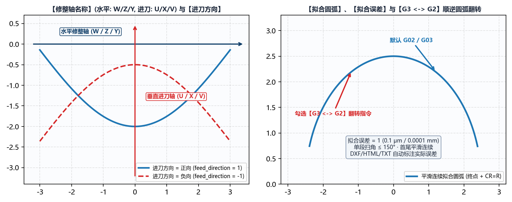

# 3.3 程序模式与修整轴

在 **`高级参数 -> 程序信息`** 中配置宏程序注释头、数控 **`程序模式`**，以及修整水平轴、进刀轴名称和切入极性。

---

## 程序头配置

* **`程序头信息`**：支持多行备注（图号、批次、砂轮粒度等），生成时自动添加对应数控系统注释前缀（Siemens `;`、Fanuc `(...)`、Syntec `//`）；
* **`程序头加载齿形信息`（`否` / `是`）**：设为 **`是`** 时自动将全部主参数、补偿量及 `*-info.txt` 几何摘要写入代码头部，方便机台核对。

---

## 14 种程序模式对照

IGD 共内置 **14 种 `程序模式`**，覆盖 **Siemens**、**Fanuc**、**Syntec（新代）** 及单直径纯 DXF 模式（`模式-10` / `模式-99`）：

| `程序模式` | 数控系统与文件后缀 | 默认直径变量 | 默认轴名 (`水平`/`进刀`) | 默认 `进刀方向` | 特征与适用场景 |
| :--- | :--- | :--- | :--- | :--- | :--- |
| **`模式-0`** | Siemens (`.SPF`/`.CPF`) | `DRESSER[24]` | `W` / `U` *(可改)* | `负向` *(可改)* | 标准通用模板（`DRESSER[44]` 修整侧、`DRESSER[40]` 读信息），适用于内/外螺纹磨床 |
| **`模式-1`** | Siemens (`.SPF`/`.CPF`) | `_OVR[167]` | `Y` / `X` *(固定)* | `负向` *(固定)* | 含完整换刀与修整头尾循环，默认勾选 `G3 ⇆ G2`，常用于转子与外成形磨床 |
| **`模式-2`** | Siemens (`.SPF`/`.CPF`) | `DRESSER[1]` | `W` / `X` *(固定)* | `负向` *(固定)* | 西门子专用模板 A（`DRESSER[43]` 读取参数） |
| **`模式-3`** | Siemens (`.SPF`/`.CPF`) | `REPAIR[8]` | `Y` / `X` *(固定)* | `负向` *(固定)* | 西门子专用模板 B（`REPAIR[8]` 实时砂轮直径） |
| **`模式-4`** | Siemens (`.SPF`/`.CPF`) | `R9` | `W` / `V` *(固定)* | `负向` *(固定)* | R 参数多道修整循环模板（含 `STRIM / RECALVAR / TRIMEND`） |
| **`模式-5`** | Fanuc (`O2010`) | `#603` (`#550=#603`) | `Z` / `X` *(固定)* | `正向` *(固定)* | 发那科标准模板 A（`IF[#550 GE ...] GOTO` 阶梯分支） |
| **`模式-6`** | Syntec (`O2010.txt`) | `#340` (`#350:=#340`) | `Y` / `X` *(固定)* | `负向` *(固定)* | 新代宏模板（含 `%@MACRO` 与 `:=` 赋值语法） |
| **`模式-7`** | Fanuc (`O2010`) | `#603` (`#550=#603`) | `Z` / `X` *(固定)* | `正向` *(固定)* | 发那科标准模板 B（带 `#122=100` 行号步进规范） |
| **`模式-8`** | Siemens (`.SPF`/`.CPF`) | `R40` | `W` / `V` *(固定)* | `负向` *(固定)* | 西门子双滚轮定位模板（含 `R52~R55` 基准偏移） |
| **`模式-9`** | Fanuc (`O2010`) | `#603` | `Z` / `X` *(固定)* | `负向` *(固定)* | 默认勾选 `G3 ⇆ G2`，X 轴采用直径编程模式（×2），支持进给率变量 `#604` |
| **`模式-10`** | 仅输出 DXF (`.dxf`) | *自动隐藏* | *自动隐藏* | *自动隐藏* | 单直径纯 DXF 极简模式：锁定最小直径与 `砂轮直径间隔`，关闭圆弧拟合、`G3 ⇆ G2`、加密与代码头部加载，仅导出单直径全套 DXF |
| **`模式-98`** | Fanuc 自定义 (`O2010`) | `#603` *(可改)* | `Z` / `X` *(可改)* | `正向` *(可改)* | 发那科全开放自定义模式，自由定义变量、轴名与进刀极性 |
| **`模式-99`** | 仅输出 DXF (`.dxf`) | *自动隐藏* | *自动隐藏* | *自动隐藏* | 单直径纯 DXF 完整模式：锁定最小直径与 `砂轮直径间隔`，不生成 G 代码，保留圆弧拟合结果 DXF（`dxf_dress_wheel_curve_*.dxf`、`dxf_dress_contour_curve_*.dxf`）供检图/CAM 使用 |
| **`模式-100`** | Siemens 自定义 (`.SPF`/`.CPF`) | `DRESSER[24]` *(可改)* | `W` / `U` *(可改)* | `负向` *(可改)* | 西门子全开放自定义模式，自由修改变量、轴名与极性 |

---

## 修整轴名称与进刀极性

* **允许自定义模式**：`模式-0`、`模式-98`、`模式-100`；
* **`修整轴名称`**：
  * `水平:` 沿砂轮轴线方向轴（常见 `W`、`Z`、`Y`）；
  * `进刀:` 沿砂轮径向切入轴（常见 `U`、`V`、`X`）；
* **`进刀方向`**：
  * `负向`：切入砂轮时进刀坐标减小（常规后置修整器）；
  * `正向`：切入砂轮时进刀坐标增大（常见前置修整器）；
* **极性影响**：修改 `进刀方向` 会同步反转进刀坐标、圆弧圆心（`I/J/K` 或 `CR=`）符号及部分圆弧顺逆方向，更换机床模板后务必在 **`模拟计算`** 视图和机床空跑画面中二次确认。

