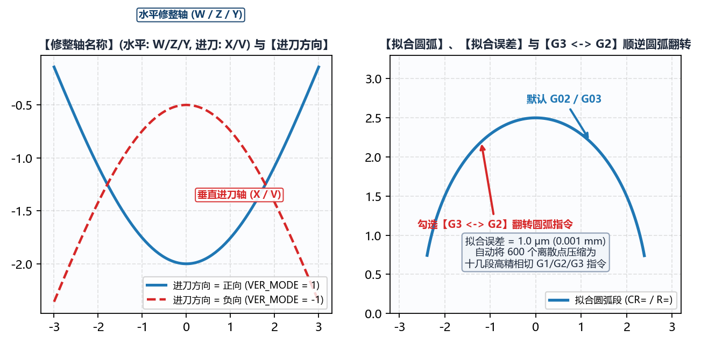

# 3.3 程序信息：程序模式（模式-0 ~ 模式-100）与修整轴配置

切换至 **`高级参数 -> 程序信息`** 子标签页，工程人员可在此定义输出数控宏程序的头部注释信息、选择适配目标磨床数控系统的 **`程序模式`**，并配置修整水平轴、进刀轴名称及进刀方向。

---

## 一、`程序头信息` 与 `程序头加载齿形信息`

1. **`程序头信息`**（多行文本框）：
   允许用户输入自定义的工艺备注（如零件图号、批次号、砂轮粒度型号、操作员提示等）。生成代码时，软件会自动在每行文字前添加对应数控系统的注释符（西门子添加 `;`，发那科添加 `(...)`，新代添加 `//`）并写入宏程序最顶部。
2. **`程序头加载齿形信息`**（`否` / `是`）：
   * 当设为 **`是`**（强烈推荐）时，软件会自动将本次计算的**全部核心输入参数**（包括 `工件类型`、`螺纹旋向`、`工件中径`、`导程`、`砂轮安装角`、左右 `滚轮圆弧半径`、`齿根倒圆半径`、`拟合误差`，以及伴随文件 `*-info.txt` 中的齿形建模参数）自动写入宏程序头部注释区；
   * 这样现场调机人员在数控系统屏幕上打开程序时，一眼即可核对当前修整程序对应的工件规格与滚轮半径，彻底杜绝用错程序撞机。

---

## 二、13 种 `程序模式`（`模式-0` ~ `模式-100`）全景对照表

IGD 内置了 **13 种标准化与自定义程序输出模式**，全面覆盖 **Siemens（西门子 840D sl / 828D / ONE）**、**Fanuc（发那科 0i / 31i）** 与 **Syntec（新代）** 数控磨床，并提供专用于逆向工程的纯 DXF 导出模式（`模式-99`）：

| `程序模式` | 数控系统与文件后缀 | 默认 `当前砂轮直径变量` | 默认 `修整轴名称` (`水平:` / `进刀:`) | 默认 `进刀方向` | 宏程序结构特征与适用机型说明 |
| :--- | :--- | :--- | :--- | :--- | :--- |
| **`模式-0`** | **Siemens** (`.SPF`/`.CPF`) | `DRESSER[24]` | `W` / `U` *(可编辑)* | `负向` *(可编辑)* | **西门子标准通用模板**：含 `当前修整侧变量(0右/1左)`=`DRESSER[44]`、`读取程序信息变量(1读取)`=`DRESSER[40]`，支持在线读取最大/最小直径与滚轮参数，广泛用于内/外螺纹磨床。 |
| **`模式-1`** | **Siemens** (`.SPF`/`.CPF`) | `_OVR[167]` | `Y` / `X` *(固定)* | `负向` *(固定)* | **西门子带完整换刀/修整循环头尾模板**：默认勾选 `G3 ⇆ G2`，自动生成 `G500/T4D1/M91/DIAMOF...DRESS_END` 机床动作指令，常用于螺杆转子与外圆成形磨床。 |
| **`模式-2`** | **Siemens** (`.SPF`/`.CPF`) | `DRESSER[1]` | `W` / `X` *(固定)* | `负向` *(固定)* | **西门子专用模板 A**：`读取程序信息变量(1读取)` 默认为 `DRESSER[43]`，水平轴 `W`、进刀轴 `X`。 |
| **`模式-3`** | **Siemens** (`.SPF`/`.CPF`) | `REPAIR[8]` | `Y` / `X` *(固定)* | `负向` *(固定)* | **西门子专用模板 B**：使用 `REPAIR[8]` 作为实时砂轮直径宏变量，水平轴 `Y`、进刀轴 `X`。 |
| **`模式-4`** | **Siemens** (`.SPF`/`.CPF`) | `R9` | `W` / `V` *(固定)* | `负向` *(固定)* | **西门子 R 参数多道修整循环模板**：内建 `DIAMOF / STRIM / RECALVAR / TRIMEND` 循环标签与修整次数计数器，水平轴 `W`、进刀轴 `V`。 |
| **`模式-5`** | **Fanuc** (`O2010`) | `#603` (`#550=#603`) | `Z` / `X` *(固定)* | `正向` *(固定)* | **发那科标准宏程序模板 A**：输出无后缀 `O2010` 宏程序，通过 `#550=#603` 读取当前砂轮直径并执行 `IF[#550 GE ...] GOTO...` 阶梯跳转。 |
| **`模式-6`** | **新代 Syntec** (`O2010.txt`) | `#340` (`#350 := #340`) | `Y` / `X` *(固定)* | `负向` *(固定)* | **新代（Syntec）专用宏程序模板**：首行带 `%@MACRO` 声明，采用 `//` 注释符与 `:=` 赋值语法（`#350 := #340`），水平轴 `Y`、进刀轴 `X`。 |
| **`模式-7`** | **Fanuc** (`O2010`) | `#603` (`#550=#603`) | `Z` / `X` *(固定)* | `正向` *(固定)* | **发那科标准宏程序模板 B**：带 `#122=100` 起始行号步进与 `N100` 结尾段，适配特定发那科内螺纹磨床宏调用规范。 |
| **`模式-8`** | **Siemens** (`.SPF`/`.CPF`) | `R40` | `W` / `V` *(固定)* | `负向` *(固定)* | **西门子双滚轮参数化定位模板**：支持通过 `R54/R55/R52/R53` 动态偏移左右修整轮基准坐标，水平轴 `W`、进刀轴 `V`。 |
| **`模式-9`** | **Fanuc** (`O2010`) | `#603` | `Z` / `X` *(固定)* | `正向` *(固定)* | **发那科精简宏程序模板**：直接判断 `#603` 直径范围并执行左右分侧修整插补。 |
| **`模式-98`** | **Fanuc 自定义** (`O2010`) | `#603` *(可编辑)* | `Z` / `X` *(可编辑)* | `正向` *(可编辑)* | **发那科全开放自定义模式**：开放 `当前砂轮直径变量`、`水平:`、`进刀:` 轴名及 `进刀方向` 自由编辑，适配任意改装或非标 Fanuc 磨床。 |
| **`模式-99`** | **仅输出 DXF** (`.dxf`) | *自动隐藏* | *自动隐藏* | *自动隐藏* | **单砂轮直径纯 DXF 导出模式**：不生成数控 G 代码，仅针对当前给定的单一最大砂轮直径（或最小杆偏移）输出高精密 `*-wheel.dxf`（理论砂轮廓形）与 `*-dresser.dxf`（滚轮中心轨迹），供第三方 CAM 或 CAD 检图使用。 |
| **`模式-100`** | **Siemens 自定义** (`.SPF`/`.CPF`) | `DRESSER[24]` *(可编辑)* | `W` / `U` *(可编辑)* | `负向` *(可编辑)* | **西门子全开放自定义模式**：开放 `当前砂轮直径变量`、`水平:`、`进刀:` 轴名及 `进刀方向` 自由修改，适配任意非标西门子系统机床。 |

---

## 三、`修整轴名称`、`进刀方向` 与圆弧插补指令映射

在 **`模式-0`**、**`模式-98`** 与 **`模式-100`** 下，用户可根据机床实际机械轴定义修改：

1. **`修整轴名称`**：
   * **`水平:`**：金刚石滚轮沿砂轮宽度方向（平行于砂轮主轴轴线）移动的数控轴名称（常见为 `W`、`Z` 或 `Y`）；
   * **`进刀:`**：金刚石滚轮沿砂轮径向（切入/退出砂轮表面）移动的数控轴名称（常见为 `U`、`V` 或 `X`）。
2. **`进刀方向`（`负向` / `正向`）**：
   * **`负向`**：修整器向砂轮中心切入时，进刀轴坐标值减小（绝大多数卧式内/外圆磨床后置修整器的标准方向，齿根处进刀坐标为负值，齿顶处趋近于 0）；
   * **`正向`**：修整器向砂轮切入时，进刀轴坐标值增大（常见于前置修整器或特定立式/发那科磨床，齿根处进刀坐标为正值）。
   * **重要安全核查**：更改 `进刀方向` 不仅会使所有生成的进刀轴坐标值以及圆弧圆心增量（`I`/`J`/`K` 或 `CR=`）符号反转，还会联动影响圆弧顺逆时针方向。首次在新机床上试切前，请务必在机床空运行模拟画面（或本软件右下角 **`模拟计算`** 视图）中确认刀路凸凹朝向正确！

