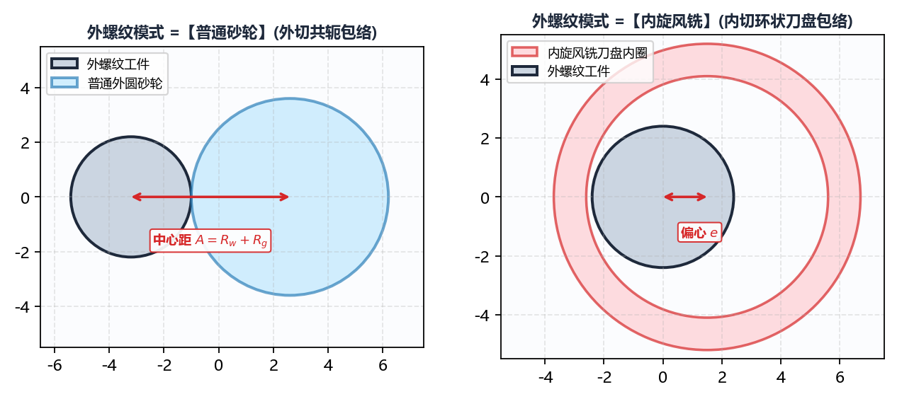
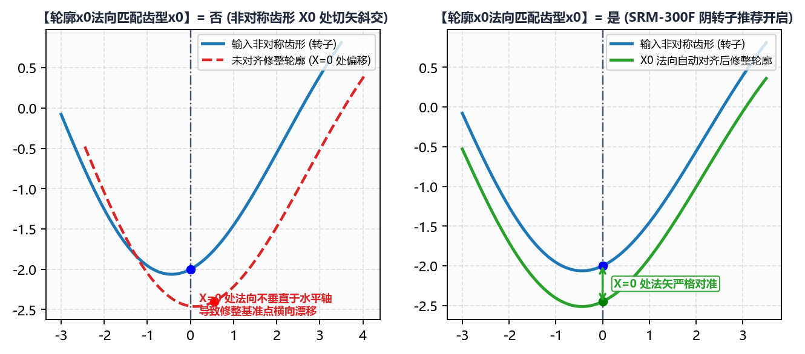

# 3.2 特殊工艺开关：内旋风铣、转子匹配与程序加密

在 **`高级参数 -> 初始化配置`** 下半部分，集成了针对外螺纹旋风铣削、双螺杆压缩机转子基准对齐、以及西门子数控系统知识产权保护的四项核心工艺开关。

---

## 一、`外螺纹模式`（`普通砂轮` vs `内旋风铣`）

当且仅当 **`基本参数 -> 工件类型`** 选择为 **`外螺纹`** 时，`初始化配置` 面板底部会动态显示 **`外螺纹模式`** 选项：

| `外螺纹模式` 选项 | 空间啮合拓扑构型 | 典型工艺场景与砂轮/刀盘直径特征 |
| :--- | :--- | :--- |
| **`普通砂轮`**（默认） | **外啮合（凸对凸）**：砂轮位于外螺纹工件外侧，砂轮中心与工件中心位于接触点两侧，中心距 $A = R_{\text{work}} + R_{\text{wheel}}$。 | 适用于所有常规外螺纹丝杠磨床、精密蜗杆磨床、螺杆转子成形磨床及花键磨床。 |
| **`内旋风铣`** | **内包络外螺纹（凹包凸）**：内切式刀盘（或环形内磨头）环抱在外螺纹丝杠外部旋转，刀盘回转半径大于工件外径，中心偏心距 $e = R_{\text{cutter}} - R_{\text{work}}$。 | 适用于高效率硬态**内旋风铣削**（Whirlwind Milling）刀片廓形设计或内切式外螺纹环面磨削。由于刀盘内圆弧与外螺纹同向包络，接触弧显著拉长，必须开启此模式以获得正确的内包络廓形。 |

---

## 二、`轮廓x0法向匹配齿型x0`（螺杆压缩机转子核心开关）

在对称齿形（如标准三角、梯形或双圆弧丝杠）中，齿槽最低点（$X = 0$）的法线天然垂直于水平轴，空间包络前后的 $X = 0$ 中心位置不会发生漂移。然而，对于**双螺杆压缩机阴阳转子**（如 `SRM-300F`、`SRM-301M`、`SRM-160E`）等**强非对称端面型线**，情况截然不同：

* **`轮廓x0法向匹配齿型x0` = `否`**（默认，常规螺纹/蜗杆使用）：
  直接按导入 DXF 的原始坐标原点进行空间包络投影。对于非对称转子，由于 $X=0$ 处切线具有较大倾角，空间包络计算出的砂轮截面最低点（或基准点）会相对于原始齿形 $X=0$ 产生显著的水平偏移 $\Delta X$ 与径向偏移，导致机床上难以直接用 $X=0$ 对刀。
* **`轮廓x0法向匹配齿型x0` = `是`**（**螺杆转子磨削必开**）：
  如上图左半部分所示，开启此项后，软件会在三维螺旋面包络求解过程中自动追踪原始 DXF 齿形在 $X=0$ 处的空间法矢，并将生成的**砂轮修整截面基准点 $(X=0, Y=0)$ 严格锁死在原始齿形 $X=0$ 的法向对应点上**。这保证了砂轮修整对刀中心与转子型线设计基准完全重合！

---

## 三、`法向作为砂轮廓形`（`否` / `是`）

* **`否`**（默认，**标准三维空间包络计算**）：
  软件完整执行三维螺旋面空间啮合方程求解，精确计算砂轮直径与安装角引起的空间曲率干涉修正量。
* **`是`**（**跳过三维干涉修正，直接以法向齿形作为砂轮廓形**）：
  如上图右半部分所示，当设为 **`是`** 时，系统不再计算由于砂轮有限直径引起的空间包络减薄量，而是直接将工件的法向截面齿形当作砂轮理论截形，仅继续执行后续的**齿高延长、齿根倒圆、左右金刚石滚轮圆弧半径补偿与圆弧拟合**。
  * **何时使用**：
    1. 用作对比基准，评估三维空间干涉修正量到底有多大；
    2. 上游客户给出的 DXF 文件**本身就已经是经过修正的砂轮截面图**，只需使用 IGD 进行滚轮半径偏置补偿并生成数控修整 G 代码。

---

## 四、`Siemens程序加密`（`.SPF` 自动转 `.CPF`）

在 **`拟合误差`** 右侧，配有一个 **`Siemens程序加密`** 复选框（仅在 Windows 操作系统下可用）：

* **未勾选（默认）**：当 `程序模式` 选择为西门子模式（`模式-0` ~ `模式-4`、`模式-8`、`模式-100`）时，`输出程序路径` 下生成标准可读明文宏程序 **`*.SPF`**；
* **勾选 `Siemens程序加密`**：软件在生成 `.SPF` 明文程序后，自动调用内置的西门子程序加密引擎，将其编译加密为不可逆的密文子程序 **`*.CPF`**，从而保护企业核心修整工艺参数与包络数据不被现场导出泄露。

