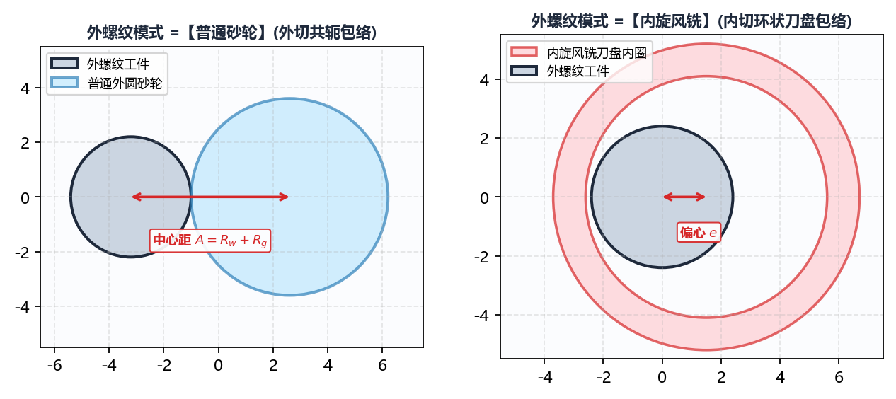
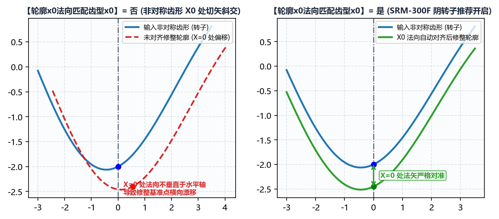

# 3.2 特殊工艺开关

本节说明 **`高级参数 -> 初始化配置`** 下半部分中的四项核心特殊开关：外螺纹旋风铣构型、非对称转子基准锁定、法向直出与西门子程序加密。

---

## `外螺纹模式`（普通砂轮 / 内旋风铣）

当 **`基本参数 -> 工件类型`** 为 **`外螺纹`** 时，面板底部自动显示 **`外螺纹模式`**：

| 选项 | 空间啮合构型 | 适用场景 |
| :--- | :--- | :--- |
| **`普通砂轮`**（默认） | 外啮合（凸对凸），中心距 = 工件半径 + 砂轮半径 | 常规外丝杠、蜗杆、螺杆转子与齿轮/花键磨削 |
| **`内旋风铣`** | 内包络外螺纹（凹包凸），中心偏心 = 刀盘半径 − 工件半径 | 硬态内旋风铣刀片设计或内切环形包络磨削，精确求解长接触弧干涉 |

---

## `轮廓x0法向匹配齿型x0`

对称螺纹齿槽底部（`X = 0`）切线水平，包络前后中心不漂移；而**双螺杆压缩机阴阳转子**（如 `SRM-300F`、`SRM-301M`）等非对称型线在 `X = 0` 处切矢倾斜，会导致砂轮中心横向偏置。

* **`否`**（默认，上图左侧）：按 DXF 原点直接包络，非对称型线会出现对刀基准 `X = 0` 漂移；
* **`是`**（上图右侧，转子磨削推荐）：追踪原始 DXF 在 `X = 0` 处的空间法矢，将砂轮修整截面基准 `(X = 0, Y = 0)` 锁定在其法向对应点，保证与型线设计基准严格重合。

---

## `法向作为砂轮廓形`

* **`否`**（默认）：完整求解三维空间螺旋面啮合方程，精确修正空间曲率干涉；
* **`是`**：跳过三维包络计算，直接沿用输入法向齿形并仅执行齿高延长、倒圆、滚轮偏置与圆弧拟合。
* **常见用途**：
  * 用于工程对比，量化评估三维干涉修正量大小；
  * 当外部客户直接提供已修正完毕的砂轮轮廓 DXF 时，可开启此项直接生成滚轮修整代码。

---

## `Siemens程序加密`

位于 **`拟合误差`** 右侧（仅 Windows 系统下生效）：

* **未勾选（默认）**：西门子模式（`模式-0` ~ `模式-4`、`模式-8`、`模式-100`）输出明文 **`*.SPF`**；
* **勾选后**：生成 `.SPF` 后自动编译加密为 **`*.CPF`** 密文子程序，保护核心修整工艺参数不外泄。

