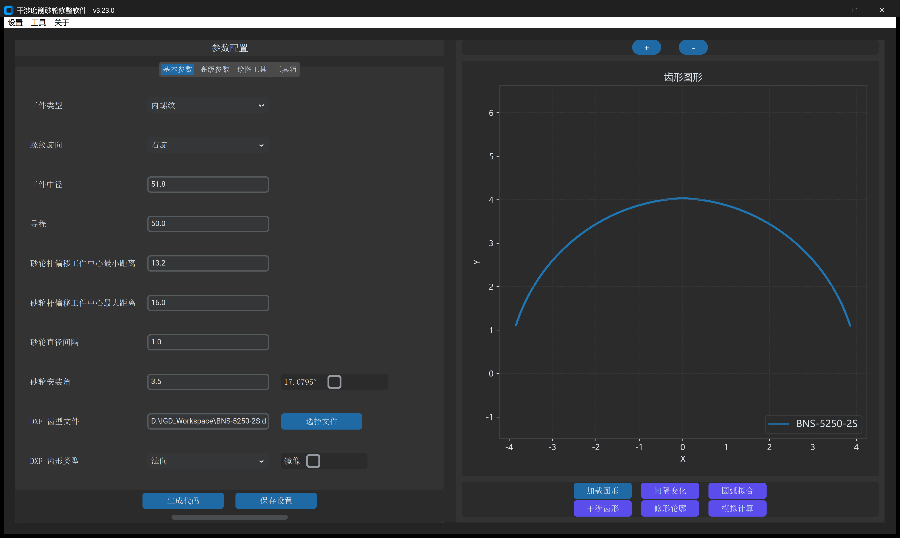
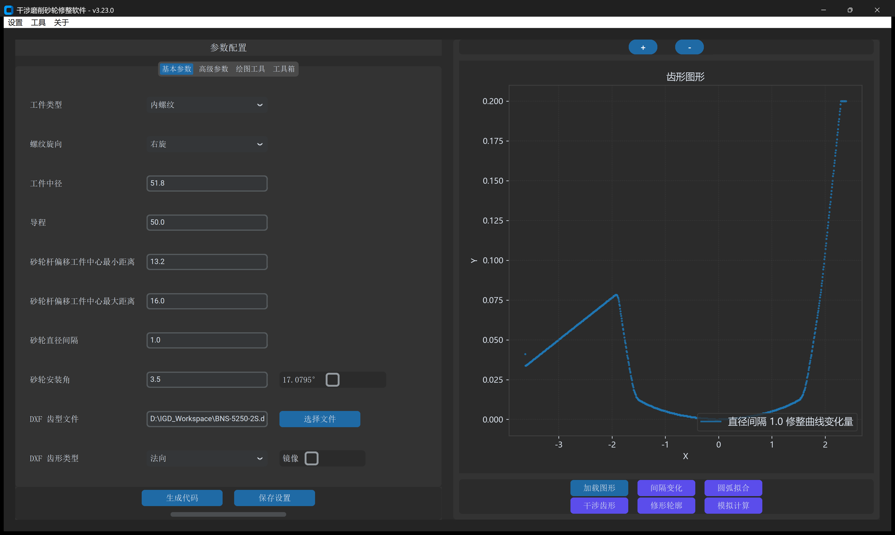
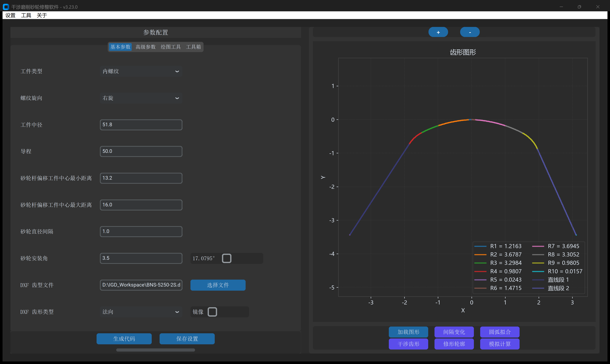
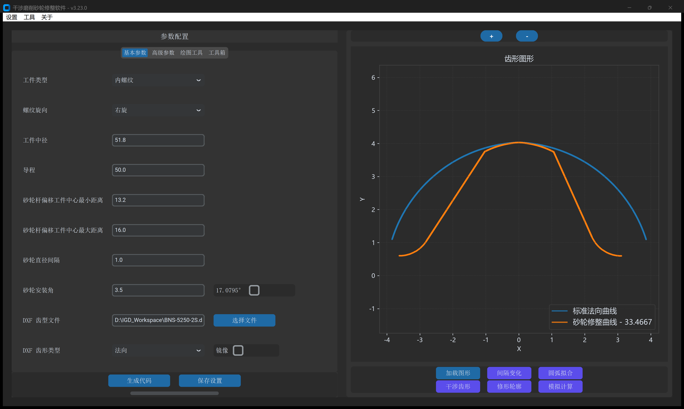
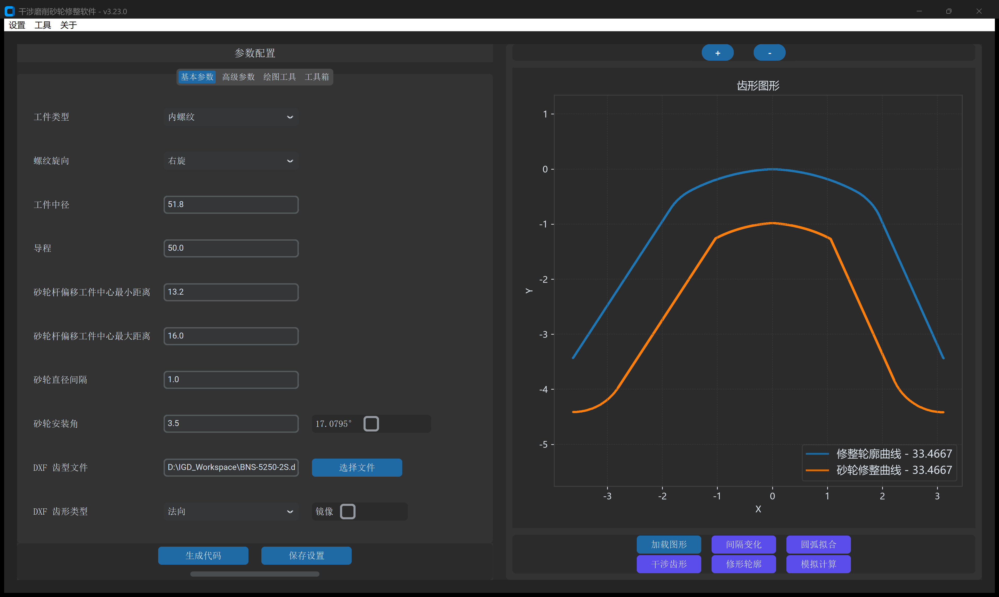
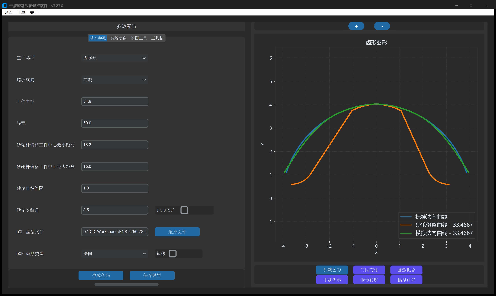

# 4.1 六大计算结果视图

点击 **`生成代码`** 后，右下角 6 个视图按钮依次可用，推荐按序核对每项计算结果后再下发上机。

---

## 视图 1：`加载图形`

直接绘制 `基本参数` 中导入的 DXF 原始齿型轮廓（此处示例为 `BNS-5250-2S` 双圆弧齿槽）：

* **图例要素**：图例显示源文件名（`BNS-5250-2S`），横轴 `X`（对称槽以 `X = 0` 为中心），纵轴 `Y`（`Y = 0` 对齐工件中径）。
* **审查要点**：
  * **连续光滑**：确认无自交、多余辅助线或断裂；
  * **中径对齐与朝向**：核对 `Y = 0` 处宽度及非对称左右侧方向（必要时勾选 `镜像`）。

---

## 视图 2：`间隔变化`

展示砂轮外径随磨损减小（`dxf_compare_two_dia_errors.dxf`）时相邻档位修整轮廓的法向差异：

* **图例要素**：图例按设定步长显示 **`直径间隔 1.0 修整曲线变化量`**。
* **审查要点**：变化曲线应平顺连续无突变尖刺；斜率陡峭说明大导程对该直径段曲率变化较敏感，应保持较小的 `砂轮直径间隔`。

---

## 视图 3：`圆弧拟合`

读取双切圆弧逼近结果（`dxf_dress_contour_curve_fit_arcs_33_4667.dxf`），展示分段圆弧（`G2`/`G3`）与直线结构：

* **图例要素**：分色显示全部平滑圆弧与直线分段并标出精确半径与序号：
  * 圆弧段：`R1 = 1.2163`、`R2 = 3.6787`、`R3 = 3.2984`、`R4 = 0.9807`、`R5 = 0.0243`、`R6 = 1.4715`、`R7 = 3.6945`、`R8 = 3.3052`、`R9 = 0.9805`、`R10 = 0.0157`；
  * 直线段：`直线段 1`、`直线段 2`。
* **审查要点**：
  * **首尾平滑与角度拆分**：单段圆弧扫角严格 ≤ 150°，首尾与 `终点 + CR=R` 连续相切，无台阶错位；
  * **误差写入留档**：去重统计后的实际最大/平均误差同步写入输出 DXF 左下角（及 HTML/TXT 报表）。

---

## 视图 4：`干涉齿形`

叠加对比工件标准理论法向曲线与三维螺旋面包络求解出的无干涉砂轮修整曲线：

* **图例要素**：
  * **`标准法向曲线`**：目标工件法向廓形；
  * **`砂轮修整曲线 - 33.4667`**：消除干涉并执行 `侧边修正`（此处为 `均衡过切和残留`）后的净砂轮廓形。
* **审查要点**：有效工作段保持空间包络相切，肩部截断与延长段平整过渡（外侧截断量不越过 `X = 0`）。

---

## 视图 5：`修形轮廓`

显示叠加左右 `滚轮圆弧半径` 偏置与 `齿根倒圆` 后的金刚石滚轮刀心轨迹：

* **图例要素**：
  * **`修整轮廓曲线 - 33.4667`**：滚轮刀心数控走刀轨迹；
  * **`砂轮修整曲线 - 33.4667`**：净砂轮工作廓形。
* **审查要点**：轨迹与净砂轮曲线全程严格等距偏置（如 `0.98 mm`），齿底交汇平滑无自交打结。

---

## 视图 6：`模拟计算`

上机前终审视图——使用最终砂轮修整轨迹反向模拟磨削工件，并与理论曲线同屏重叠比对：

* **图例要素**：
  * **`标准法向曲线`**（蓝线）：理论目标设计轮廓；
  * **`砂轮修整曲线 - 33.4667`**（橙线）：实际成形砂轮廓形；
  * **`模拟法向曲线 - 33.4667`**（绿线）：虚拟磨削生成的实际工件截面。
* **审查要点**：
  * **重合法则**：工作段 `模拟法向曲线` 与 `标准法向曲线` 高度重合；
  * **孔口过切控制**：在 `均衡过切和残留` 模式下，肩部孔口处的过切已被抑制到微米级均衡区间（详查输出 `dxf_sumulator_normal_*.dxf`）。
