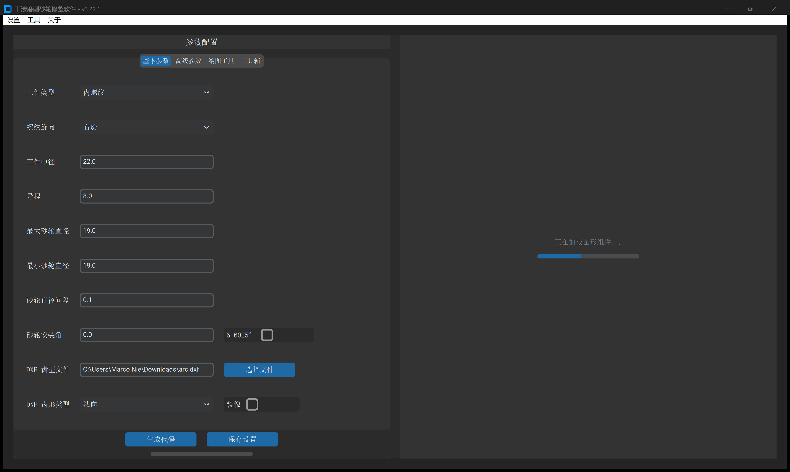
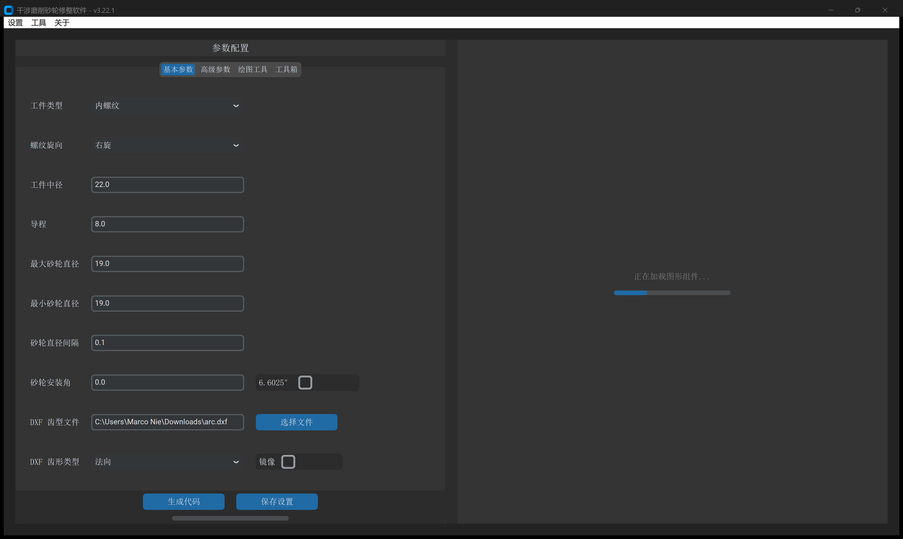
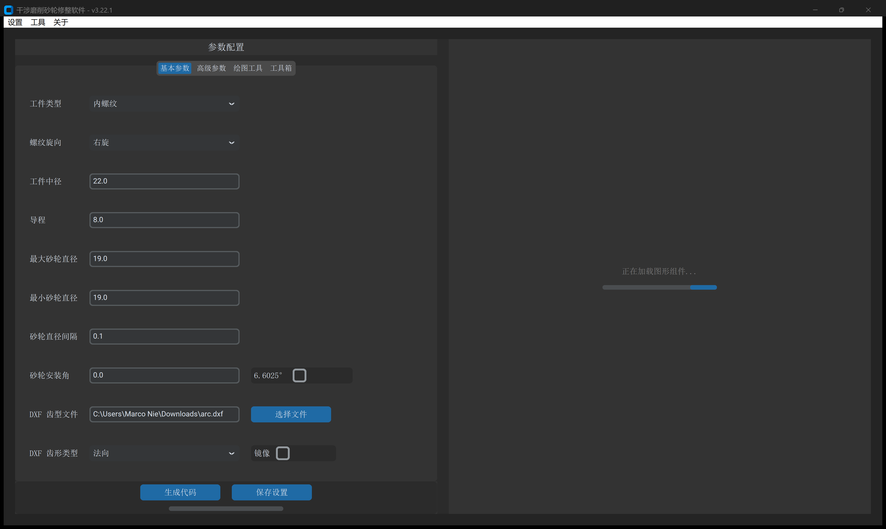
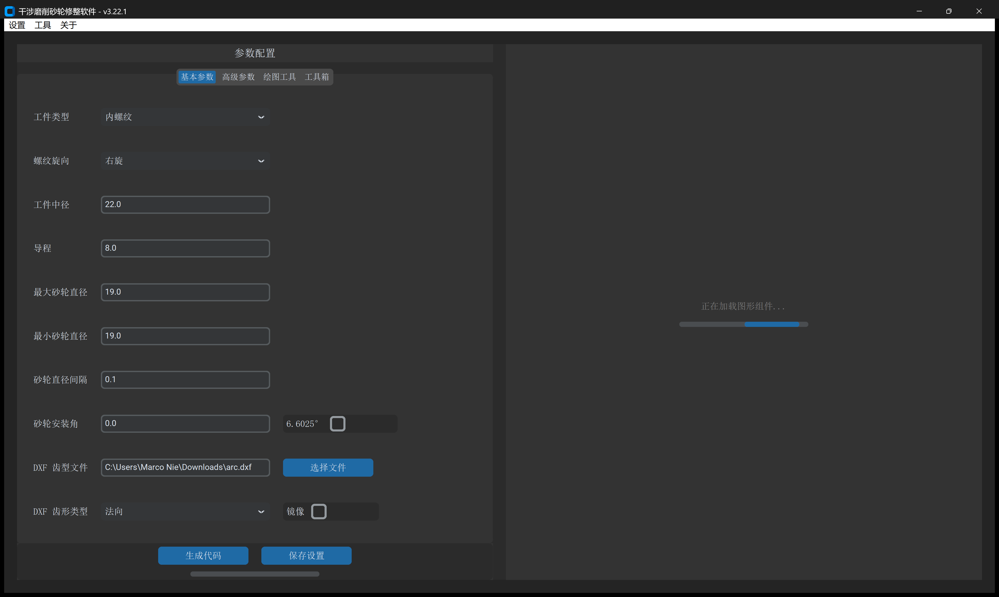

# 4.1 右侧交互画布与 6 大计算结果视图详解

每次在 `基本参数` 或 `高级参数` 中执行 **`生成代码`** 成功后，右下角的 6 个结果视图按钮将依次激活。强烈建议操作人员按顺序点击检视图形质量，作为上机前的数字化虚拟试磨审核。

---

## 视图 1：`加载图形`（检查导入的目标齿形）

显示软件从 DXF 文件中解析出的目标截面曲线：

- **检查要点**：
  - 确认曲线光滑完整、无首尾悬空折返或多余图元。
  - 核验 $Y=0$ 位于中径基准线，对称齿槽以 $X=0$ 为中心。
  - 对于非对称型线，确认左右朝向符合机床装夹方向（必要时勾选 `镜像`）。

---

## 视图 2：`间隔变化`（砂轮全寿命周期修整廓形族）

展示由最大工作砂轮直径至最小报废砂轮直径之间，每隔一个 `砂轮直径间隔` 计算出的全套砂轮修整截面曲线簇：

- **检查要点**：
  - 观察各阶梯曲线是否呈现平顺、均匀的曲率收敛。
  - 最外侧曲线对应新砂轮，最内侧红色实线对应最小砂轮极限。
  - 检查内侧红线是否存在尖锐奇异点（若有，说明最小砂轮直径超出了无干涉极限）。

---

## 视图 3：`圆弧拟合`（G2/G3 圆弧逼近与法向残差分布）

采用上下双子图结构对自适应双切圆弧插补精度进行严密审核：

- **上方子图（圆弧插补段分布）**：
  - 红色与蓝色交替标示各段 G2/G3 相切圆弧，蓝点表示圆弧之间的平滑切点（G 代码节点）。
  - 拐弯曲率剧烈处自动加密，平缓处自动稀疏。
- **下方子图（法向拟合残差分布）**：
  - 纵轴单位为微米（$\mu\text{m}$），显示沿齿形横坐标的实际法向拟合误差。
  - 确认蓝色残差曲线全程落在上下两条红色虚线（设定的 `拟合误差` 公差带，如 $\pm 1\ \mu\text{m}$）内部。

---

## 视图 4：`干涉齿形`（包络修正后的净砂轮成形截面）

检视经过三维螺旋空间包络方程求解、消除了大导程空间干涉，并叠加了齿端延长与倒圆后的理论净砂轮廓形：

- **检查要点**：
  - 用顶部放大镜框选齿根过渡处，确认圆弧过渡光滑相切。
  - 检视齿高延长高度与内收斜坡平整度。

---

## 视图 5：`修形轮廓`（叠加滚轮半径后的刀心修整轨迹）

显示金刚石滚轮刀心在数控机床中实际走刀的左右修整轨迹：

- **检查要点**：
  - **红色曲线**：左侧修整轮走刀轨迹。
  - **蓝色曲线**：右侧修整轮走刀轨迹。
  - 检查左右两侧走刀在齿顶中心处的交汇过渡，确保无漏修台阶或齿根干涉。

---

## 视图 6：`模拟计算`（机床实际 G 代码走刀轨迹还原）

直接解析即将写入 `.SPF` 或 `O2010` 的多阶梯数控代码，还原机床坐标系下的真实走刀路径簇：

- **检查要点**：
  - 核对图形开口朝向与机床 `进刀方向`（正向 / 负向）严格对齐。
  - 确认全部直径档位的修整走刀轨迹均匀有序，无跳跃、无飞圆。
