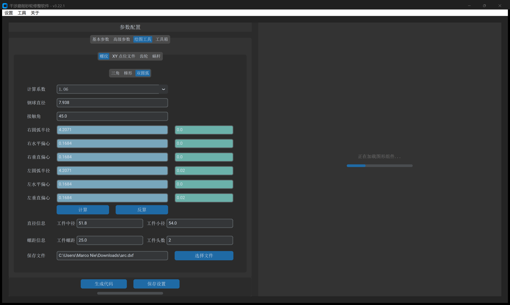
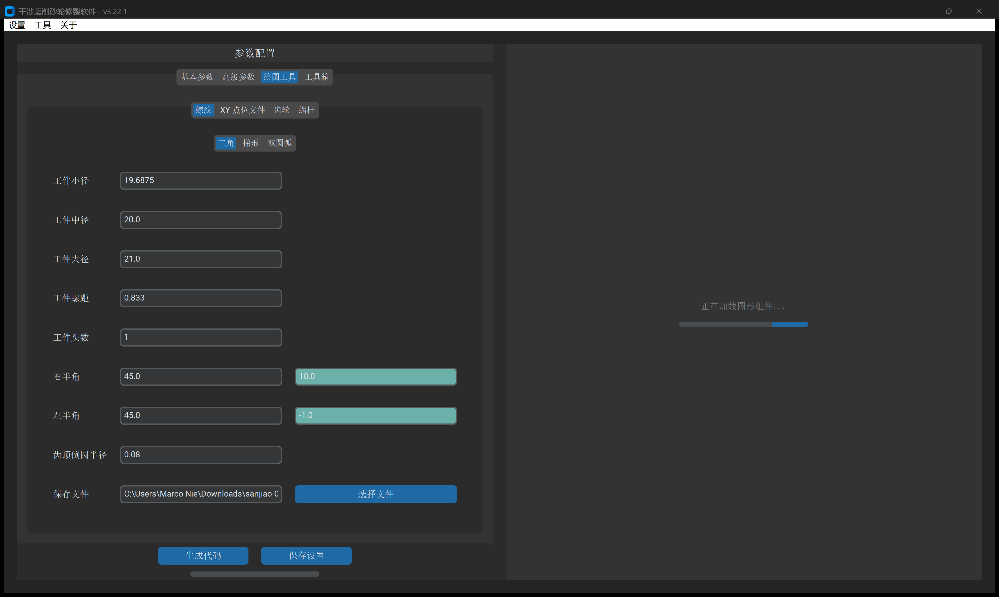
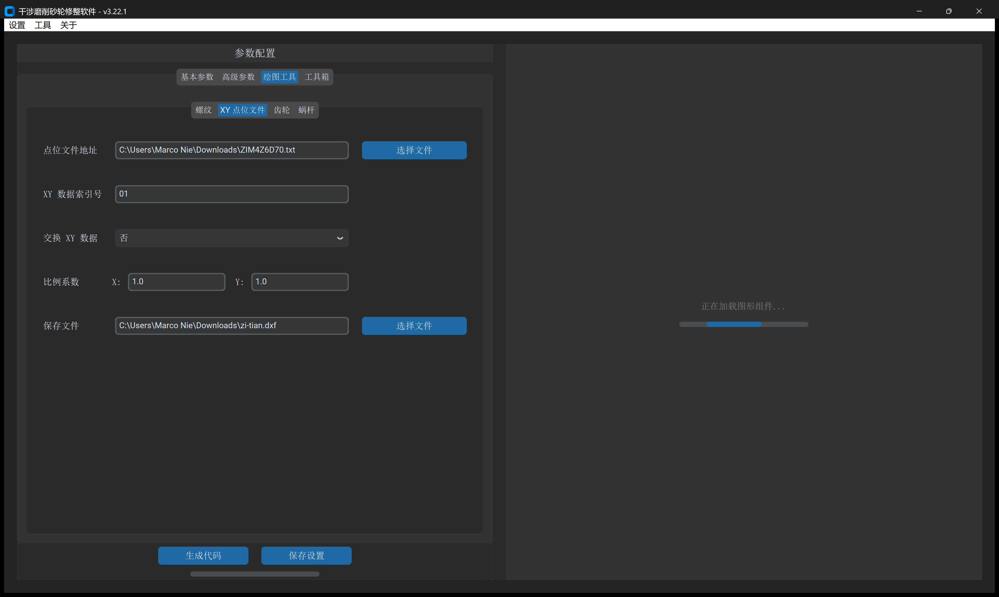
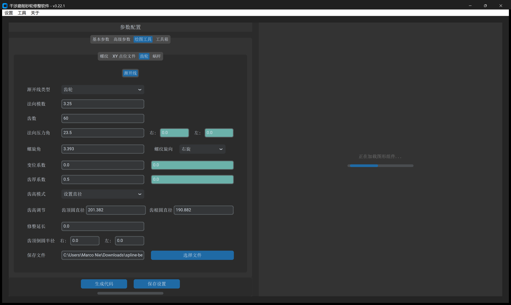
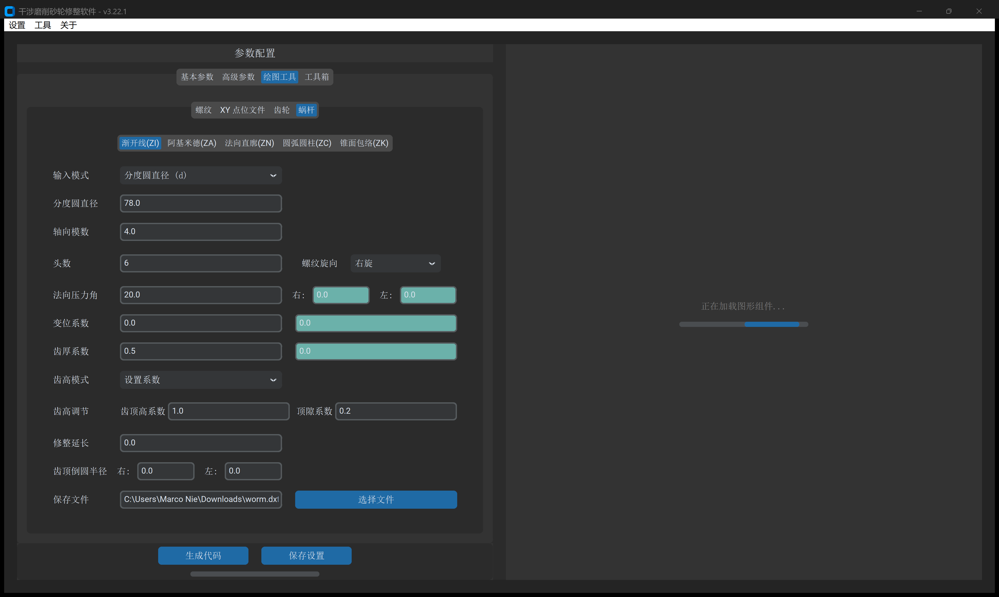

# 第 5 章 绘图工具：标准齿形与空间曲线建模

**`绘图工具`** 标签页内置了完备的参数化几何建模引擎。点击左下角 **`生成齿形文件`** 导出的全部 `.dxf` 文件，均严格保证 **$Y=0$ 位于 `工件中径`**，并同步输出记录几何参数的伴随文件 **`*-info.txt`**，可被 `基本参数` 一键识别加载。

---

## 一、双圆弧（哥特式）滚道建模模块

专用于滚珠丝杠内螺纹螺母与外螺纹丝杠轴的哥特式滚道生成，提供正向 `计算` 与逆向 `反算` 两种工作流：

- **`计算` 模式**：输入 `计算系数`（`1.11`/`1.08`）、`钢球直径` 与 `接触角`（默认 `45°`），系统自动求解左右圆弧半径与偏心坐标并填入蓝灰底框（`#78a6bc`）。
- **`反算` 模式**：在蓝灰框中直接键入图纸给定的半径与偏心，系统逆向推算接触角与钢球规格。
- **公差微调**：在蓝灰框右侧的青绿色微调框（`#6bb1aa`）中直接输入试磨补偿量（如半径补偿 `-0.01`）。

---

## 二、三角与梯形螺纹建模模块

用于行星滚柱丝杠内齿圈（螺母）、精密三角螺纹、梯形丝杠及锯齿形螺纹：

- **多头参数规范**：严格按单牙填写 `工件螺距`，按实际头数填写 `工件头数`（系统自动按导程折算法向截面宽度）。
- **半角独立补偿**：在 `右半角` 与 `左半角` 右侧均配备青绿色微调框（`#6bb1aa`），支持非对称锯齿螺纹及试磨半角修正。

---

## 三、XY 点位文件与渐开线齿轮/花键模块

- **`XY 点位文件`**：
  - 支持单文件或文件夹批量读取离散点云。
  - **`XY 数据索引号`**：指定哪两列为 $X$ 与 $Y$（如 `01` 代表第 1、2 列，`12` 代表第 2、3 列）。
  - **`比例系数`**：支持公英制转换（`25.4`）或方向倒置（`-1`）。

- **`齿轮 -> 渐开线`**：
  - **`渐开线类型`**：下拉切换 `齿轮` 与 `花键`（DIN 5480 标准）。
  - **`齿高模式`**：支持 `设置直径`（$d_a, d_f$）与 `设置系数`（$h_a^*, c^*$）。
  - **齿厚微调**：通过 `齿厚系数` 右侧的青绿框微调公法线或跨棒距。

---

## 四、蜗杆全系 7 种齿形建模模块

涵盖国家标准与国际通用标准的 7 种圆柱蜗杆端面齿形参数化建模：

- **类型导航**：
  - **`渐开线(ZI)`**：渐开线螺旋面精密分度蜗杆。
  - **`阿基米德(ZA)`**：轴向剖面直线齿廓蜗杆。
  - **`齿槽法向(ZN1)`**：齿槽法向直线齿廓蜗杆。
  - **`圆环面包络(ZC1)`**：盘状凸圆弧砂轮包络蜗杆（专属参数：`圆弧半径`、`标准砂轮直径`）。
  - **`特定交角包络(ZC2)`**：指定砂轮轴交角包络蜗杆。
  - **`轴向圆弧齿(ZC3)`**：轴向剖面圆弧齿形蜗杆。
  - **`盘状锥面包络(ZK1)`**：双锥面盘状砂轮包络蜗杆。
