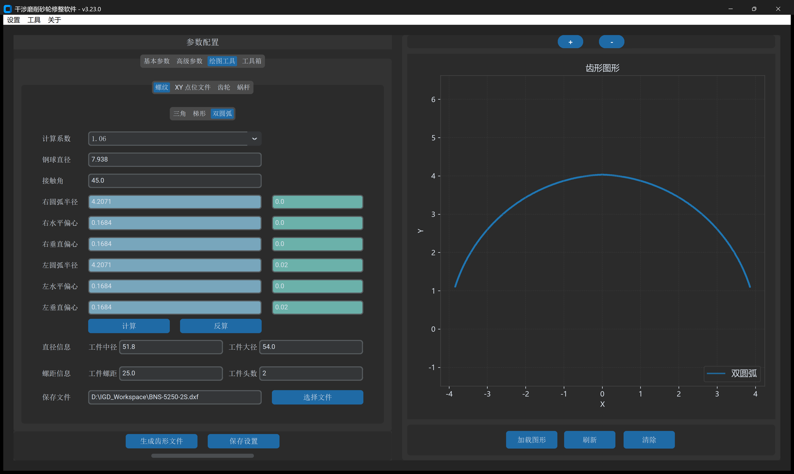
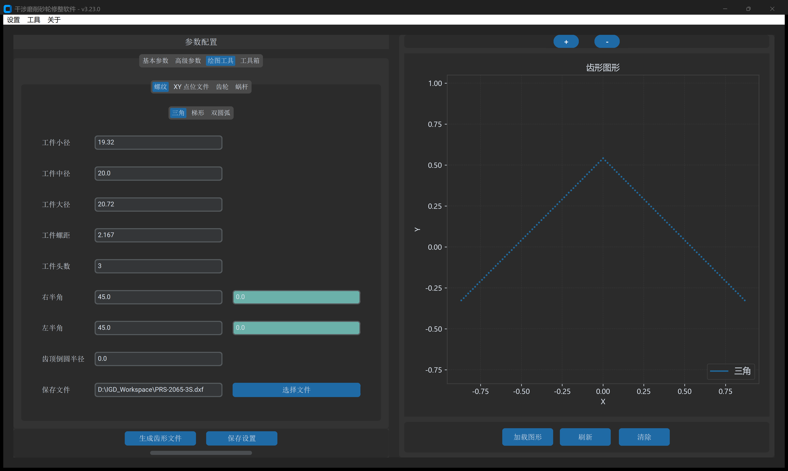
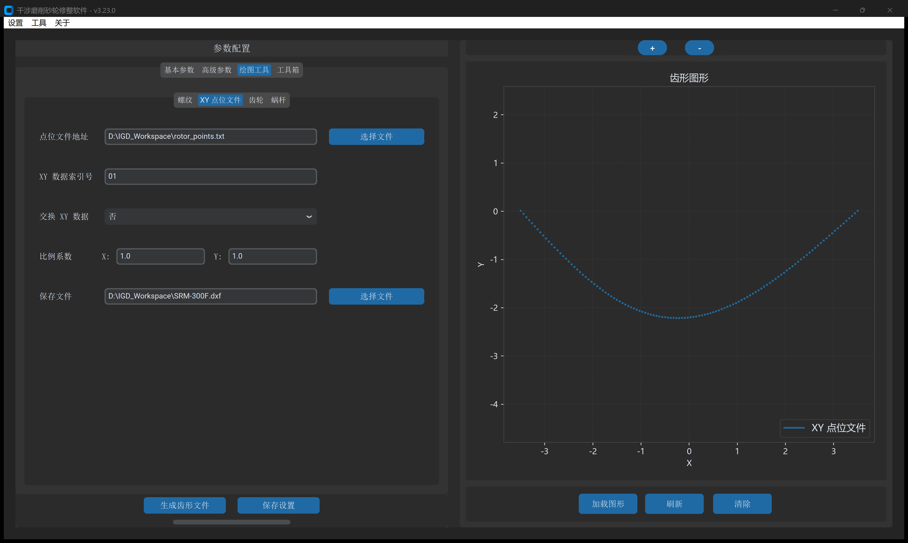
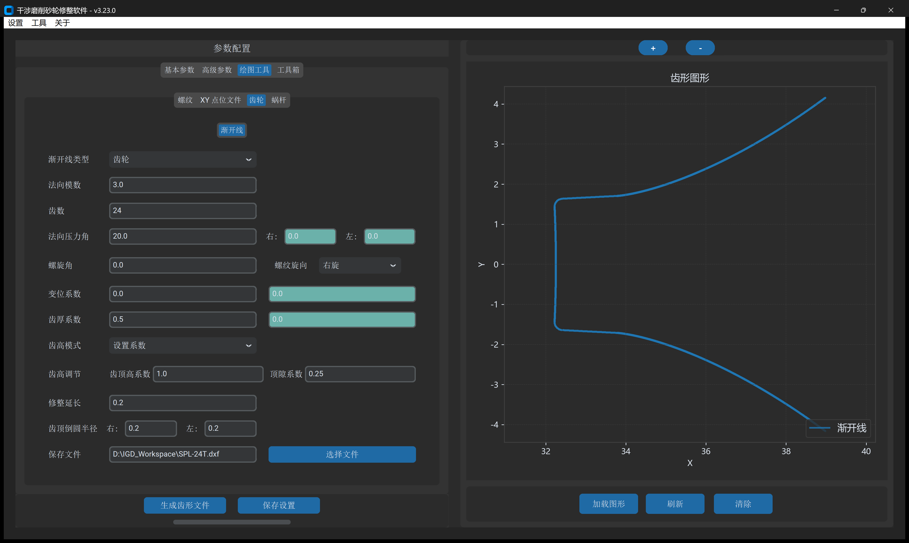
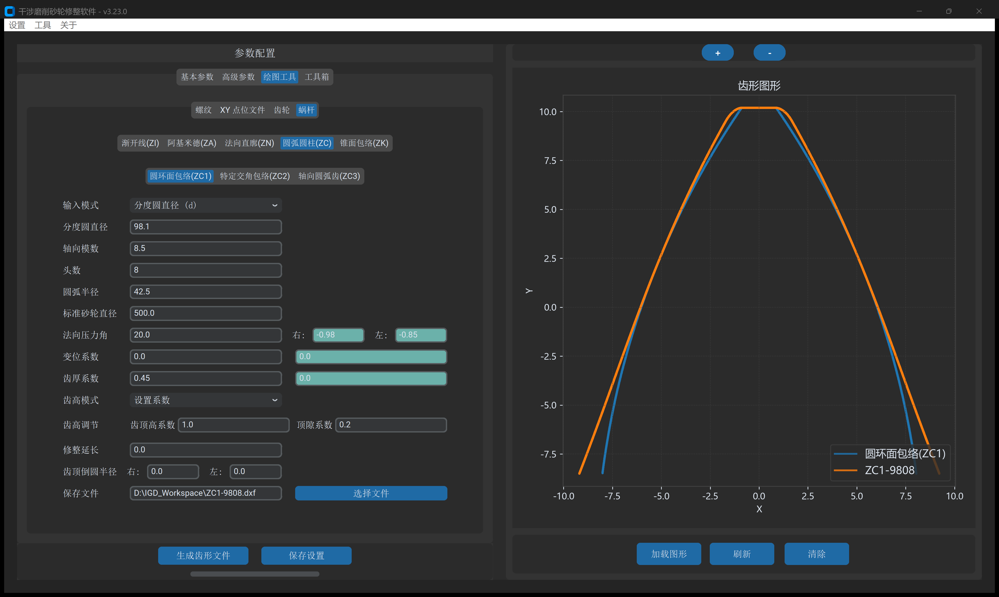

# 5. 绘图工具

**`绘图工具`** 内置五大标准齿形与曲线建模引擎；点击 **`生成齿形文件`** 导出的 `.dxf` 均自动保证 **`Y = 0` 对齐 `工件中径`**，并伴随生成 **`*-info.txt`** 参数元数据以便 `基本参数` 一键回填。

---

## 模块概览

* **双圆弧（哥特式）滚道**：
  
  * `计算` 模式：输入 `计算系数`、`钢球直径`、`接触角`，自动解算偏心与半径填入蓝灰框（`#78a6bc`）；
  * `反算` 模式：输入图纸偏心与半径逆推接触角与钢球尺寸；
  * 青绿微调框（`#6bb1aa`）：输入半径修调量以修正试磨误差或避让顶角。
* **三角与梯形螺纹**：
  
  * 多头工件必须如实分开填写 `工件螺距` 与 `工件头数`（自动折算法向）；
  * `右半角` / `左半角` 均带 `#6bb1aa` 独立补偿框，支持非对称锯齿与角度微调。
* **XY 点位文件转换**：
  
  * 读取单文件或文件夹点云，按 `XY 数据索引号` 指定坐标列，并支持 X/Y 对调与独立缩放比例。
* **渐开线齿轮与花键**：
  
  * 切换 `齿轮` 与 `花键`，支持 `设置直径` / `设置系数` 两种齿高模式及压力角/变位/齿厚微调。
* **7 种标准圆柱蜗杆**：
  
  * 覆盖 `ZI`、`ZA`、`ZN1`、`ZC1`、`ZC2`、`ZC3`、`ZK1` 标准蜗杆建模。

---

## 本章内容

* **[5.1 三角与梯形螺纹](triangle_trapezoid.md)**
* **[5.2 双圆弧（哥特式）螺纹](double_arc.md)**
* **[5.3 XY 点位文件转换](xy_points_file.md)**
* **[5.4 渐开线齿轮与花键](gear_spline.md)**
* **[5.5 七种标准蜗杆建模](worm_profiles.md)**
