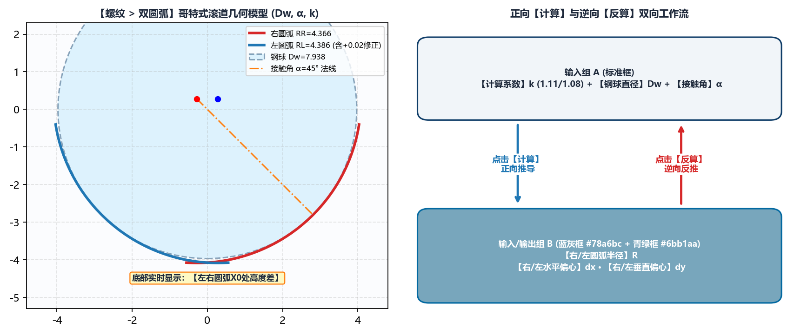

# 5.2 双圆弧（哥特式）螺纹

**`绘图工具 -> 螺纹 -> 双圆弧`** 用于滚珠丝杠螺母与丝杠轴的哥特式（Gothic Arch）双圆弧滚道建模，提供正向 **`计算`** 与逆向 **`反算`** 双向求解。

---

## 几何结构与参数体系

每一侧圆弧由圆弧半径 `R`、水平偏心 `dx`（相对中心 `X = 0`）和垂直偏心 `dy`（相对中径 `Y = 0`）唯一确定。

---

## 正向 `计算` 模式

已知钢球直径与接触角时，自动求解半径与偏心：

1. **填写顶部 3 项（白底框）**：
   * **`计算系数`（k）**：下拉预设 `1.11`、`1.08`，也支持直接在框内手动输入任意比值系数（如 `1.06`、`1.045`）；
   * **`钢球直径`（Dw，mm）**：精密钢球公称直径（如 `3.175`、`7.938`）；
   * **`接触角`（α₀，°）**：标准值通常为 `45`。
2. **点击 `计算` 按钮**：
   系统按以下公式自动计算并填入中部 **6 个蓝灰框（`#78a6bc`）**：

$$R = \frac{1}{2} k \cdot D_w, \qquad d_x = \mp \left(R - \frac{D_w}{2}\right)\cos\alpha_0, \qquad d_y = -\left(R - \frac{D_w}{2}\right)\sin\alpha_0$$

3. **现场公差微调**：
   * 每个蓝灰框右侧配有 **青绿微调框（`#6bb1aa`）**（默认 `0`）；
   * 生成齿形时自动将蓝灰理论值与青绿微调值叠加，无需重算理论参数。

---

## 逆向 `反算` 模式

当图纸直接给出圆弧半径与圆心偏心（如微型螺母 `BNS-0802-M`：`R = 0.636 mm`，`dx = 0.0222 mm`，`dy = 0.0284 mm`）：

1. 在 6 个 **蓝灰框（`#78a6bc`）** 直接输入 `右/左圆弧半径`、`右/左水平偏心`、`右/左垂直偏心`；
2. 点击 **`反算`** 按钮：系统逆推等效 **`钢球直径`** 与 **`接触角`** 并回填顶部框以便校核。

---

## 直径、螺距与底部高度差检查

* **`直径信息` 联动标签**：
  * 输入 **`工件中径`**；
  * 当 `基本参数 -> 工件类型` = **`内螺纹`** 时第 2 项显示 **`工件大径`**（> 中径）；为 **`外螺纹`** 时显示 **`工件小径`**（< 中径）。
* **`螺距信息`**：填写单牙 **`工件螺距`** 与 **`工件头数`**（如双头 `BNS-5250-2S` 填 `25` 与 `2`）。
* **`左右圆弧X0处高度差:` 校验**：
  * 点击左下角 **`生成齿形文件`** 后底部实时显示两圆弧在 `X = 0` 处的高度差；
  * 对称微调时显示 `0.0 mm`；非对称调整后若差值 > `0.005 mm`，请在画布放大核查底角衔接是否平滑。

