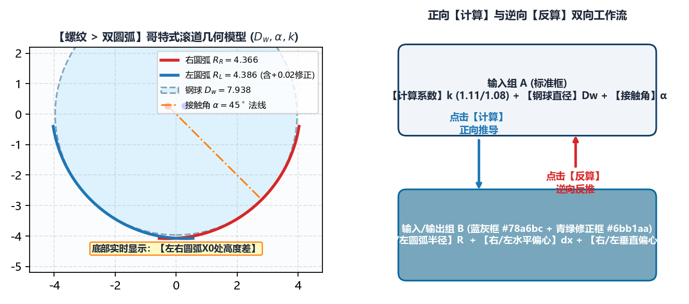

# 5.2 螺纹：双圆弧（哥特式）齿形正向计算与反算

**`绘图工具 -> 螺纹 -> 双圆弧`** 是滚珠丝杠副（内螺纹螺母与外螺纹丝杠轴）加工中最常使用的核心建模模块。滚珠丝杠滚道普遍采用由左右两段偏心圆弧交汇而成的**哥特式（Gothic Arch）双圆弧截形**，以实现钢球与滚道在 $45^\circ$ 接触角下的四点/两点精准接触并容纳润滑油膜。

---

## 一、双圆弧滚道空间几何与参数体系

如上图所示，双圆弧齿形的每一侧由圆弧半径 $R$、圆心水平偏心量 $d_x$（相对于齿槽对称轴 $X=0$）和圆心垂直偏心量 $d_y$（相对于中径基准线 $Y=0$）唯一确定。软件提供**正向 `计算`**与**逆向 `反算`**两种互补的工程建模模式。

---

## 二、模式 A：正向 `计算`（已知钢球直径与接触角，自动推算圆弧与偏心）

当工艺设计给定了滚珠规格与接触角时，使用 **`计算`** 按钮：

1. **填写顶部 3 项设计输入（白底框）**：
   * **`计算系数`** ($k$)：下拉选择 **`1.11`** 或 **`1.08`**（代表理论圆弧半径与钢球半径的比值系数，行业标准常取 $R \approx 0.54 D_w \sim 0.555 D_w$）；
   * **`钢球直径`** ($D_w$，单位：$\text{mm}$)：滚珠丝杠所使用的精密钢球公称直径（例如 `3.175`、`5.953`、`9.525` 等）；
   * **`接触角`** ($\alpha_0$，单位：`$^\circ$`）：钢球与滚道曲面的法向接触角（标准值通常为 **`45`**）。
2. **点击中部的 `计算` 按钮**：
   系统立即按哥特式双圆弧啮合公式自动算出 6 项几何参数并填入中部的 **蓝灰色输入框（`#78a6bc`）**：
   * **`右圆弧半径`** / **`左圆弧半径`**：$R = \frac{1}{2} k \cdot D_w$
   * **`右水平偏心`** / **`左水平偏心`**：$d_x = \mp \left(R - \frac{D_w}{2}\right)\cos\alpha_0$
   * **`右垂直偏心`** / **`左垂直偏心`**：$d_y = -\left(R - \frac{D_w}{2}\right)\sin\alpha_0$
3. **利用青绿色修正框（`#6bb1aa`）进行现场工艺微调**：
   在每个蓝灰色框右侧，均配有一个 **`#6bb1aa` 青绿色修正框**（默认 `0`）。例如在 `BNS-5250-2S` 大螺母磨削中，若试磨后发现双圆弧底部交汇处过深或接触角偏大，无需重算理论值，只需在 `右垂直偏心` / `左垂直偏心` 右侧的青绿框中输入微调量（如 `-0.008`），生成齿形时系统会自动将蓝灰框理论值与青绿框微调值相加！

---

## 三、模式 B：逆向 `反算`（已知图纸圆弧半径与偏心，反推钢球与接触角）

许多主机厂的产品图纸不直接标注 `计算系数`，而是在剖视图上直接给定滚道圆弧半径 $R$ 以及圆心偏心距 $(d_x, d_y)$（如 `BNS-0802-M` 微型螺母图纸直接给出 $R=0.46\text{ mm}, d_x=-0.025\text{ mm}, d_y=-0.036\text{ mm}$）：

1. 直接在 6 个 **蓝灰色输入框（`#78a6bc`）** 中手动输入图纸给定的：
   * **`右圆弧半径`**、**`右水平偏心`**、**`右垂直偏心`**
   * **`左圆弧半径`**、**`左水平偏心`**、**`左垂直偏心`**
2. 点击 **`反算`** 按钮：
   * 软件自动根据输入的圆弧半径与偏心坐标，逆向解算出对应的等效 **`钢球直径`** 与 **`接触角`** 并回填至顶部输入框，方便工艺员核验图纸标注是否自洽。

---

## 四、`直径信息`、`螺距信息` 与 `左右圆弧X0处高度差` 校验

1. **`直径信息` 联动规则**：
   * **`工件中径`**：输入滚道节圆（中径）直径；
   * **第 2 个直径框（动态标签）**：
     * 当 `基本参数 -> 工件类型` 为 **`内螺纹`** 时，该标签自动显示为 **`工件大径`**（输入螺母滚道底部的最大内孔直径，必须**大于** `工件中径`）；
     * 当 `基本参数 -> 工件类型` 为 **`外螺纹`** 时，该标签自动显示为 **`工件小径`**（输入丝杠轴滚道底部的最小底径，必须**小于** `工件中径`）。
2. **`螺距信息`**：填写 **`工件螺距`** 与 **`工件头数`**（多头丝杠如双头 `BNS-5250-2S` 填写螺距 `25`、头数 `2`）。
3. **底部状态栏 `左右圆弧X0处高度差:` 判据**：
   点击左下角 **`生成齿形文件`** 后，面板最下方会实时显示左右两段圆弧在对称中心 $X = 0$ 交汇处的径向高度差 $\Delta Y_{X=0}$：
   * 当左右圆弧半径与偏心完全对称时，显示 **`左右圆弧X0处高度差: 0.0 mm`**；
   * 若在对左右偏心进行了非对称独立微调后，该值大于 `0.005 mm`，说明 $X=0$ 交点偏移了几何中心，请在右侧画布中放大检视尖底交接处是否平滑。

