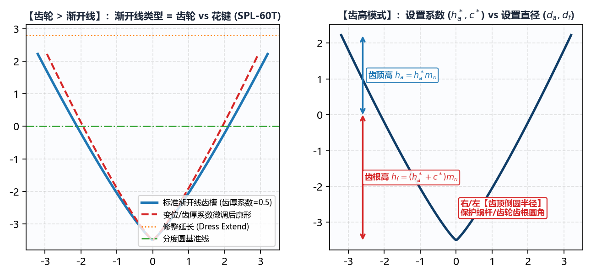

# 5.4 齿轮：渐开线齿轮与花键齿形生成

切换至 **`绘图工具 -> 齿轮 -> 渐开线`**，该模块用于参数化生成标准或变位**渐开线直齿/斜齿轮**以及**渐开线花键**（如 `SPL-60T`）的精确端面齿槽曲线 DXF。

---

## 一、`渐开线类型`（`齿轮` vs `花键`）与 `齿高模式`

### 1. `渐开线类型` 切换逻辑

* **`齿轮`**（默认）：
  面向圆柱直齿轮与斜齿轮成形磨削，开放 **`齿高模式`** 下拉框（支持按 **`设置直径`** 或 **`设置系数`** 两种方式定义齿顶与齿根高度）；
* **`花键`**：
  面向 DIN 5480 / GB/T 3478 等渐开线花键轴成形磨削（如 60 齿花键 `SPL-60T`）。切换为 **`花键`** 时，系统自动隐藏 `齿高模式` 下拉框，固定采用工程图纸最直观的 **`齿顶圆直径`** ($d_a$) 与 **`齿根圆直径`** ($d_f$) 直接控制齿槽上下边界。

### 2. 两种 `齿高模式`（当 `渐开线类型` = `齿轮` 时）

* **`设置直径`**：在下方 `齿高调节` 区域直接输入 **`齿顶圆直径`** ($d_a$) 与 **`齿根圆直径`** ($d_f$)；
* **`设置系数`**：在下方 `齿高调节` 区域输入标准无量纲系数——**`齿顶高系数`** ($h_a^*$，标准值 `1.0`) 与 **`顶隙系数`** ($c^*$，标准值 `0.25`)，系统自动根据法向模数 $m_n$、齿数 $z$、螺旋角 $\beta$ 与变位系数 $x_n$ 推算齿顶圆与齿根圆直径。

---

## 二、全参数明细与青绿色微调框（`#6bb1aa`）用法

| 参数名称 | 单位 | 工程含义与配置说明 |
| :--- | :--- | :--- |
| **`渐开线类型`** | 选项 | 下拉选择 **`齿轮`** 或 **`花键`**。 |
| **`法向模数`** ($m_n$) | $\text{mm}$ | 齿轮或花键的法向模数（必须 $> 0$）。 |
| **`齿数`** ($z$) | 正整数 | 工件总齿数（如 `SPL-60T` 填 `60`）。 |
| **`法向压力角`** ($\alpha_n$) + `右:`/`左:` `#6bb1aa` | `$^\circ$` | 白底主框输入标准法向压力角（齿轮常取 `20`，花键常取 `30` 或 `37.5`）；右侧两个 **`#6bb1aa` 青绿色微调框**分别用于对**右齿面**与**左齿面**压力角进行独立微调补偿（消除齿形角偏差）。 |
| **`螺旋角`** ($\beta$) + **`螺纹旋向`** | `$^\circ$` | 分度圆螺旋角（直齿/直花键填 **`0`**；斜齿轮填入实际螺旋角并选择 `右旋` 或 `左旋`）。 |
| **`变位系数`** ($x_n$) + `#6bb1aa` 修正框 | 无量纲 | 白底主框填图纸设计法向变位系数（标准无变位填 `0`）；右侧 `#6bb1aa` 框用于现场磨削深度微调。 |
| **`齿厚系数`** + `#6bb1aa` 修正框 | 无量纲 | 定义分度圆处弧齿厚与齿距的比值（标准对分齿厚填 **`0.5`**）；当需要通过减薄/加厚砂轮来直接调整公法线长度 $W_k$ 或跨棒距 $M$ 值时，直接在右侧 **`#6bb1aa` 青绿色框**中输入微调量！ |
| **`齿高调节`** | $\text{mm}$ 或系数 | 输入 **`齿顶圆直径`** / **`齿根圆直径`**（或 **`齿顶高系数`** / **`顶隙系数`**）。 |
| **`修整延长`** | $\text{mm}$ | 齿顶圆以外向上延伸的修整余量高度（默认 `0` ~ `0.5 mm`）。 |
| **`齿顶倒圆半径`** (`右:` / `左:`) | $\text{mm}$ | 生成的砂轮齿顶（即对应工件齿槽根部）左右过渡圆角半径。 |
| **`保存文件`** + **`选择文件`** | 路径 | 指定输出的端面齿形 `.dxf` 保存路径。 |

> **与 `基本参数` 的联动提示**：由 `绘图工具 -> 齿轮 -> 渐开线` 生成的 `*-info.txt` 会自动将 `DXF 齿形类型` 标记为 **`端面(左)`**，并将分度圆直径 $d = m_n z / \cos\beta$ 与导程 $P_h = \pi d / \tan\beta$（直齿时导程定义为无穷大等效超大值）自动记录。

