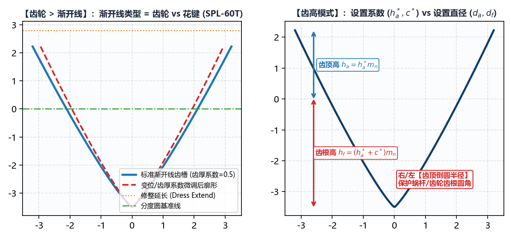

# 5.4 渐开线齿轮与花键

**`绘图工具 -> 齿轮 -> 渐开线`** 用于生成标准或变位直/斜圆柱齿轮及渐开线花键（如 `SPL-60T`）的端面齿槽 DXF。

---

## `渐开线类型` 与 `齿高模式`

* **`齿轮`**（默认）：开放 `齿高模式` 选择：
  * **`设置直径`**：直接输入 `齿顶圆直径`（`da`）与 `齿根圆直径`（`df`）；
  * **`设置系数`**：输入无量纲 `齿顶高系数`（`ha*`）与 `顶隙系数`（`c*`）由公式自动推算。
* **`花键`**：面向 DIN 5480 / GB/T 3478 花键，固定按 `齿顶圆直径` 与 `齿根圆直径` 控制边界（隐藏 `齿高模式`）。

---

## 参数配置表

| 参数名称 | 单位 | 工程含义与设置要点 |
| :--- | :--- | :--- |
| **`法向模数`** | mm | 齿轮或花键法向模数（> 0） |
| **`齿数`** | 正整数 | 总齿数（如 `SPL-60T` 填 `60`） |
| **`法向压力角`** + `#6bb1aa` | `°` | 齿轮常取 `20`，花键常取 `30` 或 `37.5`；右侧青绿框分别微调右/左齿面角度 |
| **`螺旋角`** + **`螺纹旋向`** | `°` | 直齿/直花键填 `0`；斜齿轮填分度圆螺旋角并选 `右旋`/`左旋` |
| **`变位系数`** + `#6bb1aa` | 无量纲 | 设计法向变位系数（标准填 `0`），右侧青绿框可微调磨深 |
| **`齿厚系数`** + `#6bb1aa` | 无量纲 | 默认 `0.5`；用右侧青绿框微调公法线 `Wk` 或跨棒距 `M` |
| **`齿高调节`** | mm/系数 | 填入 `da`/`df` 或 `ha*`/`c*` |
| **`修整延长`** / **`齿顶倒圆半径`** | mm | 齿顶以外延伸余量与砂轮齿顶（齿槽根部）`右:`/`左:` 圆角半径 |
| **`保存文件`** | 路径 | 目标端面 `.dxf` 路径 |

* **`基本参数` 自动联动**：伴随文件 `*-info.txt` 自动将 `DXF 齿形类型` 设为 **`端面(左)`**，并写入分度圆直径与等效导程。

