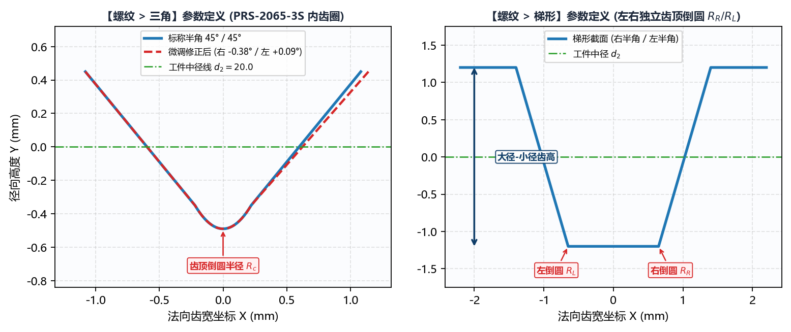

# 5.1 三角与梯形螺纹

**`绘图工具 -> 螺纹 -> 三角` / `梯形`** 用于生成精密三角螺纹、行星滚柱丝杠齿圈、梯形丝杠及非对称锯齿螺纹的**法向截面标准 DXF**。

---

## 几何结构对比

两者均基于法向截面构建（`*-info.txt` 默认标注 `法向`），差异在于齿顶与过渡倒角：

* **`三角`**：左右直线侧翼交汇后以单一 **`齿顶倒圆半径`**（`Rc`）圆滑过渡，无水平齿底平段（契合行星滚柱丝杠 `PRS-2065-3S`）；
* **`梯形`**：保留平顶段，支持为左右角独立设定 **`齿顶倒圆半径`**（`右:` 与 `左:`）。

---

## 参数输入规范

| 参数名称 | `三角` | `梯形` | 单位 | 工程含义与填值规范 |
| :--- | :---: | :---: | :--- | :--- |
| **`工件小径`** | ✓ | ✓ | mm | 螺纹最小直径（`d₁ < d₂ < d`） |
| **`工件中径`** | ✓ | ✓ | mm | 中径基准（DXF 中 `Y = 0` 所在直径） |
| **`工件大径`** | ✓ | ✓ | mm | 螺纹最大直径 |
| **`工件螺距`** | ✓ | ✓ | mm | 单牙轴向螺距 |
| **`工件头数`** | ✓ | ✓ | 正整数 | 螺纹头数（如 `PRS-2065-3S` 为 `3`），系统按 `导程 = 螺距 × 头数` 自动折算法向 |
| **`右半角` / `左半角`** | ✓ | ✓ | `°` | 左右牙型半角 + `#6bb1aa` 角度微调框，支持非对称齿形 |
| **`齿顶倒圆半径`** | 单一值 | `右:`/`左:` | mm | 齿顶圆弧过渡半径（≥ 0） |
| **`保存文件`** | ✓ | ✓ | 路径 | 目标 `.dxf` 保存路径 |

---

## 操作流程与注意事项

* **多头大导程必须分填螺距与头数**：
  * 系统先按 `λ = arctan((P × z) / (π × d₂))` 计算螺旋升角，再将轴向螺距按 `P_n = P × cos(λ)` 投影至法向；
  * 例如 `PRS-2065-3S` 应填 **`工件螺距 = 2.167`**、**`工件头数 = 3`**，切勿把总导程填为单头螺距。
* **生成结果**：
  * 点击左下角 **`生成齿形文件`** 后，右侧画布显示法向轮廓曲线；
  * 目标目录同步生成 `<文件名>.dxf` 与 `<文件名>-info.txt`。

