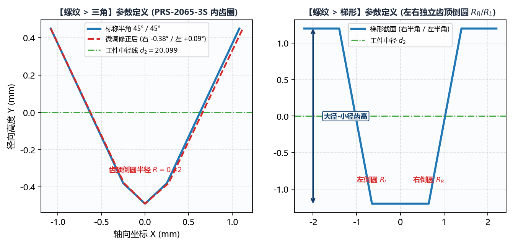

# 5.1 螺纹：三角与梯形齿形生成

切换至 **`绘图工具 -> 螺纹`**，前两个子标签页分别为 **`三角`** 与 **`梯形`**，用于生成精密三角螺纹、行星滚柱丝杠内/外螺纹、梯形丝杠（Tr）及锯齿形非对称螺纹的**法向截面标准齿形 DXF**。

---

## 一、`三角` 与 `梯形` 齿形几何结构对比

两者的数学构造均基于工件法向截面（生成的 `*-info.txt` 中自动标记 `DXF 齿形类型` 为 `法向`），核心区别在于齿顶平段与过渡圆角的定义方式：

* **`三角`（行星滚柱丝杠与精密三角螺纹）**：
  由左右两条倾斜齿侧直线向尖端交汇，并在顶部以单一 **`齿顶倒圆半径`** ($R_c$) 作相切圆弧过渡（无水平齿底平段，特别契合行星滚柱丝杠螺母内齿圈如 `PRS-2065-3S` 的圆弧槽底特征）；
* **`梯形`（梯形丝杠与精密传动螺母）**：
  具有明确的梯形平顶段，且支持对左右两个顶角分别独立设置 **`齿顶倒圆半径`**（`右:` $R_{c,R}$ 与 `左:` $R_{c,L}$）。

---

## 二、参数逐项详解与输入规范

| 参数名称 | `三角` | `梯形` | 单位 | 工程含义与输入规范 |
| :--- | :---: | :---: | :--- | :--- |
| **`工件小径`** ($d_1$) | ✓ | ✓ | $\text{mm}$ | 螺纹最小直径（必须满足 $d_1 < d_2 < d$）。 |
| **`工件中径`** ($d_2$) | ✓ | ✓ | $\text{mm}$ | 螺纹中径基准（即生成 DXF 中 $Y = 0$ 所在的基准直径）。 |
| **`工件大径`** ($d$) | ✓ | ✓ | $\text{mm}$ | 螺纹最大直径（内螺纹滚道最深处直径或外螺纹外径）。 |
| **`工件螺距`** ($P$) | ✓ | ✓ | $\text{mm}$ | 相邻两牙之间的轴向距离（单牙螺距）。 |
| **`工件头数`** ($z$) | ✓ | ✓ | 正整数 | 螺纹头数（单头填 `1`，多头行星丝杠如 `PRS-2065-3S` 填 `3` 或 `5`）。系统自动按 $\text{导程} = P \times z$ 计算法向截面缩减比。 |
| **`右半角`** ($\alpha_R$) + `#6bb1aa` 修正框 | ✓ | ✓ | `$^\circ$` | 右侧齿面牙型半角（如米制三角螺纹填 `30`，梯形螺纹填 `15`，行星丝杠填 `45`）。右侧**青绿色框（`#6bb1aa`）**用于输入现场试磨角度微调补偿量（如 `-0.05`）。 |
| **`左半角`** ($\alpha_L$) + `#6bb1aa` 修正框 | ✓ | ✓ | `$^\circ$` | 左侧齿面牙型半角 + 右侧**青绿色微调框（`#6bb1aa`）**。支持左右半角不等的非对称锯齿形螺纹建模。 |
| **`齿顶倒圆半径`** | 单一值 $R_c$ | `右:` / `左:` 双值 | $\text{mm}$ | `三角` 模式下为尖端过渡圆弧半径；`梯形` 模式下分别为右上角与左上角的过渡圆角半径（必须 $\ge 0$）。 |
| **`保存文件`** + **`选择文件`** | ✓ | ✓ | 路径 | 指定输出的 `.dxf` 文件完整保存路径。 |

---

## 三、法向齿槽宽度自动折算原理与操作流程

1. **多头大导程下的法向缩减效应**：
   当输入 **`工件螺距`** ($P$)、**`工件头数`** ($z$) 与 **`工件中径`** ($d_2$) 后，软件内部会先求出中径螺旋升角 $\lambda = \arctan\big((P \cdot z) / (\pi d_2)\big)$，随后将轴向螺距 $P$ 按 $\cos\lambda$ 精确投影为法向齿距 $P_n = P \cos\lambda$。因此，**对于多头大导程螺纹（如 `PRS-2065-3S`，螺距 `2.1667 mm`、头数 `3`、导程 `6.5 mm`），请务必如实填写 `工件螺距` 与 `工件头数`**，切勿把总导程填进 `工件螺距` 而把头数填为 `1`！
2. **生成与校验步骤**：
   * 填写上述全部几何参数并指定 **`保存文件`** 路径；
   * 点击左下角 **`生成齿形文件`** 按钮；
   * 右侧画布立即绘出绿色的标准法向齿形曲线，同时在目标路径下生成 `<文件名>.dxf` 与 `<文件名>-info.txt`。

