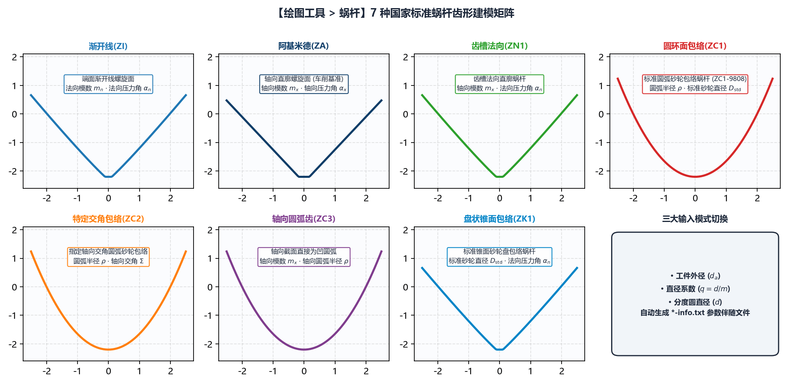

# 5.5 七种标准蜗杆建模

**`绘图工具 -> 蜗杆`** 按 DIN 3975 / GB/T 10085 标准提供 5 大类共 7 种精密圆柱蜗杆端面齿形建模。

---

## 七种蜗杆类型一览

| 二级标签页 | 三级标签页 | 代号 | 成形机理与专属参数 |
| :--- | :--- | :---: | :--- |
| **`渐开线(ZI)`** | — | **ZI** | 渐开线螺旋面蜗杆（高精分度用） |
| **`阿基米德(ZA)`** | — | **ZA** | 轴向截面直线廓形；定义 **`轴向压力角`** |
| **`法向直廓(ZN)`** | **`齿槽法向(ZN1)`** | **ZN1** | 法向截面直线廓形，便于车削与通用磨削 |
| **`圆弧圆柱(ZC)`** | **`圆环面包络(ZC1)`** | **ZC1** | 凸圆弧盘砂轮包络（如 `ZC1-9808`）；专属 **`圆弧半径`** 与 **`标准砂轮直径`** |
| **`圆弧圆柱(ZC)`** | **`特定交角包络(ZC2)`** | **ZC2** | 非理论螺旋角砂轮轴交角包络；专属 **`圆弧半径`** 与 **`轴向交角`** |
| **`圆弧圆柱(ZC)`** | **`轴向圆弧齿(ZC3)`** | **ZC3** | 轴向截形直接为圆弧；专属 **`圆弧半径`** 与 **`轴向压力角`** |
| **`锥面包络(ZK)`** | **`盘状锥面包络(ZK1)`** | **ZK1** | 双锥面盘砂轮/铣刀包络；专属 **`标准砂轮直径`** |

---

## 三种 `输入模式`

所有蜗杆面板第 1 行均可切换直径定义基准：

* **`工件外径 (da)`**（默认）：由 `蜗杆外径` 与模数齿高反推分度圆；
* **`直径系数 (q)`**：按 `d = q × mx` 计算分度圆直径；
* **`分度圆直径 (d)`**：直接输入分度圆直径（如 `ZC1-9808` 填入 `98.1`）。

---

## 通用与专属参数配置

| 参数名称 | 适用类型 | 工程说明 |
| :--- | :---: | :--- |
| **`轴向模数`** / **`头数`** | 全部 7 种 | 决定 `导程 = π × 轴向模数 × 头数`（如 `ZC1-9808` 为 `8.5` / `8`） |
| **`圆弧半径`** (`ρ`) | `ZC1` / `ZC2` / `ZC3` | 母线圆弧半径（如 `ZC1-9808` 填 `42.5`） |
| **`标准砂轮直径`** (`Dw0`) | `ZC1` / `ZK1` | 生成标准齿面的名义基准砂轮直径（如 `ZC1-9808` 填 `500.0`）；磨削砂轮变小后的偏差由 `基本参数` 自动补偿 |
| **`轴向交角`** | `ZC2` | 成形砂轮轴与蜗杆轴交角（`°`） |
| **`法向/轴向压力角`** + `#6bb1aa` | 全部 7 种 | `ZA`/`ZC3` 为轴向压力角，其余为法向压力角；支持右/左独立微调 |
| **`变位系数`** / **`齿厚系数`** + `#6bb1aa` | 全部 7 种 | 默认 `0` / `0.5`；可用 `#6bb1aa` 微调量控制三针尺寸或弦齿厚 |
| **`齿高模式`** / **`修整延长`** / **`齿顶倒圆半径`** | 全部 7 种 | 同渐开线模块设置 |

---

## 后续工艺衔接

* **精磨修整路线**：将生成的 `*.dxf`（`DXF 齿形类型 = 端面(左)`）导入 `基本参数`，生成多砂轮直径修整宏程序；
* **粗车车刀路线**：先在 `工具箱 -> 曲线转换` 转为 `法向` 曲线，再传入 `工具箱 -> 车刀计算` 输出线切割 DXF（见第 9.4 节案例）。

