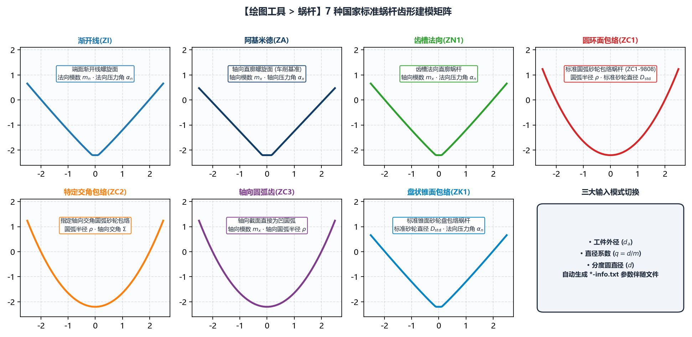

# 5.5 蜗杆：7 种标准蜗杆（ZI/ZA/ZN1/ZC1/ZC2/ZC3/ZK1）建模

**`绘图工具 -> 蜗杆`** 模块完整实现了符合 DIN 3975 与 GB/T 10085 标准的 **5 大类共 7 种精密圆柱蜗杆端面齿形**的高精度数学建模。

---

## 一、7 种圆柱蜗杆类型导航与成形机理全景表

在 **`绘图工具 -> 蜗杆`** 下，通过二级与三级子标签页可切换全部 7 种蜗杆模型：

| 二级标签页 | 三级标签页（如适用） | 国标代号 | 空间成形机理与专属特殊参数 |
| :--- | :--- | :---: | :--- |
| **`渐开线(ZI)`** | *(直接显示)* | **ZI** | **渐开线螺旋面蜗杆**：端面截形为标准渐开线，法向基圆柱相切，适用于高精密分度蜗杆传动。 |
| **`阿基米德(ZA)`** | *(直接显示)* | **ZA** | **阿基米德螺旋面蜗杆**：轴向（A-A）截面为直线齿廓，端面为阿基米德螺线；压力角直接定义为 **`轴向压力角`** ($\alpha_x$)。 |
| **`法向直廓(ZN)`** | **`齿槽法向(ZN1)`** | **ZN1** | **齿槽法向直廓蜗杆**：垂直于齿槽螺旋线的法向截面为直线齿廓，适合车削开粗与通用磨削。 |
| **`圆弧圆柱(ZC)`** | **`圆环面包络(ZC1)`** | **ZC1** | **圆环面砂轮包络圆弧蜗杆**（如案例四 `ZC1-9808`）：由截面为凸圆弧的盘状砂轮按理论螺旋升角包络成形。专属参数：**`圆弧半径`** ($\rho$) 与 **`标准砂轮直径`** ($D_{w0}$)。 |
| **`圆弧圆柱(ZC)`** | **`特定交角包络(ZC2)`** | **ZC2** | **特定轴交角圆环面包络蜗杆**：砂轮安装倾角不等于中径螺旋升角，而是按指定的 **`轴向交角`** ($\gamma_0$) 包络生成的圆弧蜗杆。专属参数：**`圆弧半径`** ($\rho$) 与 **`轴向交角`**。 |
| **`圆弧圆柱(ZC)`** | **`轴向圆弧齿(ZC3)`** | **ZC3** | **轴向截面圆弧齿廓蜗杆**：在轴向（A-A）剖面内齿廓直接为两段对称圆弧。专属参数：**`圆弧半径`** ($\rho$) 与 **`轴向压力角`**。 |
| **`锥面包络(ZK)`** | **`盘状锥面包络(ZK1)`** | **ZK1** | **盘状锥面砂轮（或锥面铣刀）包络蜗杆**：由直廓双锥面盘形砂轮包络而成的非线性空间螺旋面。专属参数：**`标准砂轮直径`** ($D_{w0}$)。 |

---

## 二、三种 `输入模式`（切换蜗杆基准直径定义）

所有 7 种蜗杆面板顶部的第 1 行均为 **`输入模式`** 下拉框，支持适配不同国家的蜗杆图纸标注习惯：

1. **`工件外径 (da)`**（默认）：第 2 行显示 **`蜗杆外径`** ($d_a$)，系统由外径、模数与齿顶高反推分度圆直径 $d$ 与直径系数 $q$；
2. **`直径系数 (q)`**：第 2 行显示 **`蜗杆直径系数`** ($q = d / m_x$)，系统自动按 $d = q \cdot m_x$ 计算分度圆直径；
3. **`分度圆直径 (d)`**：第 2 行直接显示 **`分度圆直径`** ($d$)，适合直接标注节圆/分度圆直径的图纸。

---

## 三、通用参数与专属参数配置指南

| 参数名称 | 适用蜗杆类型 | 工程含义与配置说明 |
| :--- | :---: | :--- |
| **`轴向模数`** ($m_x$) | 全部 7 种 | 蜗杆轴向模数（$\text{mm}$，轴向齿距 $p_x = \pi m_x$）。 |
| **`头数`** ($z_1$) | 全部 7 种 | 蜗杆头数（正整数，导程 $P_h = \pi m_x z_1$）。 |
| **`圆弧半径`** ($\rho$) | 仅 `ZC1` / `ZC2` / `ZC3` | 圆弧圆柱蜗杆的母线圆弧半径（$\text{mm}$，例如 `ZC1-9808` 填 `9.5`）。 |
| **`标准砂轮直径`** ($D_{w0}$) | 仅 `ZC1` / `ZK1` | 定义包络生成该 ZC1 或 ZK1 蜗杆标准齿面时的**名义基准砂轮直径**（$\text{mm}$，例如 `ZC1-9808` 填 `350`）。注意：当机床实际磨削砂轮磨损偏离 $D_{w0}$ 时，后续在 `基本参数` 中生成的修整程序会自动补偿因砂轮变小带来的包络差异！ |
| **`轴向交角`** | 仅 `ZC2` | 成形砂轮主轴与蜗杆轴线的特定空间交角（`$^\circ$`）。 |
| **`法向压力角`** / **`轴向压力角`** | 全部 7 种 | `ZA` 与 `ZC3` 显示为 **`轴向压力角`**，其余 5 种显示为 **`法向压力角`**。右侧均配备 `右:` / `左:` 两个 **`#6bb1aa` 青绿色微调框**，支持左右齿面压力角独立补偿。 |
| **`变位系数`** / **`齿厚系数`** | 全部 7 种 | 标准 `变位系数` 默认 `0`，`齿厚系数` 默认 `0.5`；右侧均配 `#6bb1aa` 微调框用于控制法向弦齿厚或三针测量值 $M$。 |
| **`齿高模式`** & **`齿高调节`** | 全部 7 种 | 可选 **`设置直径`**（输入 `齿顶圆直径` 与 `齿根圆直径`）或 **`设置系数`**（输入 `齿顶高系数` 与 `顶隙系数`）。 |
| **`修整延长`** & **`齿顶倒圆半径`** | 全部 7 种 | 定义齿顶延伸高度与 `右:` / `左:` 齿顶过渡圆角半径。 |

---

## 四、生成蜗杆 DXF 并衔接 `基本参数` 或 `车刀计算`

1. 在对应蜗杆子标签页填妥参数并指定 **`保存文件`** 路径后，点击左下角 **`生成齿形文件`**；
2. 系统自动生成蜗杆端面齿槽曲线 `<文件名>.dxf` 及 `<文件名>-info.txt`（其中 `DXF 齿形类型` 自动标记为 **`端面(左)`**）；
3. **后续两条工艺路线**：
   * **路线 A（精磨砂轮修整）**：直接切换至 **`基本参数`**，加载该 `.dxf` 文件，软件自动回填分度圆中径、导程并将 `DXF 齿形类型` 设为 `端面(左)`，一键生成多砂轮直径修整宏程序；
   * **路线 B（粗加工成形车刀设计）**：先通过 `工具箱 -> 曲线转换` 将该 `端面(左)` 曲线转换为 `法向` 标准齿形，再送入 `工具箱 -> 车刀计算` 生成粗车刀刃口 DXF（详见第 9 章 9.4 节 `ZC1-9808` 完整案例）。

