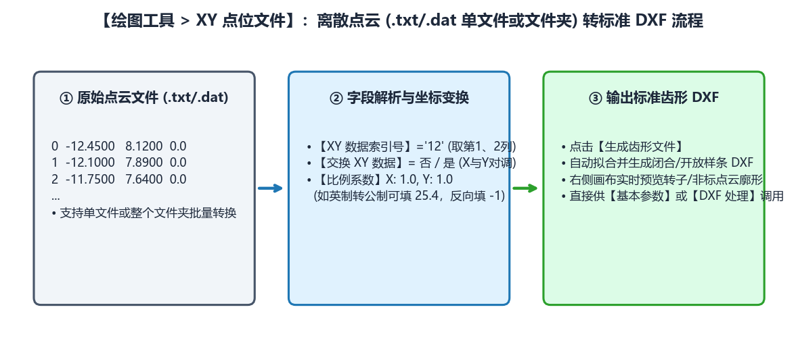

# 5.3 XY 点位文件导入与坐标缩放转换

在双螺杆压缩机阴阳转子（如 `SRM-300F`、`SRM-301M`）、特种泵螺杆以及三坐标测量机（CMM）逆向工程中，齿形数据往往以离散坐标点文件（`.txt`、`.dat`、`.csv` 或多段点云文件夹）的形式提供。**`绘图工具 -> XY 点位文件`** 模块可将任意列格式的离散点位一键转换为标准 `.dxf` 齿形文件。

---

## 一、`XY 点位文件` 转换流程与参数说明

| 参数名称 | 默认值 | 功能定义与配置技巧 |
| :--- | :--- | :--- |
| **`点位文件地址`** + **`选择文件`** | 空 | 点击 `选择文件` 时，系统首先弹出 **`选择类型`** 询问框：**`数据是单文件吗?选否为文件夹`**。 • 点击 **“是”**：选择单个 `.txt`/`.dat` 点云文件； • 点击 **“否”**：选择包含多个分段点云文件的整个文件夹（常见于转子多段组成曲线），系统将按顺序自动合并拼接。 |
| **`XY 数据索引号`** | `01` | 指定文本每一行中，哪两列数字分别代表 $X$ 和 $Y$ 坐标（列索引从 `0` 开始计数）： • **`01`**（默认）：第 `0` 列为 $X$，第 `1` 列为 $Y$（适用于纯两列 `X  Y` 格式）； • **`12`**：第 `1` 列为 $X$，第 `2` 列为 $Y$（适用于带行号的三列/四列格式：`序号  X  Y  Z`，如三坐标测量导出报告）。 |
| **`交换 XY 数据`** | `否` | 下拉选择 **`否`** 或 **`是`**。 当上游软件以水平轴为径向、垂直轴为齿宽方向输出点表时，将其设为 **`是`** 即可在导入瞬间将 $(X, Y)$ 坐标列整体对调。 |
| **`比例系数`** (`X:` / `Y:`) | `1` / `1` | 对读取到的 $X$ 和 $Y$ 坐标分别乘以缩放因子： • **常规公制（$\text{mm}$）**：保持 `X: 1`、`Y: 1`； • **英制（$\text{inch}$）转公制**：填入 `X: 25.4`、`Y: 25.4`； • **坐标轴反向镜像**：若需要将 $X$ 或 $Y$ 方向倒置，可直接填入 **`-1`**（如 `Y: -1`）。 |
| **`保存文件`** + **`选择文件`** | 空 | 指定转换后生成的标准 `.dxf` 齿形文件保存路径。 |

---

## 二、标准操作步骤与注意事项

1. **检查原始点位文本格式**：
   确认文本文件中的数值列之间以空格、制表符（Tab）或逗号分隔（软件会自动跳过非数字表头注释行）。
2. **设定列索引与变换系数**：
   * 若文本行形如 `-12.4500  8.1200`，保持 **`XY 数据索引号`** 为 `01`；
   * 若文本行形如 `1  -12.4500  8.1200  0.0000`（首列为点序号），将 **`XY 数据索引号`** 改为 `12`。
3. **点击 `生成齿形文件` 并核对视图**：
   * 点击左下角 **`生成齿形文件`** 后，右侧画布立即渲染出转换后的连续齿形曲线；
   * 观察画布坐标刻度，确认中径基准是否位于 $Y = 0$（若原始点云以转子圆心为 $Y=0$，可随后进入 `工具箱 -> DXF 处理 -> DXF 变换` 将 $Y$ 坐标平移一个中径半径 $-R_2$，使 $Y=0$ 对齐到中径）。

