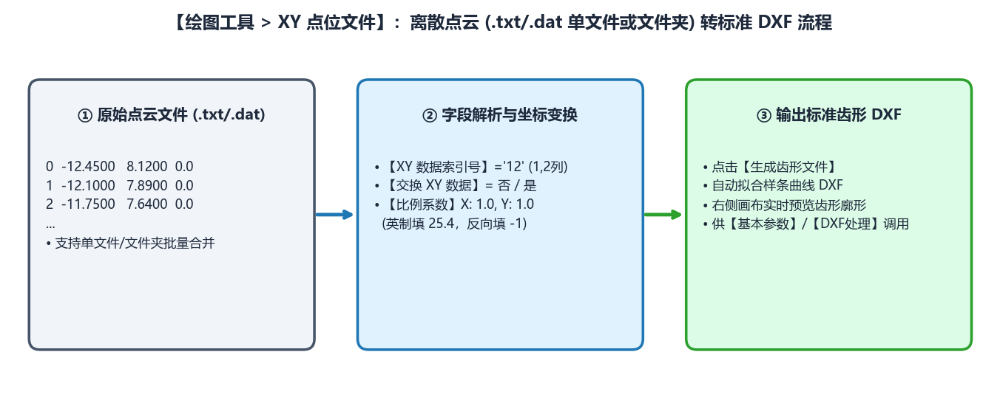

# 5.3 XY 点位文件转换

**`绘图工具 -> XY 点位文件`** 用于将双螺杆压缩机转子（`SRM-300F` / `SRM-301M`）或三坐标实测的离散点云（`.txt` / `.dat` / `.csv`）批量转换为标准 `.dxf`。

---

## 参数明细表

| 参数名称 | 默认值 | 功能定义与配置技巧 |
| :--- | :--- | :--- |
| **`点位文件地址`** | 空 | 点击 `选择文件` 时弹出询问： • **是**：选单个点云文件 • **否**：选包含多段 `.dat` 点云的文件夹并自动合并 |
| **`XY 数据索引号`** | `01` | 指定作为 X 与 Y 的列索引（从 `0` 起计）： • `01`：第 0 列 = X，第 1 列 = Y • `12`：第 1 列 = X，第 2 列 = Y（带序号格式） |
| **`交换 XY 数据`** | `否` | 设为 `是` 时导入瞬间整体对调 `(X, Y)` |
| **`比例系数`** (`X:` / `Y:`) | `1` / `1` | 分别缩放 X 与 Y： • 英制转公制填 `25.4` • 单轴镜像反向填 `-1` |
| **`保存文件`** | 空 | 指定目标 `.dxf` 保存路径 |

---

## 操作步骤

1. **核查格式**：确认数据列以空格、Tab 或逗号分隔（系统自动忽略非数字表头注释）。
2. **设列索引与比例**：根据数据列排布填入 `01` 或 `12` 与缩放因子。
3. **生成与原点检查**：
   * 点击左下角 **`生成齿形文件`** 在画布预览轮廓；
   * 若原始点云以圆心为 `Y = 0`，可再经 `工具箱 -> DXF 处理 -> DXF 变换` 平移使 **`Y = 0` 对齐中径**。

