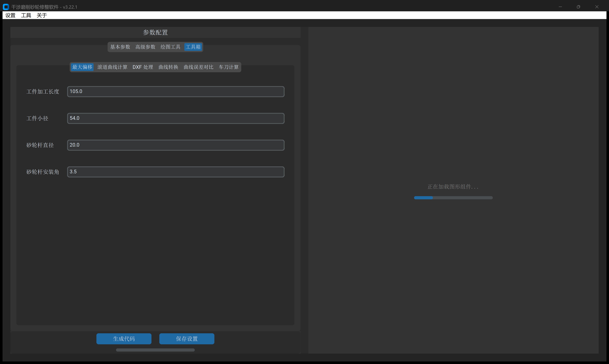
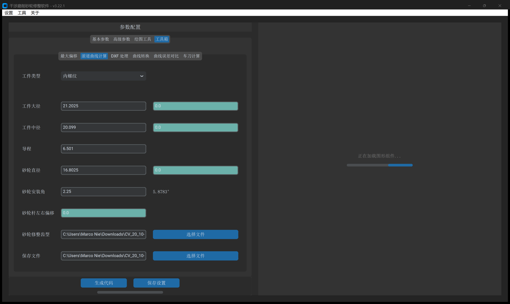
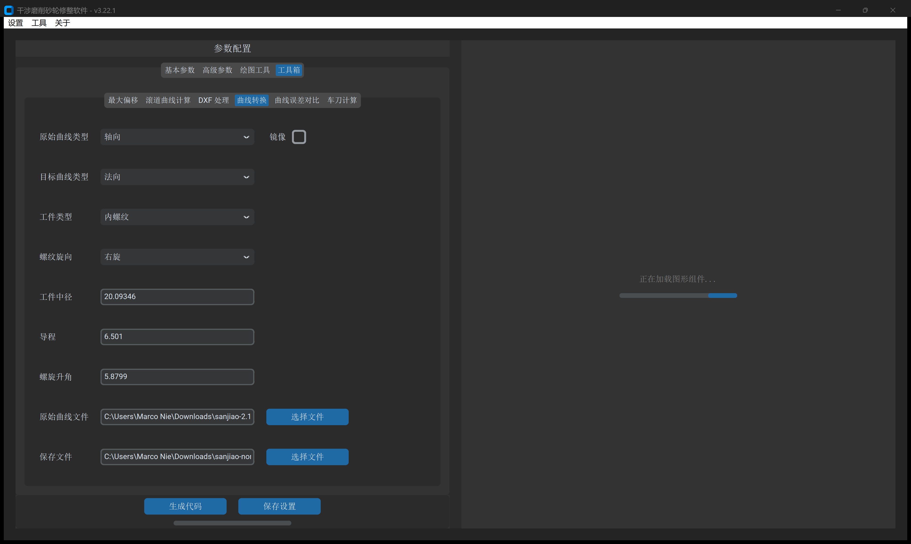
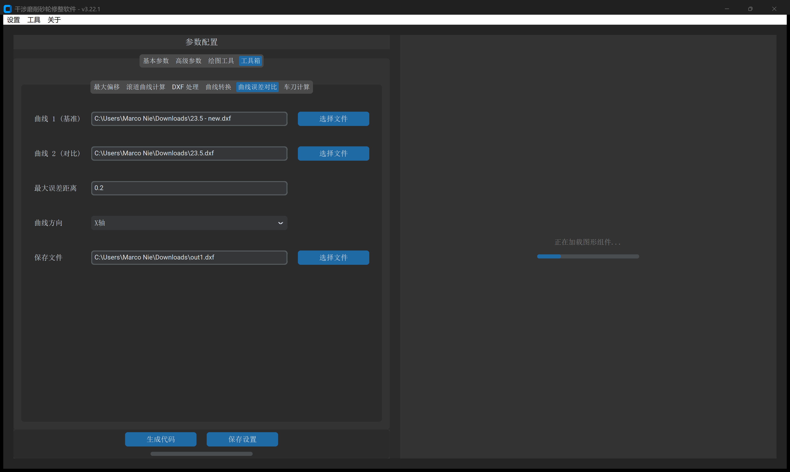

# 第 6 章 工具箱（一）：空间校验、滚道仿真与曲线分析

**`工具箱`** 集成了 6 大高阶工程分析与反求设计工具。本章重点讲解面向深孔内螺纹防撞校核、砂轮逆向包络磨削仿真、截面空间投影转换及双曲线亚微米误差对比的四大分析器。

---

## 一、`最大偏移`（砂轮杆 3D 防干涉计算）

面向深孔或大导程内螺纹螺母磨削，在编程前精确计算砂轮杆不撞孔口的物理极限：

- **输入参数**：`工件加工长度`、`工件小径`、`砂轮杆直径`、`砂轮杆安装角`。
- **状态提示**：
  - **安全状态**：实时输出 `理论最大偏移: X.XXXX mm`。
  - **超限报警**：倾角过大导致孔口干涉时，显示 `安装角设置过大`。
- **3D 交互画布**：右侧实时绘制螺母内孔网格与倾斜砂轮杆实体，支持按住鼠标左键 360° 旋转检视最小间隙点。

---

## 二、`滚道曲线计算`（逆向包络磨削与公差敏感度仿真）

已知修整好的砂轮廓形，反求在不同砂轮直径、进刀深度及对刀偏差下实际磨出的工件滚道截形：

- **青绿框偏差注入**：
  - 砂轮直径偏差（如砂轮磨小 $0.5\text{ mm}$ 未修整时磨出的滚道变化）。
  - 砂轮杆左右对刀偏心量。
  - 径向进刀深度误差。
- **`误差曲线` 专属视图**：计算完成后右下角激活紫色按钮，一键展示齿槽全长各点的法向过切/欠切微米级偏差。

---

## 三、`曲线转换` 与 `曲线误差对比`

- **`曲线转换`**：
  - 在 `法向`、`轴向` 与 `端面(左)` 三种空间截面之间无损解析投影互转。
  - 解决蜗杆端面图转车刀法向图、轮廓仪轴向测量比对等工艺转换难题。

- **`曲线误差对比`**：
  - 自动对齐基准曲线与对比曲线，生成微米级法向误差梳状图 DXF。
  - 输出最大误差、平均误差、RMS 误差统计文本（TXT）。
