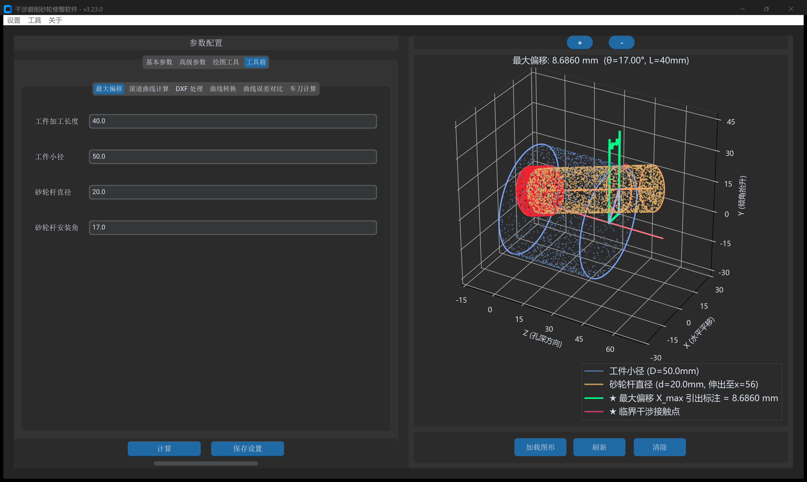
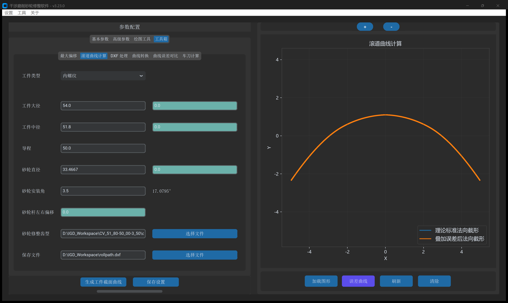
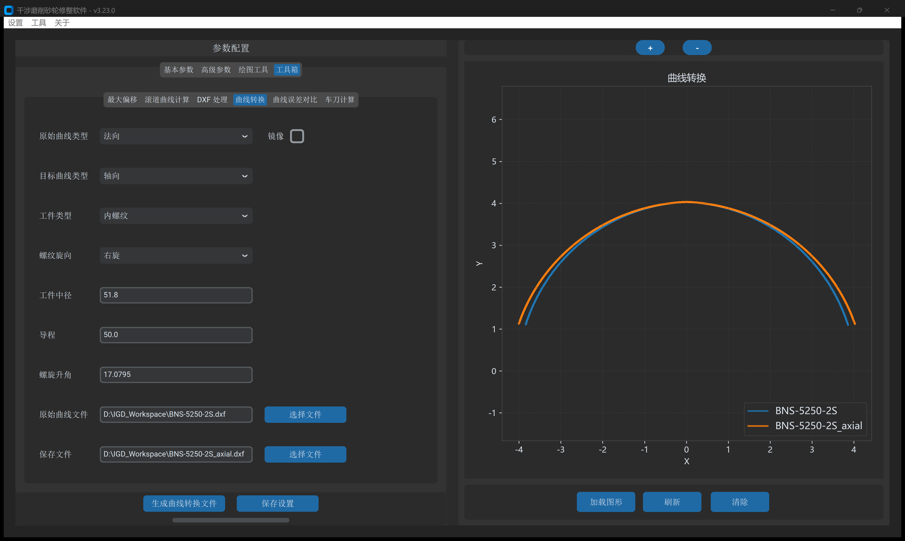
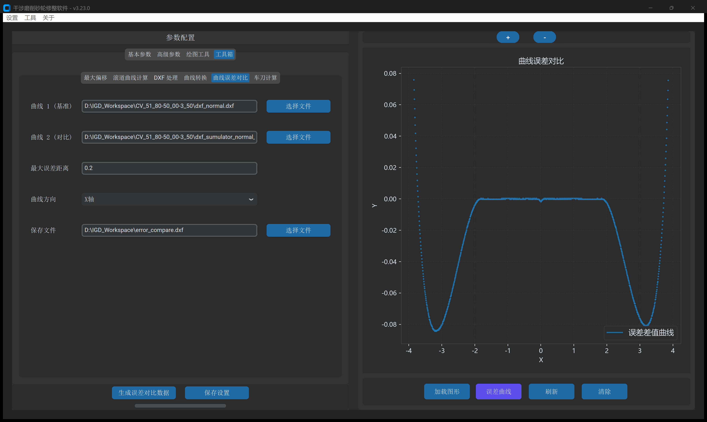

# 6. 工具箱：校验与分析

**`工具箱`** 集成了 6 大工程校验、反求仿真与曲线分析工具；本章涵盖前 4 项空间校验与曲线分析功能。

---

## 本章功能概览

* **6.1 [最大偏移（防撞校核）](max_offset.md)**：
  
  * 输入加工长度、工件小径、砂轮杆径与安装角，实时输出 `理论最大偏移: X.XXXX`（或 `安装角设置过大` 预警）；
  * 右侧交互式 3D 画布可 360° 检视孔壁间隙与接触干涉点。
* **6.2 [滚道曲线计算](rollpath_calc.md)**：
  
  * 由已修整砂轮 DXF 逆向反演实际磨削工件截形；
  * 通过青绿微调框（`#6bb1aa`）注入直径、偏心或进刀偏差，并用 **`误差曲线`** 视图量化微米级过切/欠切。
* **6.3 [空间曲线转换](curve_conversion.md)**：
  
  * 基于三维螺旋面解析投影，实现 `法向`、`轴向`、`端面(左)` 截面双向互转。
* **6.4 [曲线误差对比](error_compare.md)**：
  
  * 自动对齐基准与对比 DXF，输出误差放大矢量图（`-differences.dxf`）、HTML 报告与最大/均值/RMS 统计。
