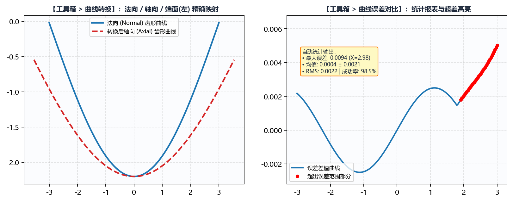

# 6.3 空间曲线转换

**`工具箱 -> 曲线转换`** 通过三维等升距螺旋面解析投影，将同一齿形在 **`法向`**、**`轴向`** 与 **`端面(左)`** 三种空间平面之间精确互转。

---

## 典型应用与参数配置

* **常见转化场景**：
  * `端面(左)` ➔ `法向`：将 `绘图工具 -> 蜗杆` 导出的端面蜗杆 DXF 转为 `法向` 曲线，用于后续 `车刀计算`；
  * `法向` ➔ `轴向`：将双圆弧法向理论齿形转为 `轴向` 曲线，便于直接对照轮廓仪轴向实测报告。

| 参数名称 | 选项 / 单位 | 配置说明 |
| :--- | :--- | :--- |
| **`原始曲线类型`** / **`目标曲线类型`** | `法向` / `轴向` / `端面(左)` | 分别指定输入与输出截面类型（若两者相同且勾选 `镜像`，可用于同截面原位镜像） |
| **`镜像`** | 复选框 | `法向` / `轴向` 沿 Y 轴左右翻转，`端面(左)` 沿 X 轴上下翻转后再执行投影 |
| **`工件类型`** / **`螺纹旋向`** | `内/外螺纹`、`右/左旋` | 确定径向增减极性与左右螺旋展开方向 |
| **`工件中径`** / **`导程`** | mm | 基准直径（对应 `Y = 0`）与螺旋导程，输入后自动计算升角 |
| **`螺旋升角`** | `°` | 默认勾选自动同步理论升角，也可取消勾选自定义倾斜截面角度 |
| **`原始曲线文件`** / **`保存文件`** | `.dxf` 路径 | 若源图同目录存在 `*-info.txt`，将自动回填中径与导程 |

---

## 操作流程

1. 设定 **`原始曲线类型`** 与 **`目标曲线类型`**，加载 **`原始曲线文件`** 并核对中径、导程与旋向；
2. 指定 **`保存文件`** 路径，点击左下角 **`生成曲线转换文件`**；
3. 画布同屏叠加转换前后两条截面曲线，同目录输出 `<文件名>.dxf` 与 `<文件名>.html` 报告。

