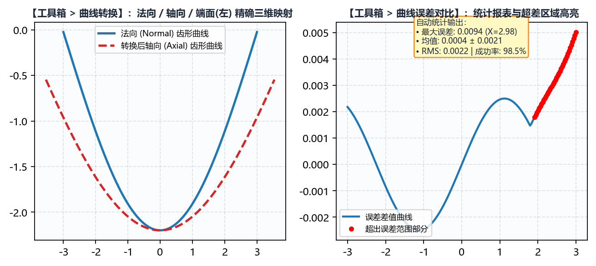

# 6.3 曲线转换：法向、轴向与端面(左)空间齿形互转

在精密螺纹、蜗杆与转子的工艺设计、三坐标检测及粗加工刀具设计中，常常需要在同一个三维螺旋面的**三种标准平面截形**之间进行精确转换：
* 例如：由 `绘图工具 -> 蜗杆` 生成的 ZC1 蜗杆 DXF 是 **`端面(左)`** 截形，但后续进入 `工具箱 -> 车刀计算` 设计粗车刀时，必须输入 **`法向`** 标准齿形；
* 又如：设计图纸给出的是 **`法向`** 双圆弧齿形，而车间轮廓仪是沿着螺母 **`轴向`** 扫描测量的，需要将理论 `法向` 齿形转换为 `轴向` 齿形才能与轮廓仪实测曲线直接比对。

**`工具箱 -> 曲线转换`** 模块基于三维等升距螺旋面解析投影算法，实现 **`法向`**、**`轴向`** 与 **`端面(左)`** 之间的任意双向精确转换。

---

## 一、空间截面三维螺旋投影关系与参数配置

切换至 **`工具箱 -> 曲线转换`**，面板参数说明如下：

| 参数名称 | 可选值 / 类型 | 工程含义与配置说明 |
| :--- | :--- | :--- |
| **`原始曲线类型`** | `法向` / `轴向` / `端面(左)` | 声明待转换的源 DXF 文件本身属于哪一种空间截面类型。 |
| **`镜像`** | 复选框（勾选/未勾选） | 若源 DXF 需要先关于 $X=0$ 轴水平翻转后再执行空间截面转换，请勾选此项。 |
| **`目标曲线类型`** | `法向` / `轴向` / `端面(左)` | 选择希望转换输出的目标空间截面类型（例如从 `端面(左)` 转为 `法向`，或从 `法向` 转为 `轴向`）。 |
| **`工件类型`** | `内螺纹` / `外螺纹` | 决定径向高度 $Y$ 与螺旋圆柱半径 $r(y) = R_2 \mp y$ 的加减极性。 |
| **`螺纹旋向`** | `右旋` / `左旋` | 决定三维螺旋面展开时的右手/左手螺旋方向。 |
| **`工件中径`** ($d_2$) | $\text{mm}$ | 螺旋面中径基准（对应 $Y = 0$ 所在直径）。 |
| **`导程`** ($P_h$) | $\text{mm}$ | 工件导程。输入有效 `工件中径` 与 `导程` 后，下方 **`螺旋升角`** 将自动实时算出。 |
| **`螺旋升角`** ($\lambda$) | `$^\circ$`（自动联动或手动微调） | 默认勾选右侧复选框自动同步理论螺旋升角 $\lambda$；取消勾选后也可输入特定截面倾角进行广义斜截面投影。 |
| **`原始曲线文件`** | 选择 `.dxf` 文件 | 导入源 DXF 文件（若同目录含 `*-info.txt`，软件会自动回填 `工件中径` 与 `导程`）。 |
| **`保存文件`** | 选择输出 `.dxf` 路径 | 指定转换后生成的新截面 `.dxf` 保存路径。 |

---

## 二、标准操作流程

1. 选择 **`原始曲线类型`** 与 **`目标曲线类型`**（两者不可相同）；
2. 点击 **`原始曲线文件`** 右侧的 **`选择文件`** 导入源 `.dxf`；
3. 核对 **`工件类型`**、**`螺纹旋向`**、**`工件中径`** 与 **`导程`**；
4. 指定 **`保存文件`** 路径后，点击左下角主按钮 **`生成曲线转换文件`**；
5. 右侧画布将同时绘出转换前的原始截面曲线与转换后的目标截面曲线，直观呈现因螺旋角引起的齿宽展宽/缩窄与曲率变化。

