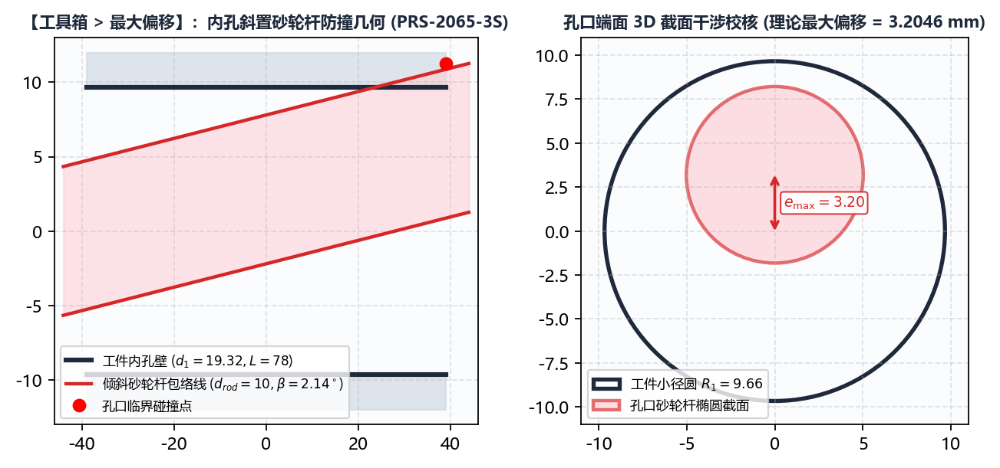

# 6.1 最大偏移：内螺纹磨削砂轮杆防干涉计算与 3D 视图

在大导程或深孔**内螺纹螺母**（如 `BNS-2020-R`、`BNS-5250-2S`、`PRS-2065-3S`）磨削中，砂轮主轴连接杆必须倾斜一个 `砂轮安装角` 伸入螺母内孔。随着砂轮不断修整变小，砂轮杆需向螺母单侧径向偏移以继续切入滚道——一旦偏移量超出孔口几何极限，**高速旋转的砂轮杆外缘就会与螺母两端孔口内壁（小径）发生灾难性碰撞（撞杆）**！

**`工具箱 -> 最大偏移`** 模块专用于在编制定刀工艺前，精确计算砂轮杆不碰伤螺母内孔的 **`理论最大偏移`** 极限。

---

## 一、三维空间防干涉计算模型与参数说明

切换至 **`工具箱 -> 最大偏移`**，面板包含 4 项实时联动输入参数（修改任意一项数值或按回车键，系统即刻重算并刷新右侧 3D 视图）：

| 参数名称 | 默认示例值 | 单位 | 工程定义与测量基准 |
| :--- | :--- | :--- | :--- |
| **`工件加工长度`** ($L$) | `60` | $\text{mm}$ | 螺母内螺纹孔的总轴向长度（若两端有非螺纹退刀孔，按最易发生碰撞的通孔长度计）。 |
| **`工件小径`** ($d_1$) | `30` | $\text{mm}$ | 螺母内孔最小直径（即内螺纹牙顶圆直径）。 |
| **`砂轮杆直径`** ($d_{\text{bar}}$) | `20` | $\text{mm}$ | 伸入螺母孔内的砂轮接长杆（主轴杆）最大圆柱外径（必须满足 $d_{\text{bar}} < d_1$）。 |
| **`砂轮杆安装角`** ($\Sigma$) | `10` | `$^\circ$` | 机床实际设定的砂轮主轴倾斜角度（对应 `基本参数 -> 砂轮安装角`）。 |

---

## 二、计算结果判读与右侧 3D 空间视图操作

1. **实时计算结果状态栏**：
   * **正常安全状态**：底部显示绿色/标准提示 **`理论最大偏移: X.XXXX`**（单位：$\text{mm}$）。该数值代表砂轮杆中心在螺母正中央横截面内，最多可向径向偏移的距离上限；
   * **干涉超限报警**：当 `工件加工长度` 过长或 `砂轮杆安装角` 过大，导致砂轮杆即使处于孔中心（偏移 = `0`）也会在两端孔口碰壁时，底部将显示醒目提示：**`安装角设置过大`**！此时必须减小 `砂轮杆安装角` 或更换更细的 `砂轮杆直径`。
2. **右侧 3D 交互式空间视图**：
   * 右侧画布实时绘制半透明的**螺母内孔小径圆柱面（蓝色网格）**与倾斜伸入的**砂轮杆圆柱体（红色实体）**，并用醒目的圆环标出两端孔口处的最小安全间隙点；
   * 在右侧 3D 画布中按住 **鼠标左键拖拽** 可 360° 自由旋转视角，按住 **鼠标右键上下拖动**（或滚动滚轮）可缩放视图。
3. **如何将结果应用到 `基本参数`**：
   * 记下此处算出的 **`理论最大偏移`** $e_{\text{limit}}$（例如 `4.5470 mm`）；
   * 留出至少 **`0.5` ~ `1.5 mm`** 的机械安全余量后，将安全上限填入 `基本参数 -> 砂轮杆偏移工件中心最大距离`（例如填入 `3.5 mm`），即可从源头确保砂轮磨损到最小直径时绝不发生撞杆事故！

