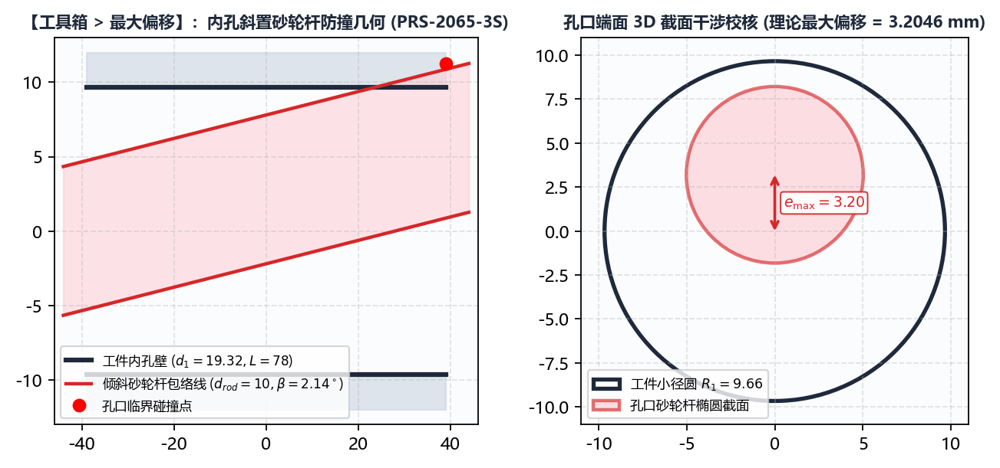

# 6.1 最大偏移（防撞校核）

**`工具箱 -> 最大偏移`** 用于内螺纹螺母（`BNS-2020-R`、`BNS-5250-2S`、`PRS-2065-3S`）磨削前校核砂轮接长杆不碰伤孔口的 **`理论最大偏移`** 极限。

---

## 参数配置表

修改任意参数即自动重算并刷新右侧 3D 模型：

| 参数名称 | 示例值 | 单位 | 工程定义与测量基准 |
| :--- | :---: | :--- | :--- |
| **`工件加工长度`** | `40` | mm | 内螺纹通孔总长度（按最易碰壁的孔口两端间距计） |
| **`工件小径`** | `50` | mm | 螺母内孔最小直径（牙顶圆直径） |
| **`砂轮杆直径`** | `20` | mm | 伸入孔内的砂轮主轴连接杆最大外径（须 < 工件小径） |
| **`砂轮杆安装角`** | `17` | `°` | 砂轮主轴实际倾斜角（对应 `基本参数 -> 砂轮安装角`） |

---

## 结果判读与 3D 交互

* **状态栏输出**：
  * **安全可磨**：显示 **`理论最大偏移: X.XXXX`**（mm），代表孔中心截面最大允许径向偏移上限；
  * **孔口干涉**：倾角过大或加工过长时提示 **`安装角设置过大`**，需减小角度或选用更细砂轮杆。
* **右侧 3D 画布**：
  * 半透明网格为工件小径内孔，实心圆柱为倾斜砂轮杆，并用圆环标注孔口最小安全间隙位置；
  * **左键拖拽** 360° 旋转视角，**右键上下拖动 / 滚轮 / 双指手势** 缩放视图。
* **回填基本参数**：将 `理论最大偏移` 扣除 `0.5 ~ 1.5 mm` 机械安全余量后，填入 `基本参数 -> 砂轮杆偏移工件中心最大距离`。

