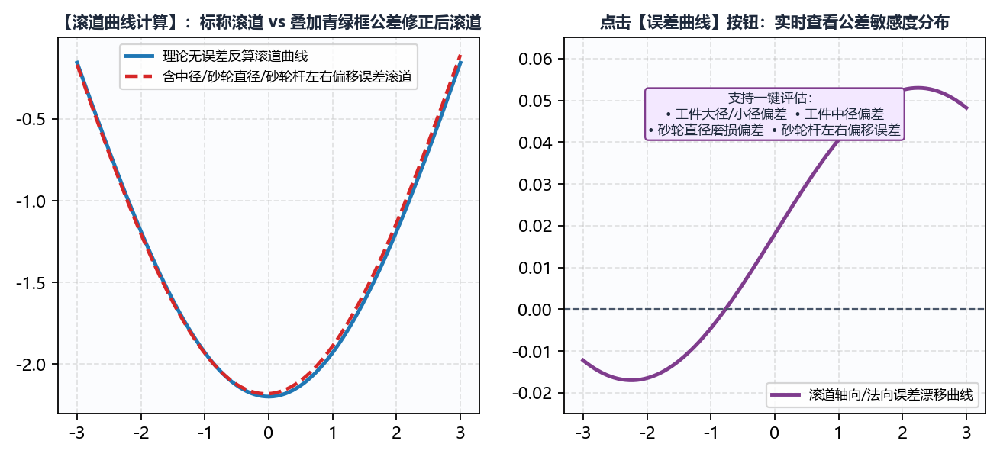

# 6.2 滚道曲线计算

**`工具箱 -> 滚道曲线计算`** 为逆向包络磨削仿真与公差敏感度分析器，用于已知砂轮廓形后反演实际磨出的工件截形及机床对刀偏差影响。

---

## 参数配置与偏差注入

参数右侧的 **`#6bb1aa` 青绿色微调框**用于向理想工况中注入物理装调与磨损偏差：

| 参数名称 | 白底框（名义值） | 青绿框（`#6bb1aa` 偏差注入） | 仿真分析用途 |
| :--- | :--- | :--- | :--- |
| **`工件类型`** | `内螺纹` / `外螺纹` | — | 切换内/外啮合；选 `外螺纹` 时显示 `外螺纹模式` |
| **`工件大径`/`工件小径`** | 基准底径 | 径向进刀深度偏差 | 评估磨削深度多进或少切时的接触角与形状变化 |
| **`工件中径`** | 理论中径 | 中径尺寸偏差 | 评估中径浮动对包络曲率的影响 |
| **`导程`** | 理论导程 | — | 工件螺旋导程 |
| **`砂轮直径`** | 基准砂轮外径 | **砂轮直径失配量** | 仿真砂轮磨损后未切换修整程序直接磨削造成的误差 |
| **`砂轮安装角`** | 砂轮轴倾角 | — | 评估安装角设定差异对滚道廓形的影响 |
| **`砂轮杆左右偏移`** | — | **轴向对刀偏心量**（默认 `0`） | 仿真砂轮轴向对刀中心偏离引起的非对称滚道偏差 |
| **`砂轮修整齿型`** | 导入砂轮 `.dxf` | — | 选择如 `dxf_dress_wheel_curve_*.dxf` 净砂轮轮廓 |
| **`保存文件`** | 输出 `.dxf` 路径 | — | 指定反演生成的工件截形输出路径 |

---

## 执行仿真与输出文件

1. 导入 `砂轮修整齿型` 并填好名义参数与偏差量，点击左下角 **`生成工件截面曲线`**；
2. **主画布叠加对比**：同时显示标准理论截形与逆向包络算出的实际工件截形；
3. **点击右下角 `误差曲线`**：查看沿齿槽展开的微米级法向偏差分布；
4. **输出文件集**：
   * `<文件名>.dxf`（叠加误差后的实际法向截形）与 `<文件名>_original.dxf`（理论标准法向截形）；
   * `<文件名>_compare_errors.dxf` 与 `<文件名>_compare_errors.html` / `<文件名>_compare_overlay.html`。

