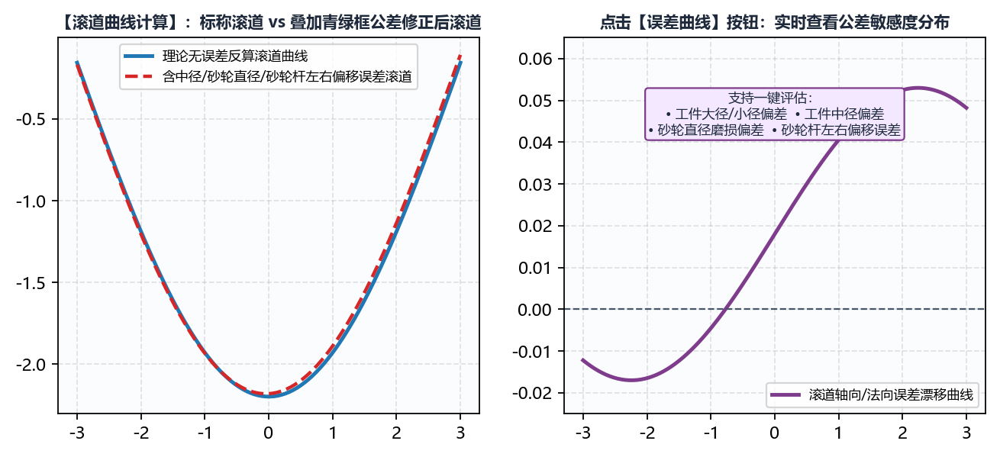

# 6.2 滚道曲线计算：逆向包络仿真与公差敏感度验证

在 `基本参数` 中，软件解决的是**“正向问题”**：已知目标工件齿形，求无干涉的砂轮修整截面。而在实际生产与工艺评审中，工程师常常需要回答**“逆向问题”**：
* *“如果我已经把砂轮修整成了某个特定齿形，拿到机床上磨削时，实际包络磨出的工件滚道截面到底长什么样？”*
* *“如果机床实际砂轮直径偏了 $+0.1\text{ mm}$、或者砂轮杆左右对刀偏了 $0.02\text{ mm}$，会导致磨出的滚道产生多大的齿形误差？”*

**`工具箱 -> 滚道曲线计算`** 模块正是为此打造的**逆向三维磨削包络仿真与公差敏感度分析器**。

---

## 一、逆向包络仿真原理与 `#6bb1aa` 误差注入分析

切换至 **`工具箱 -> 滚道曲线计算`**，您会发现多个核心参数右侧配备了 **`#6bb1aa` 青绿色微调框**。在这里，青绿色框扮演的是**“机床装调误差 / 砂轮磨损偏差注入器”**的角色：

| 参数名称 | 白底框（基准值） | 右侧 `#6bb1aa` 青绿框（注入偏差量） | 工程仿真用途说明 |
| :--- | :--- | :--- | :--- |
| **`工件类型`** | `内螺纹` / `外螺纹` | — | 选择内啮合或外啮合磨削（选择 `外螺纹` 时额外显示 **`外螺纹模式`**：`普通砂轮` / `内旋风铣`）。 |
| **`工件大径`**（内螺纹）或 **`工件小径`**（外螺纹） | 滚道基准底径 | 径向进刀深度偏差 $\Delta D_{\text{root}}$ | 仿真当磨床径向进刀（X/U 轴）多进或少进 $0.01\text{ mm}$ 时，滚道截面与接触角的变化。 |
| **`工件中径`** | 理论中径 $d_2$ | 中径偏差 $\Delta d_2$ | 评估中径尺寸浮动对螺旋面包络曲率的影响。 |
| **`导程`** | 理论导程 $P_h$ | — | 工件螺旋导程。 |
| **`砂轮直径`** | 修整时的基准砂轮直径 | 砂轮直径失配量 $\Delta D_w$ | **核心仿真项**：例如砂轮是按 $\varnothing 40\text{ mm}$ 修整的，但在 $\varnothing 39.5\text{ mm}$ 时未重新修整直接磨削（青绿框填 `-0.5`），一键算出由此产生的滚道过切误差！ |
| **`砂轮安装角`** | 机床实际设定的砂轮倾角 | — | 仿真不同砂轮安装角下的包络成形效果。 |
| **`砂轮杆左右偏移`** | — | 仅 `#6bb1aa` 框（默认 `0`） | 仿真砂轮轴向对刀中心与滚道中心存在左右偏移量时引起的非对称误差。 |
| **`砂轮修整齿型`** | 选择砂轮廓形 DXF | — | 导入待验证的砂轮截面 `.dxf` 文件（如由 `模式-99` 导出的 `*-wheel.dxf`）。 |
| **`保存文件`** | 选择输出 DXF 路径 | — | 指定反演计算出的实际工件滚道截面 `.dxf` 保存路径。 |

---

## 二、执行仿真与查看专属 `误差曲线` 视图

1. 填妥上述参数并导入 **`砂轮修整齿型`** DXF 文件后，点击左下角主按钮 **`生成工件截面曲线`**；
2. **主画布双曲线叠加对比**：
   右侧画布立即同时绘出**理论目标滚道曲线（蓝色实线）**与**本次逆向包络磨出的实际工件截面曲线（红色虚线）**；
3. **点击右下角专属 `误差曲线` 按钮**：
   * 计算完成后，右下角视图栏会自动浮现一个紫色的 **`误差曲线`** 按钮；
   * 点击 **`误差曲线`**，画布切换为高精度法向偏差分布图（横轴为齿槽宽度 $X$，纵轴为法向误差 $\mu\text{m}$），直观展示齿槽左、右两翼的最大过切/欠切峰值位置；
   * 同时在保存路径下自动生成 `<文件名>.dxf`（反演出的工件截面图）与 `<文件名>_error.txt`（误差统计数据）。

