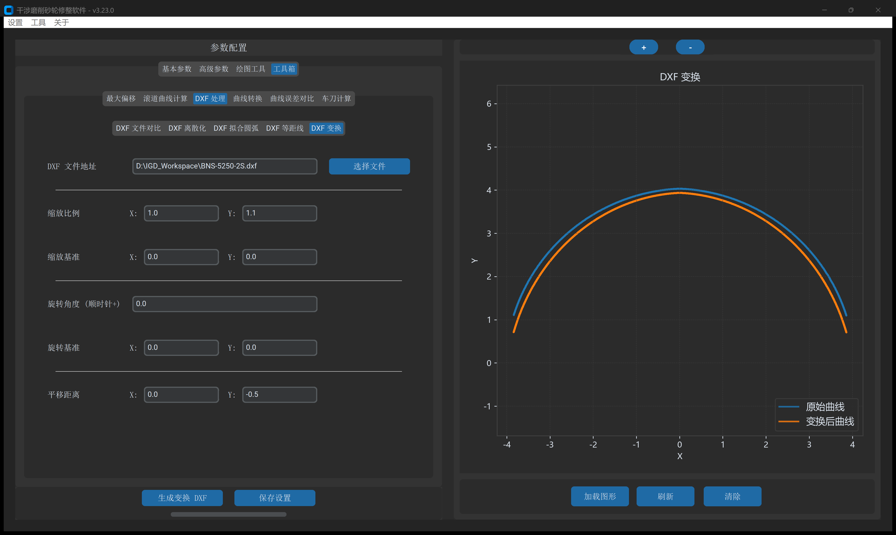
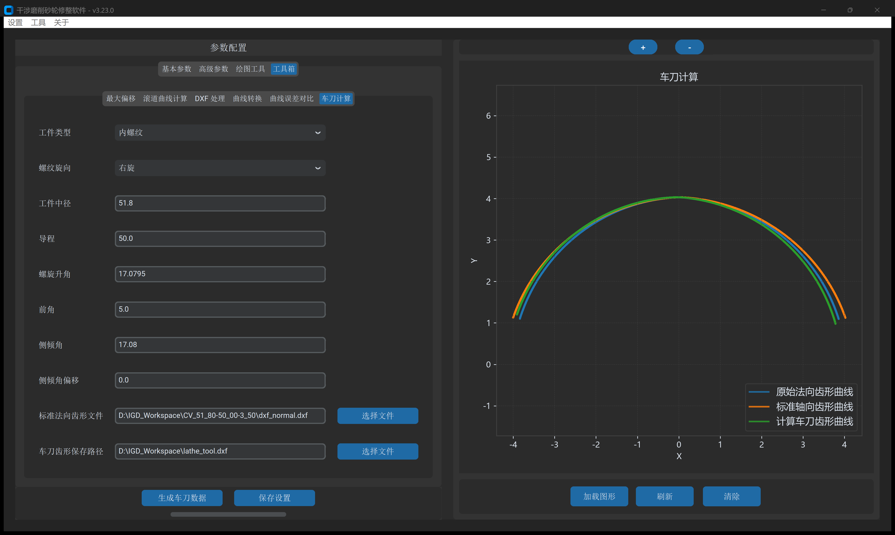

# 7. 工具箱：DXF 与车刀

本章说明 `工具箱` 中的 **`DXF 处理`** 五大子工具（文件对比、离散化、拟合圆弧、等距线、X/Y 独立变换）及 **`车刀计算`**（成形硬车刀空间刃口求解）。

---

## 功能概览

* **7.1 [DXF 处理（五大工具）](dxf_process.md)**：
  
  * `DXF 文件对比`：多达 3 份 DXF 彩色同屏叠加；
  * `DXF 离散化`：均匀重采样与 6 种曲线拓扑排序；
  * `DXF 拟合圆弧`：样条转纯 `ARC`/`LINE`（`拟合误差` 单位 `0.1 μm`，单段 ≤ 150°）；
  * `DXF 等距线`：法向偏置并自动修剪内凹自交环；
  * `DXF 变换`：独立 **`X:` / `Y:`** 缩放、旋转及平移校准 `Y = 0`。
* **7.2 [成形车刀计算](lathe_tool_calc.md)**：
  
  * 求解含 `前角`、`侧倾角`、`侧倾角偏移` 的车刀前刀面真实交线；
  * 输出线切割用 `<文件名>.dxf` 与交互式三维检查网页 `<文件名>-3D.html`。
