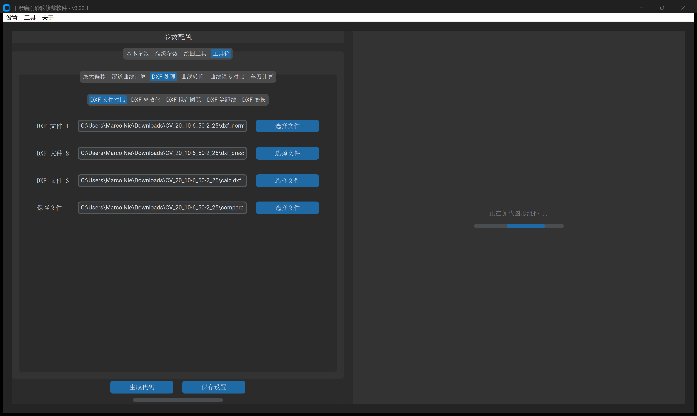
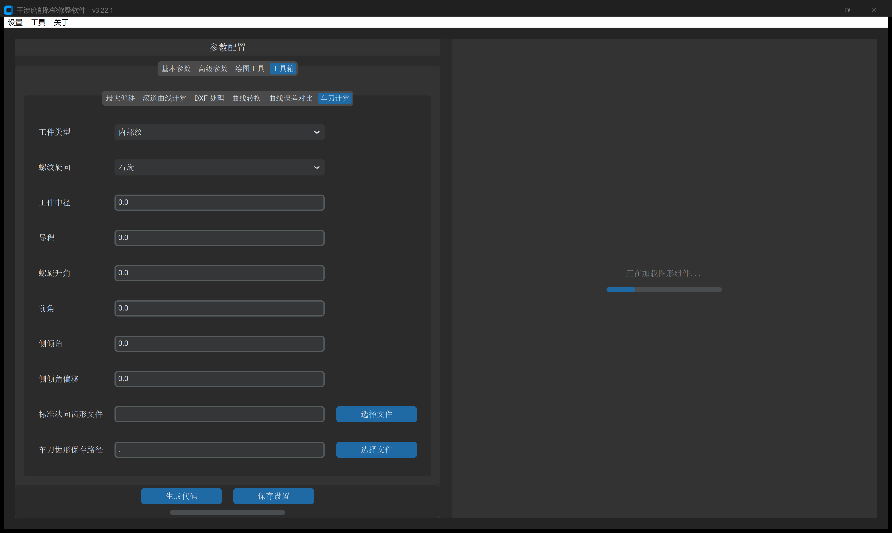

# 第 7 章 工具箱（二）：DXF 曲线工程处理与车刀设计

本章介绍 `工具箱` 中面向外部 DXF 齿形几何处理的 **`DXF 处理`**（含 5 大子模块）以及面向成形硬车刀刃口反求设计的 **`车刀计算`** 模块。

---

## 一、`DXF 处理` 五大子模块

无需安装外部 AutoCAD 软件，直接在 IGD 内完成样条圆弧逼近、点云重采样、多图层对比与坐标基准平移：

- **`DXF 文件对比`**：将最多 3 个 DXF 文件按彩色图层叠加同屏比对。
- **`DXF 离散化`**：按指定点密度重采样点云，支持 6 种拓扑排序策略（`自动识别`、`顺时针`、`逆时针`、`升序`、`降序`、`拆分`）。
- **`DXF 拟合圆弧`**：将 `SPLINE` 样条曲线高精逼近拟合为由纯 `ARC` 与 `LINE` 组成的相切 DXF（指定 `拟合误差`，如 $\pm 0.5\ \mu\text{m}$）。
- **`DXF 等距线`**：沿齿形法线向内或向外偏置恒定加工余量。
- **`DXF 变换`**：通过缩放、旋转与平移基准点，快速将外部 CAD 齿槽曲线移动至 $Y=0$ 位于中径的标准位置。

---

## 二、`车刀计算`（带前角与侧倾角成形刀刃口求解）

针对大导程螺纹或中大模数蜗杆粗加工成形车刀，精确求解三维螺旋槽与倾斜前刀面的空间截交线：

- **输入参数**：工件中径、导程、螺旋升角、车刀 **`前角`**、**`侧倾角`**（法向装刀倾斜度）、**`侧倾角偏移`** 及标准法向齿形 DXF。
- **计算成果**：
  - **车刀刃口 DXF**：用于慢走丝线切割或光学曲线磨床直接加工刀头。
  - **三维交互式报告（`_3D.html`）**：在浏览器中 360° 旋转检视刀面与螺旋槽的空间啮合形态，杜绝后角干涉。
