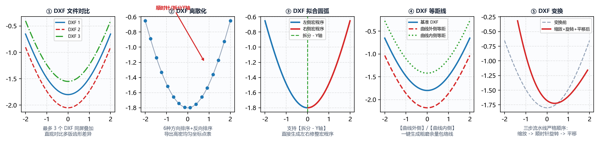

# 7.1 DXF 处理：文件对比、离散化、拟合圆弧、等距线与变换

在导入外部客户提供的非标 DXF 齿形（如包含 `SPLINE` 样条曲线的压缩机转子、从总装图上截取的带偏移坐标的花键齿槽）或对砂轮廓形进行二次偏置加工时，**`工具箱 -> DXF 处理`** 提供了 5 个免 CAD 的专业几何处理子标签页。

---

## 一、子模块 1：`DXF 文件对比`（多图档彩色图层叠加）

将最多 3 个不同阶段的 `.dxf` 文件合并叠加到同一个 DXF 图档的不同颜色图层中，并在右侧画布同屏对比：

* **输入参数**：**`DXF 文件 1`**（必填）、**`DXF 文件 2`**（必填）、**`DXF 文件 3`**（选填，留空则只对比前两个文件）、**`保存文件`**；
* **触发按钮**：点击左下角 **`生成对比 DXF`**；
* **典型应用**：将“理论原始齿形 DXF”、“砂轮干涉修正齿形 DXF”与“滚轮刀心轨迹 DXF”叠加在同一张图上直观审阅。

---

## 二、子模块 2：`DXF 离散化`（图元有序重采样与方向整理）

将包含多段圆弧、直线或样条曲线的 `.dxf` 按指定点密度重采样为有序均匀点集，并导出规范化的多段线 DXF 与点云文本：

* **输入参数**：
  * **`DXF 文件地址`**：选择待离散化的源 `.dxf`；
  * **`最终曲线点密度`**：默认 `500`（指定重采样总点数）；
  * **`曲线方向`**（6 种拓扑排序策略）：
    * **`自动识别`**（推荐默认）：自动追踪相连图元首尾端点；
    * **`顺时针 - X轴+`** / **`逆时针 - X轴+`**：适用于闭合或准闭合环状轮廓；
    * **`升序 - X轴`** / **`降序 - X轴`**：强制按横坐标 $X$ 从左到右或从右到左排序；
    * **`拆分 - Y轴`**：适用于上下对称或左右分侧的特殊廓形。
  * **`反向排序`** 复选框：勾选后将最终点集的起点与终点顺序完全倒置。
* **触发按钮**：点击左下角 **`生成离散化数据`**（结果自动保存在源 DXF 同一文件夹下）。

---

## 三、子模块 3：`DXF 拟合圆弧`（样条/离散线转相切圆弧 DXF）

将高密度点线或 `SPLINE` 样条曲线（许多老式数控系统或线切割机不支持直接读取 `SPLINE`）拟合成由纯 **`ARC`（圆弧）与 `LINE`（直线）** 构成的相切 DXF 图档：

* **输入参数**：
  * **`DXF 文件地址`**：选择源 `.dxf`；
  * **`拟合误差`**：默认 `1`（单位：$\mu\text{m}$，即 $0.001\text{ mm}$）；
  * **`曲线方向`** & **`反向排序`**：同上；
  * **`G3 ⇆ G2`** 复选框：顺逆圆弧方向互换。
* **触发按钮**：点击左下角 **`生成拟合数据`**。右侧画布将同步展示双子图（上方为拟合圆弧切点分布，下方为微米级拟合残差曲线）。

---

## 四、子模块 4：`DXF 等距线`（法向恒定余量偏置）

沿输入 DXF 曲线的法线方向，向内或向外生成指定宽度的等距偏置包络线（Offset Curve），并自动裁剪消除内凹自交环：

* **输入参数**：
  * **`DXF 文件地址`**：选择源 `.dxf`；
  * **`等距宽度`**：输入法向偏置距离（$\text{mm}$，例如粗磨留余量填 `0.15`，或金刚石滚轮半径填 `0.2`）；
  * **`等距方向`**：下拉选择 **`曲线外侧`** 或 **`曲线内侧`**。
* **触发按钮**：点击左下角 **`生成等距线`**。

---

## 五、子模块 5：`DXF 变换`（缩放、旋转与平移基准对齐）

用于将从零件总图上直接拷出的齿槽曲线（例如圆心在 $(0,0)$、齿槽位于顶部的花键 `SPL-60T`）快速平移或旋转到符合 IGD 标准要求（即 **$Y=0$ 位于工件中径、$X=0$ 位于齿槽对称中心**）的位置：

* **输入参数**：
  * **`DXF 文件地址`**：选择源 `.dxf`；
  * **`缩放比例`** + **`缩放基准`** (`X:` / `Y:`)：默认比例 `1.0`、基准 `(0, 0)`；
  * **`旋转角度 (顺时针+)`** + **`旋转基准`** (`X:` / `Y:`)：输入顺时针旋转角度（`$^\circ$`，逆时针旋转填负值）及旋转中心坐标；
  * **`平移距离`** (`X:` / `Y:`)：输入水平平移量 $\Delta X$ 与垂直平移量 $\Delta Y$（例如某花键分度圆半径为 $45\text{ mm}$，原始图以花键中心为 $(0,0)$，则只需在 `平移距离` 的 `Y:` 中填入 **`-45`**，即可将分度圆中径精准移至 $Y=0$！）。
* **触发按钮**：点击左下角 **`生成变换 DXF`**。

