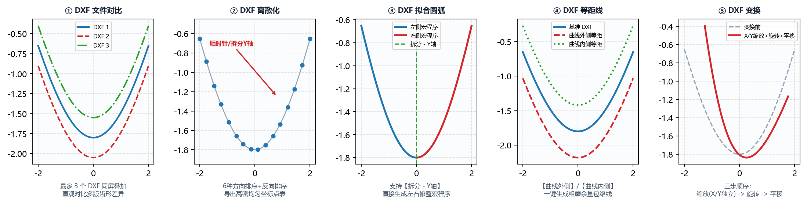

# 7.1 DXF 处理（五大工具）

**`工具箱 -> DXF 处理`** 提供 5 个免 CAD 专业前处理工具，适合将外部样条曲线、非标准坐标图档清洗并转换成符合 IGD 要求（`Y = 0` 对齐中径）的标准轮廓。

---

## 1. `DXF 文件对比`

* **参数**：`DXF 文件 1`（必填）、`DXF 文件 2`（必填）、`DXF 文件 3`（选填）、`保存文件`；
* **功能**：点击 **`生成对比 DXF`** 将多条曲线按独立图层与颜色合并叠加并同屏展示。

---

## 2. `DXF 离散化`

* **参数**：
  * `DXF 文件地址` & `最终曲线点密度`（默认 `500`）；
  * **`曲线方向`**（6 种策略）：`自动识别`、`顺时针 - X轴+`、`逆时针 - X轴+`、`升序 - X轴`、`降序 - X轴`、`拆分 - Y轴`；
  * **`反向排序`**：勾选后首尾反转点列方向；
* **输出**：点击 **`生成离散化数据`**，同目录生成 `*-discretization.dxf` 与均匀有序点云文本。

---

## 3. `DXF 拟合圆弧`

将高密度离散点或线切割不支持的 `SPLINE` 转换为纯相切 **`ARC` + `LINE`** DXF：

* **参数**：
  * `DXF 文件地址`、`曲线方向`、`反向排序`、`G3 ⇆ G2`；
  * **`拟合误差`**：单位为 **`0.1 μm`**（输入 `1` = `0.1 μm`，`10` = `1.0 μm`，默认 `1`）；
* **拟合与输出特点**：
  * 单段圆弧圆心角自动限制在 **≤ 150°** 并输出首尾平滑连续的 `ARC` 实体；
  * 右侧画布以**多色独立分段图例**展示 `*_arcs.dxf` 中各条圆弧与直线实体；
  * 自动去除重复采样点并统计**真实最大误差与平均误差**，同时生成 **`*_arcs.dxf`**、**`*_arcs.html`**、**`*_arcs.txt`** 与 **`*_arcs_program.txt`** 加工程序段。

---

## 4. `DXF 等距线`

* **参数**：`DXF 文件地址`、`等距宽度`（mm，偏置距离或余量）、`等距方向`（`曲线外侧` / `曲线内侧`）；
* **功能**：点击 **`生成等距线`** 自动沿法向生成等距包络线并裁剪内凹自交环，输出 `*_equidistant.dxf`。

---

## 5. `DXF 变换`

将圆心在 `(0, 0)` 的外CAD零件图一键调整到 `Y = 0` 对齐中径：

* **参数**：
  * `DXF 文件地址`；
  * **`缩放比例`** + **`缩放基准`**：支持独立的 **`X:`** 与 **`Y:`** 轴向缩放比例（默认均为 `1.0`）及缩放中心 `(X:, Y:)`；
  * **`旋转角度 (顺时针+)`** + **`旋转基准`** (`X:` / `Y:`)；
  * **`平移距离`** (`X:` / `Y:`)：例如分度圆半径为 `45 mm` 且原点在圆心的齿轮/花键图，在 `Y:` 填 `-45` 即可精准将分度圆移至 `Y = 0`；
* **输出**：点击 **`生成变换 DXF`**，导出 `*_transform.dxf` 与双曲线对照 `*_transform.html`。

