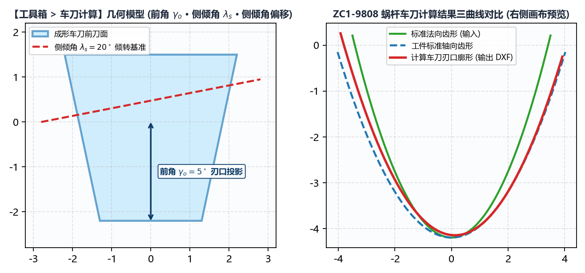

# 7.2 成形车刀计算

当硬质合金或高速钢成形粗车刀带有非零 **`前角`** 或按螺纹升角垫斜 **`侧倾角`** 时，前刀面与螺旋槽交线会产生明显畸变。**`工具箱 -> 车刀计算`** 专用于求解真实车刀前刀面成形刃口廓形（如用于 `ZC1-9808` 等大模数蜗杆粗车开槽）。

---

## 参数配置表

| 参数名称 | 默认值 / 单位 | 工程说明 |
| :--- | :--- | :--- |
| **`工件类型`** / **`螺纹旋向`** | `内/外螺纹`、`右/左旋` | 确定车刀内外空间与螺旋展开极性 |
| **`工件中径`** / **`导程`** | mm | 对应 `Y = 0` 中径与导程（输入后自动解算 `螺旋升角`） |
| **`前角`** | `0`（`°`） | 前刀面相对径向基准平面的纵向前角 |
| **`侧倾角`** | `0`（`°`） | 刀杆侧倾装夹角（平装填 `0`；法向装刀接近或等于 `螺旋升角`） |
| **`侧倾角偏移`** | `0`（mm） | 刀杆侧倾回转中心相对齿槽中心横向偏置（常规 `0`） |
| **`标准法向齿形文件`** | `.dxf` 路径 | **必须为 `法向` DXF**（若源图为 `端面(左)` 蜗杆，须先经 `曲线转换` 转为 `法向`） |
| **`车刀齿形保存路径`** | `.dxf` 路径 | 指定计算输出的车刀刃口保存路径 |

---

## 视图验证与输出文件

1. 填入参数与文件路径后，点击左下角 **`生成车刀数据`**；
2. 右侧画布同屏绘制：**`原始法向齿形曲线`**、**`标准轴向齿形曲线`** 与 **`计算车刀齿形曲线`** 三线对比；
3. **输出文件集**：
   * **`<文件名>.dxf`**：可直接发往慢走丝线切割（WEDM）或光学曲线磨床加工车刀刃口；
   * **`<文件名>-std.dxf`** 与 **`<文件名>.html`**：标准对照截面及 2D 交互比对图；
   * **`<文件名>-3D.html`**：浏览器打开可 360° 检视三维螺旋槽与前刀面空间交线，排查后角干涉。

