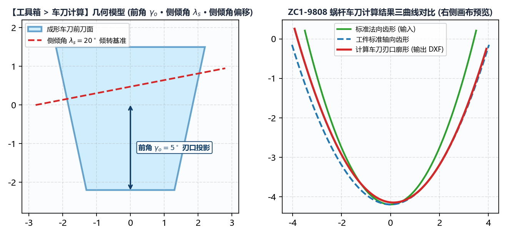

# 7.2 车刀计算：大导程螺纹/蜗杆粗加工成形车刀刃口设计

在大导程螺母、滚珠丝杠及中大模数精密蜗杆（如 `ZC1-9808`）的制造工艺路线中，热处理前或硬态开粗阶段通常采用**数控车床成形车刀（Form Turning Tool）**先行车削出螺旋槽，再留 $0.15\text{ mm} \sim 0.30\text{ mm}$ 磨削余量上磨床精磨。

当车刀具有非零的**`前角`**（Rake Angle）或为了避让大螺旋角而垫斜了一个**`侧倾角`**（Side Tilt Angle）时，车刀前刀面与工件三维螺旋面的空间交线将发生显著非线性畸变——若直接按工件法向或轴向齿形去线切割车刀片，车出的螺旋槽必然产生严重的齿形半角失真。**`工具箱 -> 车刀计算`** 模块专用于精确解算车刀前刀面上的真实成形刃口曲线。

---

## 一、车刀空间前刀面截交模型与参数说明

切换至 **`工具箱 -> 车刀计算`**，面板包含以下 10 项参数：

| 参数名称 | 默认值 / 单位 | 工程定义与输入要求 |
| :--- | :--- | :--- |
| **`工件类型`** | `内螺纹` / `外螺纹` | 选择内孔车刀或外圆车刀空间啮合构型。 |
| **`螺纹旋向`** | `右旋` / `左旋` | 工件螺旋槽旋向。 |
| **`工件中径`** ($d_2$) | $\text{mm}$ | 工件中径基准（对应输入齿形 $Y=0$ 所在直径）。 |
| **`导程`** ($P_h$) | $\text{mm}$ | 工件导程。填入 `工件中径` 与 `导程` 后，下方 **`螺旋升角`** 自动实时算出。 |
| **`螺旋升角`** ($\lambda$) | `$^\circ$`（自动计算） | 实时显示中径处的理论螺旋升角。 |
| **`前角`** ($\gamma_o$) | `0`（单位：`$^\circ$`） | 车刀前刀面相对于径向基准面的纵向前角（平前刀面成形车刀填 `0`，带正前角槽型填具体度数如 `5` ~ `8`）。 |
| **`侧倾角`** ($\lambda_s$) | `0`（单位：`$^\circ$`） | 车刀刀杆（或刀垫）绕径向轴线倾斜安装的侧倾角度。 • 若刀杆水平正装（前刀面包含工件轴线），填 **`0`**； • 若刀杆按中径螺旋升角倾斜装夹（法向装刀），填入实际倾斜角度（通常等于或接近 `螺旋升角`）。 |
| **`侧倾角偏移`** | `0`（单位：$\text{mm}$） | 车刀旋转侧倾中心相对于齿槽对称中心的偏置距离（常规对中安装保持 `0`）。 |
| **`标准法向齿形文件`** | 选择 `.dxf` 文件 | **注意**：此处导入的基准齿形必须为工件的 **`法向`** 齿形 DXF！（若您手头是由 `绘图工具 -> 蜗杆` 生成的 `端面(左)` 齿形，请先用 `工具箱 -> 曲线转换` 将其转换为 `法向` 齿形后再导入此处）。 |
| **`车刀齿形保存路径`** | 选择输出 `.dxf` 路径 | 指定计算出的车刀前刀面刃口 `.dxf` 保存路径。 |

---

## 二、执行计算、导出线切割 DXF 与审阅 `_3D.html` 交互报告

1. 填妥参数并选择 **`标准法向齿形文件`** 与 **`车刀齿形保存路径`** 后，点击左下角主按钮 **`生成车刀数据`**；
2. **右侧画布对比审阅**：
   右侧画布立即绘出对比图：蓝色曲线为输入的标准法向齿形，红色曲线为求解出的**车刀前刀面真实刃口齿形**；
3. **双文件输出**：
   * **`<文件名>.dxf`（车刀刃口加工图）**：可直接发送给慢走丝线切割机床（WEDM）或光学曲线磨床（PG），在硬质合金/CBN刀坯前刀面上直接切割出成形刀刃；
   * **`<文件名>_3D.html`（三维空间啮合交互式报告）**：在同目录下自动生成独立网页文件。双击用 Chrome / Edge 浏览器打开，即可 360° 旋转、放大检视**三维工件螺旋槽曲面**与**倾斜车刀前刀面平面**在空间中的真实截交线，直观验证刀刃各点是否存在后角干涉。

