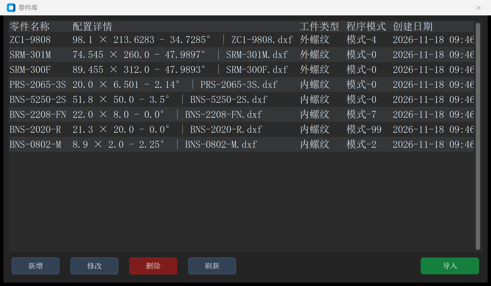

# 8.1 零件库管理

点击顶部 **`工具 -> 零件库`** 打开独立窗口，用于统一归档、检索并一键回填不同型号工件的全界面参数。

---

## 五列表格与排序

点击任意列标题均可按升序/降序双向排序：

* **`零件名称`**：产品代号或图号（如 `BNS-5250-2S`、`ZC1-9808`）；
* **`配置详情`**：自动汇总核心螺旋参数与源 DXF，格式为 **`<工件中径> × <导程> - <砂轮安装角>° | <DXF文件名>`**（如 `51.8 × 50.0 - 3.5° | BNS-5250-2S.dxf`）；
* **`工件类型`**：`内螺纹` 或 `外螺纹`；
* **`程序模式`**：对应机床代码模板（如 `模式-0`、`模式-4`、`模式-99`）；
* **`创建日期`**：档案建立或更新时间戳（`YYYY-MM-DD HH:MM`）。

---

## 三文件自包含档案

点击 **`新增`** 后，在 `~/.igd/PartsLibrary/<零件名>/` 下保存全套三文件配置包：

* **`igd_config_main.json`**：`基本参数` 与 `高级参数` 全部设置；
* **`igd_config_draw.json`**：`绘图工具` 全子模块参数快照；
* **`igd_config_tool.json`**：`工具箱` 全子模块参数快照。

* 升级或迁移电脑时，将 `~/.igd/PartsLibrary/` 目录整体拷贝至新机对应路径并点击 **`刷新`** 即可恢复全部档案。

---

## 五大操作按钮

* **`新增`**：以当前主界面已调好参数创建新零件档案；
* **`导入`**：选中表格行后一键回填至主界面各选项卡，立即可运行 **`生成代码`**；
* **`修改`**：重命名零件档案或覆写最新参数；
* **`刷新`**：重新扫描目录加载外部拷贝的档案；
* **`删除`**：移除选中的历史档案。
