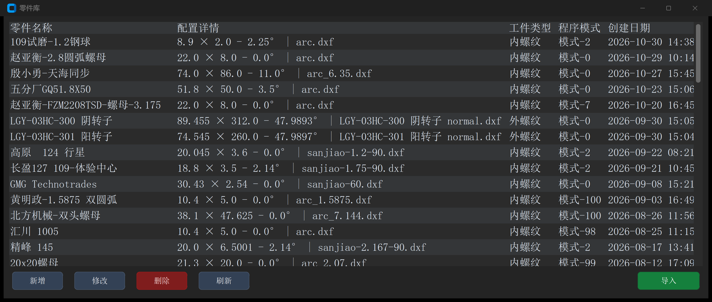

# 8.1 零件库：参数归档、排序检索与一键导入

点击主窗口顶部菜单栏 **`工具`** ➔ **`零件库`**，即可打开独立的 **零件库（Parts Library）** 窗口。

---

## 一、零件库五列表格与双向排序

零件库支持对全部归档零件按以下 5 列进行信息展示与升降序点击排序：

- **`零件名称`**：产品代号或工件图号，支持按字母/数字字典序双向排序。
- **`配置详情`**：自动提炼的核心螺旋参数标签（格式：`<齿形类型>-中径<d2>-导程<Ph>-<旋向>`）。
- **`工件类型`**：标示 `内螺纹` 或 `外螺纹`，方便按磨削类型集中归类。
- **`程序模式`**：标示所使用的数控系统宏程序模板代号（如 `模式-0`、`模式-2`、`模式-5`）。
- **`创建日期`**：参数建档或最后修改时间戳（`YYYY-MM-DD HH:MM`）。

---

## 二、三文件自包含归档机制

当在零件库中点击 **`新增`** 保存一个零件档案时，系统会在本地持久化目录 `~/.igd/PartsLibrary/<零件名>/` 下自动生成自包含三文件：

- **`igd_config_main.json`**：完整记录当前主界面 `基本参数` 与 `高级参数` 的全部数值及状态。
- **`igd_config_draw.json`**：完整快照记录 `绘图工具` 各子模块的参数。
- **`igd_config_tool.json`**：完整快照记录 `工具箱` 各子模块的参数。

> **数据安全保证**：换用电脑或升级软件时，只需将整个 `~/.igd/PartsLibrary/` 文件夹打包复制到新工控机对应目录下，点击零件库中的 **`刷新`** 即可完整恢复，绝对不会丢失任何历史工艺参数！

---

## 三、五大操作按钮速查

- **`新增`**：以当前主界面调试好的全部参数创建一个新的零件档案。
- **`导入`**：选中表格行后点击，一键将该零件的所有参数自动回填至主界面，可直接点击 `生成代码`。
- **`修改`**：重命名零件或以主界面当前最新数据覆盖保存。
- **`刷新`**：重新扫描本地零件库目录（用于加载外部手动拷贝进来的档案）。
- **`删除`**：安全移除选中的历史零件档案。
